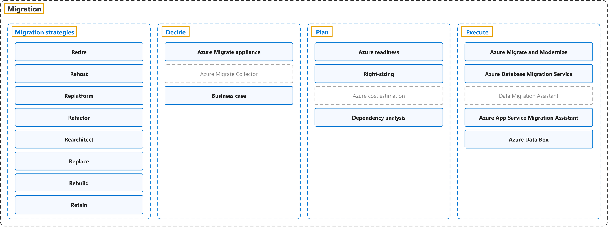

# 16. Migration

## Classification

## Glossary

| Term | Definition | 中文翻译 | Source |
|---|---|---|---|
| **Migration** 迁移 | "**Cloud migration** is the process of **moving applications and data** from one location, often a company's private, **on-premises servers**, to a **public cloud provider's servers**, but it can also entail moving resources between different clouds." | **云迁移**是把**应用程序和数据**从一个位置（通常是公司自己的**本地服务器**）**迁到公有云提供商的服务器**上的过程，也可以是在不同的云之间迁移资源。 | [Microsoft, n.d., "Cloud migration definition" section, para. 1](https://azure.microsoft.com/en-us/resources/cloud-computing-dictionary/what-is-cloud-migration#:~:text=Cloud%20migration%20is%20the%20process%20of%20moving) |
| **[Migration strategies](migration-strategies.md)** 迁移策略 | "There are **multiple migration strategies**, sometimes known as the **"Rs" of cloud migration**." | 迁移有**多种策略**，有时被称为**云迁移的"R"**。 | [Microsoft, 2025, para. 1](https://learn.microsoft.com/en-us/azure/cloud-adoption-framework/plan/select-cloud-migration-strategy#:~:text=There%20are%20multiple%20migration%20strategies) |
| **[Decide](decide.md)** 决策 | "The first step in a migration journey is to **identify your workloads**." | 迁移之旅的第一步是**识别你的工作负载**。 | [Microsoft, 2026b, "Decide" section, para. 1](https://learn.microsoft.com/en-us/azure/migrate/migrate-services-overview#:~:text=The%20first%20step%20in%20a%20migration%20journey) |
| **[Plan](plan.md)** 规划 | "After you make the **decision to migrate** to Azure, the next important phase of migration is **planning**." | 在你**决定迁移**到 Azure 之后，迁移的下一个重要阶段是**规划**。 | [Microsoft, 2026b, "Plan" section, para. 1](https://learn.microsoft.com/en-us/azure/migrate/migrate-services-overview#:~:text=After%20you%20make%20the%20decision%20to%20migrate) |
| **[Execute](execute.md)** 执行 | "In the **execution phase**, you **perform the migration or modernization** of your workloads to move to Azure." | 在**执行阶段**，你对工作负载**进行迁移或现代化**，把它们迁到 Azure。 | [Microsoft, 2026b, "Execute" section, para. 1](https://learn.microsoft.com/en-us/azure/migrate/migrate-services-overview#:~:text=In%20the%20execution%20phase%2C%20you%20perform) |

## Coverage

| Certification | Skill area |
|---|---|
| AZ-900 Microsoft Azure Fundamentals | [Describe Azure architecture and services (35–40%)](https://learn.microsoft.com/en-us/credentials/certifications/resources/study-guides/az-900#describe-azure-architecture-and-services-3540) |
| AZ-305 Designing Microsoft Azure Infrastructure Solutions | [Design infrastructure solutions (30–35%)](https://learn.microsoft.com/en-us/credentials/certifications/resources/study-guides/az-305#design-infrastructure-solutions-3035) |

**CST8912 Cloud Solution Architecture**

| Week | Group | Terms in the course | Source |
|---|---|---|---|
| 1 | Migration | cloud migration | Introduction to Cloud Solution Architecture: slide 17 |
|  | Migration strategies | lift and shift refactor | Introduction to Cloud Solution Architecture: slides 9, 10 |
| 5 | Execute | Azure Database Migration Service (DMS) | Design Cloud Database Solution: slide 11 |
| 6 | Migration strategies | rehost rearchitect rebuild replace | Week 6 – Cloud Architecture best practices: slide 18 |

**CST8913 Cloud Migration**

| Week | Group | Terms in the course | Source |
|---|---|---|---|
| 2 | Migration | cloud migration | Cloud Migration: slide 18 |
|  | Migration strategies | Rehost lift and shift Replatform (Re-platform) Refactor Rearchitect Rebuild Replace Retire Retain | Cloud Migration: slides 4, 19, 20 Reading: Cloud Adoption Framework (Unit 3) |
|  | Decide | business case | Lab 2: Planning and stakeholders |
|  | Plan | right-sizing | Lab 2: Migration execution and operations |
|  | Execute | Azure Migrate Azure Data Box | Lab 2: Azure services (Lab 2 case study) Reading: Cloud Adoption Framework (Units 5–7) |
| 4 | Decide | discovery and assessment (D&A) Azure Migrate appliance | Migration Assessment Process: slides 4, 7 |
|  | Plan | migration assessment Azure readiness dependency analysis | Migration Assessment Process: slides 4, 7 |
| 5 | Migration strategies | Rehosting (lift-and-shift migration) | Rehosting Migration: slide 5 |
|  | Execute | Azure Migrate: Server Migration tool | Rehosting Migration: slide 7 |
| 6 | Migration strategies | refactoring (repackaging) | Refactoring Migration: slide 5 |
|  | Execute | Azure App Service Migration Assistant | Refactoring Migration: slide 8 |

## References

- Microsoft. (n.d.). *What is cloud migration?* Microsoft Azure. Retrieved October 24, 2026, from https://azure.microsoft.com/en-us/resources/cloud-computing-dictionary/what-is-cloud-migration
- Microsoft. (2025). *Select your cloud migration strategies*. Cloud Adoption Framework. https://learn.microsoft.com/en-us/azure/cloud-adoption-framework/plan/select-cloud-migration-strategy
- Microsoft. (2026a). *Study guide for Exam AZ-305: Designing Microsoft Azure infrastructure solutions*. Microsoft Learn. https://learn.microsoft.com/en-us/credentials/certifications/resources/study-guides/az-305
- Microsoft. (2026b). *About Azure Migrate*. Microsoft Learn. https://learn.microsoft.com/en-us/azure/migrate/migrate-services-overview
