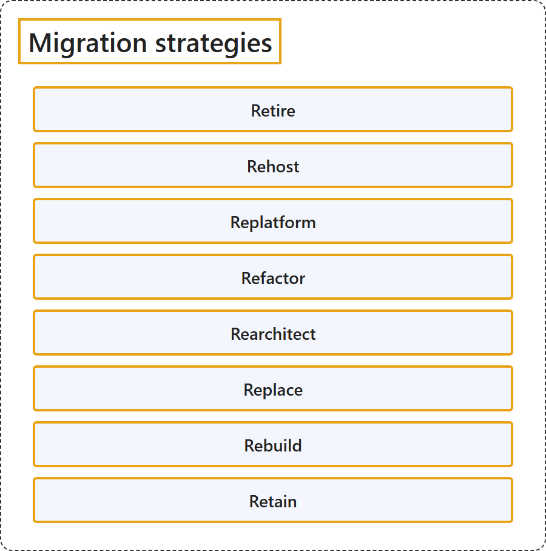

# 16.1 Migration strategies

Sources: [Select your cloud migration strategies](https://learn.microsoft.com/en-us/azure/cloud-adoption-framework/plan/select-cloud-migration-strategy).

## Classification

## Glossary

| Term | Definition | 中文解释 | Source |
|---|---|---|---|
| **Migration strategies** 迁移策略 | "There are **multiple migration strategies**, sometimes known as **the 'Rs' of cloud migration**. Each workload can be Retired, Retained, Rehosted, Replatformed, Refactored, Rearchitected, Rebuilt, or Replaced." | 有**多种迁移策略**，有时称为**云迁移的 R 策略**。每个工作负载都可以被停用、保留、重新托管、更换平台、重构、重新架构、重建或替换。 | [Microsoft, n.d., "Select your cloud migration strategies" introduction, para. 1](https://learn.microsoft.com/en-us/azure/cloud-adoption-framework/plan/select-cloud-migration-strategy#:~:text=There%20are%20multiple%20migration%20strategies) |
| **Retire** 停用 | "Retire **decommissions workloads** that **no longer provide business value**." | Retire 会**停用工作负载**，这些工作负载**不再提供业务价值**。 | [Microsoft, n.d., "1. Retire (decommission)" section, para. 1](https://learn.microsoft.com/en-us/azure/cloud-adoption-framework/plan/select-cloud-migration-strategy#:~:text=Retire%20decommissions%20workloads%20that%20no%20longer%20provide%20business%20value) |
| **Rehost** 重新托管 | "A rehost strategy enables **fast and low-risk migration** by moving workloads to Azure with **minimal changes**." | 重新托管策略实现**快速、低风险的迁移**，方法是以**最少的更改**把工作负载移到 Azure。 | [Microsoft, n.d., "2. Rehost (like-for-like migration)" section, para. 1](https://learn.microsoft.com/en-us/azure/cloud-adoption-framework/plan/select-cloud-migration-strategy#:~:text=A%20rehost%20strategy%20enables%20fast%20and%20low%2Drisk%20migration) |
| **Replatform** 更换平台 | "Replatforming moves workloads to a **modern hosting environment** with **minimal code changes**." | 更换平台把工作负载移到**现代托管环境**，只需**极少的代码更改**。 | [Microsoft, n.d., "3. Replatform (modernize hosting environment)" section, para. 1](https://learn.microsoft.com/en-us/azure/cloud-adoption-framework/plan/select-cloud-migration-strategy#:~:text=Replatforming%20moves%20workloads%20to%20a%20modern%20hosting%20environment) |
| **Refactor** 重构 | "Refactoring **improves the internal structure of code** without **adding new features**." | 重构**改进代码的内部结构**，但不**添加新功能**。 | [Microsoft, n.d., "4. Refactor (modernize code)" section, para. 1](https://learn.microsoft.com/en-us/azure/cloud-adoption-framework/plan/select-cloud-migration-strategy#:~:text=Refactoring%20improves%20the%20internal%20structure%20of%20code) |
| **Rearchitect** 重新架构 | "A rearchitect strategy **redesigns the workload's architecture** to improve **scalability, agility, and service orientation**." | 重新架构策略**重新设计工作负载的架构**，以提升**可伸缩性、敏捷性和面向服务的程度**。 | [Microsoft, n.d., "5. Rearchitect (modernize architecture and code)" section, para. 1](https://learn.microsoft.com/en-us/azure/cloud-adoption-framework/plan/select-cloud-migration-strategy#:~:text=A%20rearchitect%20strategy%20redesigns%20the%20workload) |
| **Replace** 替换 | "A replace strategy uses **commercial SaaS solutions** to eliminate the need for **custom development and ongoing maintenance**." | 替换策略使用**商业 SaaS 解决方案**，从而无需**自定义开发和持续维护**。 | [Microsoft, n.d., "6. Replace (use SaaS alternative)" section, para. 1](https://learn.microsoft.com/en-us/azure/cloud-adoption-framework/plan/select-cloud-migration-strategy#:~:text=A%20replace%20strategy%20uses%20commercial%20SaaS%20solutions) |
| **Rebuild** 重建 | "A rebuild strategy is a **full redevelopment of a workload** using **cloud-native solutions**." | 重建策略是**对工作负载的完全重新开发**，使用**云原生解决方案**。 | [Microsoft, n.d., "7. Rebuild (build cloud-native)" section, para. 1](https://learn.microsoft.com/en-us/azure/cloud-adoption-framework/plan/select-cloud-migration-strategy#:~:text=A%20rebuild%20strategy%20is%20a%20full%20redevelopment%20of%20a%20workload) |
| **Retain** 保留 | "A retain strategy **keeps workloads in their current environment** when they're **stable, compliant, and meet all current and future business needs** with **no near-term driver to move**." | 保留策略**让工作负载留在当前环境中**，前提是它们**稳定、合规，并满足当前和未来的所有业务需求**，且**近期没有迁移的驱动因素**。 | [Microsoft, n.d., "8. Retain (keep as is)" section, para. 1](https://learn.microsoft.com/en-us/azure/cloud-adoption-framework/plan/select-cloud-migration-strategy#:~:text=A%20retain%20strategy%20keeps%20workloads%20in%20their%20current%20environment) |

## References

Microsoft. (n.d.). *Select your cloud migration strategies*. Cloud Adoption Framework. Microsoft Learn. Retrieved October 18, 2026, from <https://learn.microsoft.com/en-us/azure/cloud-adoption-framework/plan/select-cloud-migration-strategy>
