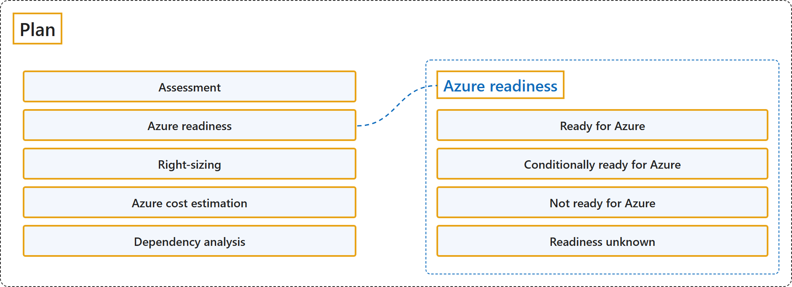

# 24.3 Plan

Sources: [About Azure Migrate: Plan](https://learn.microsoft.com/en-us/azure/migrate/migrate-services-overview#plan); [Assessment overview (migrate to Azure VMs)](https://learn.microsoft.com/en-us/azure/migrate/concepts-assessment-calculation?view=migrate-classic).

## Classification

## Glossary

| Term | Definition | 中文解释 | Source |
|---|---|---|---|
| **Plan** 计划 | "After you make the decision to migrate to Azure, the next important phase of migration is **planning**. To plan migration in detail, use **Azure Migrate assessments** to find:" | 决定迁移到 Azure 之后，迁移的下一个重要阶段是**规划**。要详细规划迁移，请使用 **Azure Migrate 评估**来确定： | [Microsoft, n.d., "Plan" section, para. 1](https://learn.microsoft.com/en-us/azure/migrate/migrate-services-overview#:~:text=the%20next%20important%20phase%20of%20migration%20is%20planning) |
| **Assessment** 评估 | "An assessment with the Discovery and assessment tool **measures the readiness** and **estimates the effect of migrating on-premises servers to Azure**." | 使用发现和评估工具进行的评估会**衡量就绪性**，并**估算把本地服务器迁移到 Azure 的影响**。 | [Microsoft, 2026, "What's an assessment?" section, para. 1](https://learn.microsoft.com/en-us/azure/migrate/concepts-assessment-calculation?view=migrate-classic#:~:text=measures%20the%20readiness%20and%20estimates) |
| **Azure readiness** Azure 就绪性 | "**Azure readiness**: Assess whether **on-premises servers, SQL servers, and web apps** are **ready for migration to Azure**." | **Azure 就绪性**：评估**本地服务器、SQL 服务器和 Web 应用**是否**已准备好迁移到 Azure**。 | [Microsoft, n.d., "Plan" section, list item 1](https://learn.microsoft.com/en-us/azure/migrate/migrate-services-overview#:~:text=Assess%20whether%20on%2Dpremises%20servers) |
| **Ready for Azure** Azure 就绪 | "**Ready for Azure**: The server can be **migrated as-is to Azure without any changes**. It will start in Azure with **full Azure support**." | **Azure 就绪**：服务器可以**不做任何更改、按原样迁移到 Azure**。它会在 Azure 中启动，并获得**完整的 Azure 支持**。 | [Microsoft, 2026, "Calculate readiness" section, list item 1](https://learn.microsoft.com/en-us/azure/migrate/concepts-assessment-calculation?view=migrate-classic#:~:text=migrated%20as%2Dis%20to%20Azure%20without%20any%20changes) |
| **Conditionally ready for Azure** 有条件就绪 | "**Conditionally ready for Azure**: The server **might start in Azure** but **might not have full Azure support**. For example, Azure doesn't support a server that's running an old version of Windows Server." | **有条件就绪**：服务器**可能可以在 Azure 中启动**，但**可能没有完整的 Azure 支持**。例如，Azure 不支持运行旧版 Windows Server 的服务器。 | [Microsoft, 2026, "Calculate readiness" section, list item 2](https://learn.microsoft.com/en-us/azure/migrate/concepts-assessment-calculation?view=migrate-classic#:~:text=might%20start%20in%20Azure%20but%20might%20not%20have%20full%20Azure%20support) |
| **Not ready for Azure** 未就绪 | "**Not ready for Azure**: The server **won't start in Azure**. For example, if an on-premises server's disk stores **more than 64 TB**, Azure can't host the server." | **未就绪**：服务器**无法在 Azure 中启动**。例如，如果本地服务器的磁盘存储了**超过 64 TB** 的数据，Azure 就无法托管该服务器。 | [Microsoft, 2026, "Calculate readiness" section, list item 3](https://learn.microsoft.com/en-us/azure/migrate/concepts-assessment-calculation?view=migrate-classic#:~:text=disk%20stores%20more%20than%2064%20TB) |
| **Readiness unknown** 就绪性未知 | "**Readiness unknown**: Azure Migrate **can't determine the readiness** of the server because of **insufficient metadata**." | **就绪性未知**：Azure Migrate **无法确定服务器的就绪性**，原因是**元数据不足**。 | [Microsoft, 2026, "Calculate readiness" section, list item 4](https://learn.microsoft.com/en-us/azure/migrate/concepts-assessment-calculation?view=migrate-classic#:~:text=because%20of%20insufficient%20metadata) |
| **Right-sizing** 规模调整 | "**Right-sizing**: Estimate the **size of Azure virtual machines (VMs)**, the **Azure SQL configuration**, and the **number of Azure VMware Solution nodes** after migration." | **规模调整**：估算迁移后 **Azure 虚拟机（VM）的大小**、**Azure SQL 配置**以及 **Azure VMware 解决方案节点的数量**。 | [Microsoft, n.d., "Plan" section, list item 2](https://learn.microsoft.com/en-us/azure/migrate/migrate-services-overview#:~:text=Estimate%20the%20size%20of%20Azure%20virtual%20machines) |
| **Azure cost estimation** Azure 成本估算 | "**Azure cost estimation**: Estimate costs for **running on-premises servers in Azure**." | **Azure 成本估算**：估算**在 Azure 中运行本地服务器**的成本。 | [Microsoft, n.d., "Plan" section, list item 3](https://learn.microsoft.com/en-us/azure/migrate/migrate-services-overview#:~:text=Estimate%20costs%20for%20running%20on%2Dpremises%20servers%20in%20Azure) |
| **Dependency analysis** 依赖关系分析 | "**Dependency analysis**: Understand the **network dependencies between servers** in your datacenter so that you can make **high-confidence migration plans** without missing any critical dependency." | **依赖关系分析**：了解数据中心内**服务器之间的网络依赖关系**，以便制定**高可信度的迁移计划**，不遗漏任何关键依赖。 | [Microsoft, n.d., "Plan" section, list item 4](https://learn.microsoft.com/en-us/azure/migrate/migrate-services-overview#:~:text=Understand%20the%20network%20dependencies%20between%20servers) |

## References

- Microsoft. (n.d.). *About Azure Migrate*. Microsoft Learn. Retrieved October 18, 2026, from <https://learn.microsoft.com/en-us/azure/migrate/migrate-services-overview>
- Microsoft. (2026, February 26). *Assessment overview (migrate to Azure VMs)*. Microsoft Learn. <https://learn.microsoft.com/en-us/azure/migrate/concepts-assessment-calculation?view=migrate-classic>
