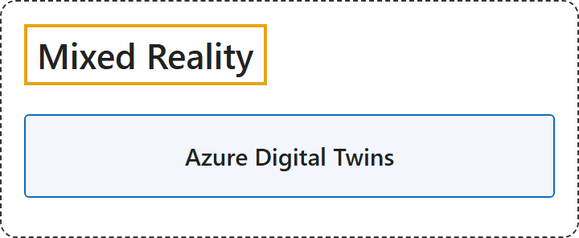

# 15. Mixed Reality

## Classification

## Glossary

| Term | Definition | 中文翻译 | Source |
|---|---|---|---|
| **Mixed Reality** 混合现实 | — | — | [Microsoft, n.d., "Browse Azure products" section, Mixed Reality](https://learn.microsoft.com/en-us/azure/?product=mixed-reality) |
| **Azure Digital Twins** Azure Digital Twins | Defined in [12.2.4 Azure Digital Twins](../internet-of-things/iot-cloud-services.md). | 定义见 12.2.4 Azure Digital Twins。 | — |

## Coverage

None of the certifications listed in the folder README names this topic's own products in its skills measured.

## References

- Microsoft. (n.d.). *Azure documentation*. Microsoft Learn. Retrieved October 25, 2026, from https://learn.microsoft.com/en-us/azure/
