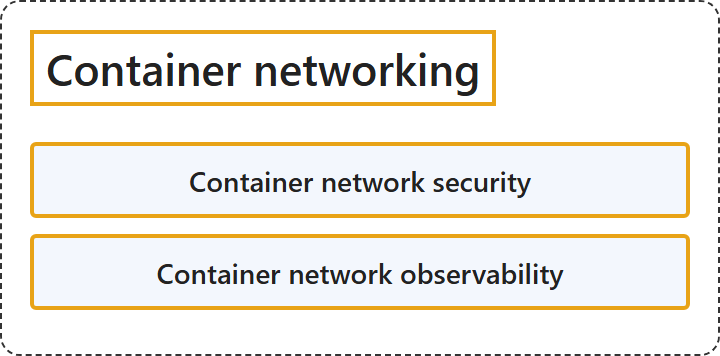

# 7.6 Container Networking

## Classification

## Glossary

| Term | Definition | 中文翻译 | Source |
|---|---|---|---|
| **Container network security** 容器网络安全 | "Container network security provides **enhanced control over AKS network security**." | 容器网络安全提供**对 AKS 网络安全的增强控制**。 | [Microsoft, 2026, "Container network security" section, para. 1](https://learn.microsoft.com/en-us/azure/networking/fundamentals/networking-overview#:~:text=Container%20network%20security%20provides%20enhanced%20control) |
| **Container network observability** 容器网络可观测性 | "Container network observability uses **Hubble's control plane** to provide **comprehensive visibility into AKS networking and performance**." | 容器网络可观测性使用 **Hubble 的控制平面**，提供**对 AKS 网络和性能的全面可见性**。 | [Microsoft, 2026, "Container network observability" section, para. 1](https://learn.microsoft.com/en-us/azure/networking/fundamentals/networking-overview#:~:text=uses%20Hubble) |

## References

- Microsoft. (2026, August 19). *Azure networking services overview*. Microsoft Learn. https://learn.microsoft.com/en-us/azure/networking/fundamentals/networking-overview
