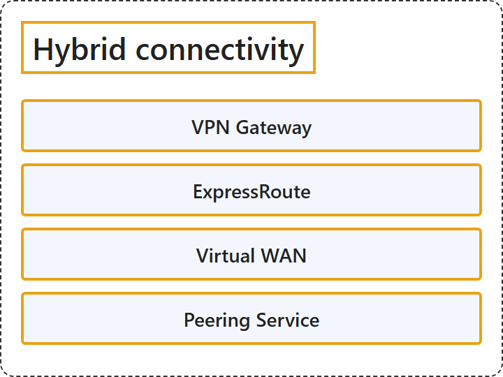

# 7.3 Hybrid connectivity

## Classification

## Glossary

| Term | Definition | 中文翻译 | Source |
|---|---|---|---|
| **VPN Gateway** VPN 网关 | "VPN Gateway helps you **create encrypted cross-premises connections** to your virtual network **from on-premises locations**, or create **encrypted connections between VNets**." | VPN 网关帮助你**创建加密的跨界连接**，**从本地位置**连接到你的虚拟网络，或者**在 VNet 之间创建加密连接**。 | [Microsoft, 2026, "VPN Gateway" section, para. 1](https://learn.microsoft.com/en-us/azure/networking/fundamentals/networking-overview#:~:text=helps%20you%20create%20encrypted%20cross-premises%20connections) |
| **ExpressRoute** ExpressRoute | "ExpressRoute **extends your on-premises networks into the Microsoft cloud** over a **private connection** that a connectivity provider facilitates." | ExpressRoute **把你的本地网络扩展到 Microsoft 云中**，通过的是由连接服务提供商协助建立的**专用连接**。 | [Microsoft, 2026, "ExpressRoute" section, para. 1](https://learn.microsoft.com/en-us/azure/networking/fundamentals/networking-overview#:~:text=extends%20your%20on-premises%20networks%20into%20the%20Microsoft%20cloud%20over%20a%20private%20connection) |
| **Virtual WAN** 虚拟 WAN | "Azure Virtual WAN is a networking service that **brings many networking, security, and routing functionalities together** to provide a **single operational interface**." | Azure 虚拟 WAN 是一种网络服务，它**把许多网络、安全和路由功能整合在一起**，提供**单一的操作界面**。 | [Microsoft, 2026, "Virtual WAN" section, para. 1](https://learn.microsoft.com/en-us/azure/networking/fundamentals/networking-overview#:~:text=brings%20many%20networking%2C%20security%2C%20and%20routing%20functionalities%20together) |
| **Peering Service** 对等互连服务 | "Azure Peering Service **enhances customer connectivity** to **Microsoft cloud services** such as Microsoft 365, Dynamics 365, software as a service (SaaS), Azure, or any Microsoft services accessible over the public internet." | Azure 对等互连服务**增强客户的连接**，连接到 **Microsoft 云服务**，这些服务例如 Microsoft 365、Dynamics 365、软件即服务（SaaS）、Azure，或任何可通过公共 Internet 访问的 Microsoft 服务。 | [Microsoft, 2026, "Peering Service" section, para. 1](https://learn.microsoft.com/en-us/azure/networking/fundamentals/networking-overview#:~:text=enhances%20customer%20connectivity%20to%20Microsoft%20cloud%20services) |

## References

- Microsoft. (2026, August 19). *Azure networking services overview*. Microsoft Learn. https://learn.microsoft.com/en-us/azure/networking/fundamentals/networking-overview
