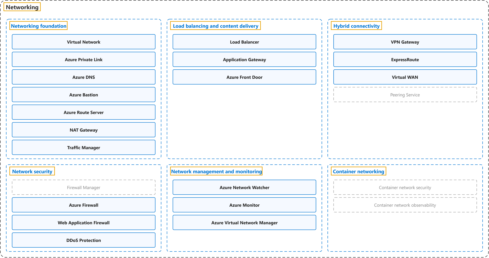

# 5. Networking

## Classification

## Glossary

| Term | Definition | 中文翻译 | Source |
|---|---|---|---|
| **Networking** 网络 | "You can think of an **Azure network** as an **extension of your on-premises network** with **resources that link other Azure resources**." | 你可以把 **Azure 网络**看作**本地网络的延伸**，其中包含**链接其他 Azure 资源的资源**。 | [Microsoft, n.d., "Describe Azure virtual networking" unit, para. 1](https://learn.microsoft.com/en-us/training/modules/describe-azure-networking-services/2-virtual-network#:~:text=You%20can%20think%20of%20an%20Azure%20network) |
| **[Networking foundation](networking-foundation.md)** 网络基础 | "**Networking foundation**: **Core connectivity** for your **resources in Azure**." | **网络基础**：提供**核心连接**，供你在 **Azure 中的资源**使用。 | [Microsoft, 2026a, para. 2, list item 1](https://learn.microsoft.com/en-us/azure/networking/fundamentals/networking-overview#:~:text=Core%20connectivity%20for%20your%20resources%20in%20Azure) |
| **[Load balancing and content delivery](load-balancing-and-content-delivery.md)** 负载均衡和内容分发 | "**Load balancing and content delivery**: **Manage, distribute, and optimize** your **applications and workloads**." | **负载均衡和内容分发**：**管理、分发和优化**你的**应用程序和工作负载**。 | [Microsoft, 2026a, para. 2, list item 2](https://learn.microsoft.com/en-us/azure/networking/fundamentals/networking-overview#:~:text=Manage%2C%20distribute%2C%20and%20optimize%20your%20applications) |
| **[Hybrid connectivity](hybrid-connectivity.md)** 混合连接 | "**Hybrid connectivity**: **Secure communication** to and from your **resources in Azure**." | **混合连接**：实现**安全通信**，连接进出你在 **Azure 中的资源**的流量。 | [Microsoft, 2026a, para. 2, list item 3](https://learn.microsoft.com/en-us/azure/networking/fundamentals/networking-overview#:~:text=Secure%20communication%20to%20and%20from%20your%20resources) |
| **[Network security](network-security.md)** 网络安全 | "**Network security**: **Protect** your **web applications and IaaS services** from **DDoS attacks** and malicious actors." | **网络安全**：**保护**你的 **Web 应用程序和 IaaS 服务**，使其免受 **DDoS 攻击**和恶意行为者的侵害。 | [Microsoft, 2026a, para. 2, list item 4](https://learn.microsoft.com/en-us/azure/networking/fundamentals/networking-overview#:~:text=Protect%20your%20web%20applications%20and%20IaaS%20services) |
| **[Network management and monitoring](network-management-and-monitoring.md)** 网络管理和监视 | "**Network management and monitoring**: **Manage and monitor** your **network resources**." | **网络管理和监视**：**管理和监视**你的**网络资源**。 | [Microsoft, 2026a, para. 2, list item 5](https://learn.microsoft.com/en-us/azure/networking/fundamentals/networking-overview#:~:text=Manage%20and%20monitor%20your%20network%20resources) |
| **[Container networking](container-networking.md)** 容器网络 | "**Container networking**: **Enhanced security and observability** for **containerized workloads** on **Azure Kubernetes Service (AKS)**." | **容器网络**：提供**增强的安全性和可观测性**，面向**容器化工作负载**（运行在 **Azure Kubernetes Service (AKS)** 上）。 | [Microsoft, 2026a, para. 2, list item 6](https://learn.microsoft.com/en-us/azure/networking/fundamentals/networking-overview#:~:text=Enhanced%20security%20and%20observability%20for%20containerized) |

## Coverage

| Certification | Skill area |
|---|---|
| AZ-900 Microsoft Azure Fundamentals | [Describe Azure architecture and services (35–40%)](https://learn.microsoft.com/en-us/credentials/certifications/resources/study-guides/az-900#describe-azure-architecture-and-services-3540) |

## References

- Microsoft. (n.d.). *Describe Azure networking services* [Training module]. Microsoft Learn. Retrieved October 22, 2026, from https://learn.microsoft.com/en-us/training/modules/describe-azure-networking-services/
- Microsoft. (2026a). *Azure networking services overview*. Microsoft Learn. https://learn.microsoft.com/en-us/azure/networking/fundamentals/networking-overview
- Microsoft. (2026b). *Study guide for Exam AZ-900: Microsoft Azure Fundamentals*. Microsoft Learn. https://learn.microsoft.com/en-us/credentials/certifications/resources/study-guides/az-900
