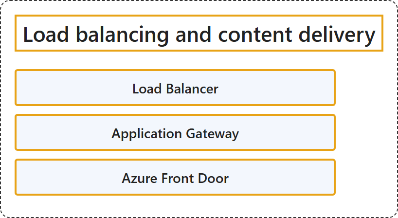

# 7.2 Load Balancing and Content Delivery

## Classification

## Glossary

| Term | Definition | 中文翻译 | Source |
|---|---|---|---|
| **Load Balancer** 负载均衡器 | "Azure Load Balancer provides **high-performance, low-latency Layer 4 load-balancing** for **all UDP and TCP protocols**." | Azure 负载均衡器提供**高性能、低延迟的第 4 层负载均衡**，适用于**所有 UDP 和 TCP 协议**。 | [Microsoft, 2026, "Load Balancer" section, para. 1](https://learn.microsoft.com/en-us/azure/networking/fundamentals/networking-overview#:~:text=provides%20high-performance%2C%20low-latency%20Layer%204%20load-balancing) |
| **Application Gateway** 应用程序网关 | "Azure Application Gateway is a **web traffic load balancer** that you can use to **manage traffic to your web applications**. It's an Application Delivery Controller (ADC) as a service, offering various **Layer 7 load-balancing capabilities** for your applications." | Azure 应用程序网关是一种 **Web 流量负载均衡器**，可用于**管理流向 Web 应用程序的流量**。它是以服务形式提供的应用程序交付控制器（ADC），为你的应用程序提供多种**第 7 层负载均衡功能**。 | [Microsoft, 2026, "Application Gateway" section, para. 1](https://learn.microsoft.com/en-us/azure/networking/fundamentals/networking-overview#:~:text=is%20a%20web%20traffic%20load%20balancer%20that%20you%20can%20use%20to%20manage%20traffic) |
| **Azure Front Door** Azure Front Door | "Azure Front Door helps you **define, manage, and monitor the global routing** for your **web traffic** by optimizing for best performance and instant global failover for high availability." | Azure Front Door 帮助你**定义、管理和监视全局路由**，用于你的 **Web 流量**，通过优化来获得最佳性能，并通过即时全局故障转移实现高可用性。 | [Microsoft, 2026, "Azure Front Door" section, para. 1](https://learn.microsoft.com/en-us/azure/networking/fundamentals/networking-overview#:~:text=helps%20you%20define%2C%20manage%2C%20and%20monitor%20the%20global%20routing) |

## References

- Microsoft. (2026, August 19). *Azure networking services overview*. Microsoft Learn. https://learn.microsoft.com/en-us/azure/networking/fundamentals/networking-overview
