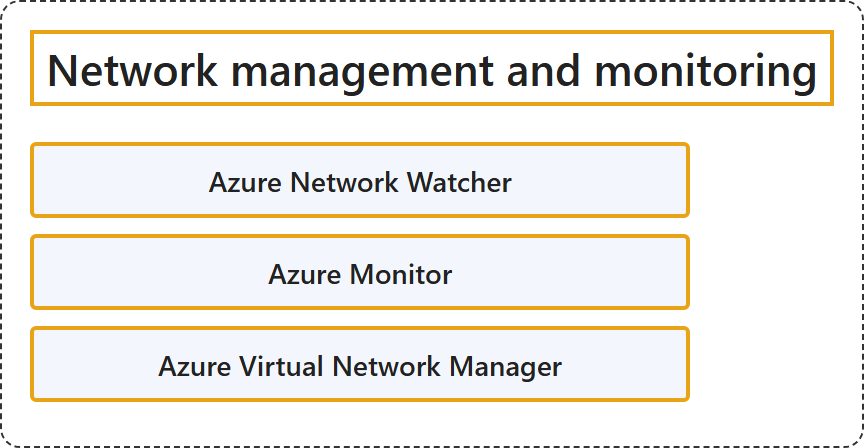

# 7.5 Network management and monitoring

## Classification

## Glossary

| Term | Definition | 中文翻译 | Source |
|---|---|---|---|
| **Azure Network Watcher** Azure 网络观察程序 | "Azure Network Watcher provides tools to **monitor, diagnose, view metrics, and enable or disable logs** for **resources in an Azure virtual network**." | Azure 网络观察程序提供工具，用于**监视、诊断、查看指标以及启用或禁用日志**，对象是 **Azure 虚拟网络中的资源**。 | [Microsoft, 2026, "Azure Network Watcher" section, para. 1](https://learn.microsoft.com/en-us/azure/networking/fundamentals/networking-overview#:~:text=provides%20tools%20to%20monitor%2C%20diagnose%2C%20view%20metrics) |
| **Azure Monitor** Azure Monitor | "Azure Monitor **maximizes the availability and performance of your applications** by delivering a comprehensive solution for **collecting, analyzing, and acting on telemetry** from your cloud and on-premises environments." | Azure Monitor **最大限度地提高应用程序的可用性和性能**，方法是提供一个全面的解决方案，用于**收集、分析来自云和本地环境的遥测数据并据此采取行动**。 | [Microsoft, 2026, "Azure Monitor" section, para. 1](https://learn.microsoft.com/en-us/azure/networking/fundamentals/networking-overview#:~:text=maximizes%20the%20availability%20and%20performance%20of%20your%20applications) |
| **Azure Virtual Network Manager** Azure 虚拟网络管理器 | "Azure Virtual Network Manager is a **management service** that you use to **group, configure, deploy, and manage virtual networks globally** across subscriptions." | Azure 虚拟网络管理器是一种**管理服务**，用于跨订阅**在全局范围内对虚拟网络进行分组、配置、部署和管理**。 | [Microsoft, 2026, "Azure Virtual Network Manager" section, para. 1](https://learn.microsoft.com/en-us/azure/networking/fundamentals/networking-overview#:~:text=is%20a%20management%20service%20that%20you%20use%20to%20group%2C%20configure) |

## References

- Microsoft. (2026, August 19). *Azure networking services overview*. Microsoft Learn. https://learn.microsoft.com/en-us/azure/networking/fundamentals/networking-overview
