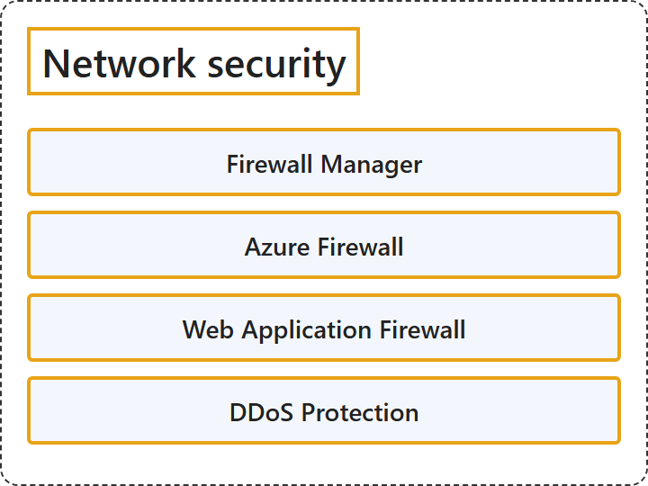

# 7.4 Network security

## Classification

## Glossary

| Term | Definition | 中文翻译 | Source |
|---|---|---|---|
| **Firewall Manager** 防火墙管理器 | "Azure Firewall Manager is a **security management service** that provides **central security policy and routing management** for **cloud-based security perimeters**." | Azure 防火墙管理器是一种**安全管理服务**，提供**集中的安全策略和路由管理**，用于**基于云的安全边界**。 | [Microsoft, 2026, "Firewall Manager" section, para. 1](https://learn.microsoft.com/en-us/azure/networking/fundamentals/networking-overview#:~:text=is%20a%20security%20management%20service%20that%20provides%20central%20security%20policy) |
| **Azure Firewall** Azure 防火墙 | "Azure Firewall is a **managed, cloud-based network security service** that **protects your Azure Virtual Network resources**." | Azure 防火墙是一种**托管的、基于云的网络安全服务**，它**保护你的 Azure 虚拟网络资源**。 | [Microsoft, 2026, "Azure Firewall" section, para. 1](https://learn.microsoft.com/en-us/azure/networking/fundamentals/networking-overview#:~:text=is%20a%20managed%2C%20cloud-based%20network%20security%20service) |
| **Web Application Firewall** Web 应用程序防火墙 | "Azure Web Application Firewall (WAF) **protects your web applications** from **common web exploits and vulnerabilities** such as SQL injection and cross-site scripting." | Azure Web 应用程序防火墙（WAF）**保护你的 Web 应用程序**，使其免受**常见的 Web 攻击和漏洞**的危害，例如 SQL 注入和跨站脚本。 | [Microsoft, 2026, "Web Application Firewall" section, para. 1](https://learn.microsoft.com/en-us/azure/networking/fundamentals/networking-overview#:~:text=protects%20your%20web%20applications%20from%20common%20web%20exploits) |
| **DDoS Protection** Azure DDoS 防护 | "Azure DDoS Protection provides **countermeasures against the most sophisticated DDoS threats**." | Azure DDoS 防护提供**针对最复杂 DDoS 威胁的应对措施**。 | [Microsoft, 2026, "DDoS Protection" section, para. 1](https://learn.microsoft.com/en-us/azure/networking/fundamentals/networking-overview#:~:text=provides%20countermeasures%20against%20the%20most%20sophisticated%20DDoS%20threats) |

## References

- Microsoft. (2026, August 19). *Azure networking services overview*. Microsoft Learn. https://learn.microsoft.com/en-us/azure/networking/fundamentals/networking-overview
