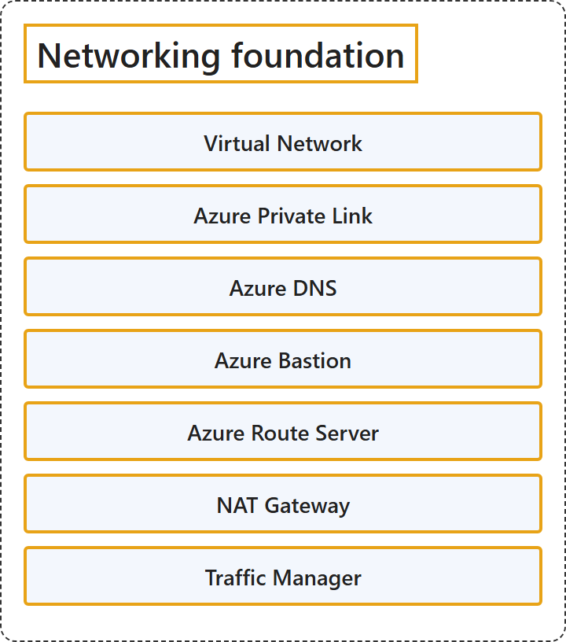

# 7.1 Networking Foundation

## Classification

## Glossary

| Term | Definition | 中文翻译 | Source |
|---|---|---|---|
| **Virtual Network** 虚拟网络 | "Azure Virtual Network (VNet) is the **fundamental building block** for your **private network in Azure**." | Azure 虚拟网络（VNet）是**基本构建基块**，用于你**在 Azure 中的专用网络**。 | [Microsoft, 2026, "Virtual network" section, para. 1](https://learn.microsoft.com/en-us/azure/networking/fundamentals/networking-overview#:~:text=is%20the%20fundamental%20building%20block%20for%20your%20private%20network) |
| **Azure Private Link** Azure 专用链接 | "Azure Private Link lets you **access Azure PaaS services** (for example, Azure Storage and SQL Database) and Azure hosted customer-owned or partner services **over a private endpoint in your virtual network**." | Azure 专用链接让你可以**访问 Azure PaaS 服务**（例如 Azure 存储和 SQL 数据库）以及 Azure 托管的客户自有服务或合作伙伴服务，**通过的是虚拟网络中的专用终结点**。 | [Microsoft, 2026, "Azure Private Link" section, para. 1](https://learn.microsoft.com/en-us/azure/networking/fundamentals/networking-overview#:~:text=lets%20you%20access%20Azure%20PaaS%20services) |
| **Azure DNS** Azure DNS | "Azure DNS provides **DNS hosting and resolution** by using the **Microsoft Azure infrastructure**." | Azure DNS 提供 **DNS 托管和解析**，使用的是 **Microsoft Azure 基础结构**。 | [Microsoft, 2026, "Azure DNS" section, para. 1](https://learn.microsoft.com/en-us/azure/networking/fundamentals/networking-overview#:~:text=provides%20DNS%20hosting%20and%20resolution) |
| **Azure Bastion** Azure Bastion | "Azure Bastion is a service that you can deploy in a virtual network to **connect to a virtual machine** by using **your browser and the Azure portal**." | Azure Bastion 是一项可以部署在虚拟网络中的服务，让你**连接到虚拟机**，使用的是**浏览器和 Azure 门户**。 | [Microsoft, 2026, "Azure Bastion" section, para. 1](https://learn.microsoft.com/en-us/azure/networking/fundamentals/networking-overview#:~:text=is%20a%20service%20that%20you%20can%20deploy%20in%20a%20virtual%20network%20to%20connect) |
| **Azure Route Server** Azure 路由服务器 | "Azure Route Server **simplifies dynamic routing** between your **network virtual appliance (NVA)** and **your virtual network**." | Azure 路由服务器**简化动态路由**，这种路由发生在你的**网络虚拟设备（NVA）**与**你的虚拟网络**之间。 | [Microsoft, 2026, "Azure Route Server" section, para. 1](https://learn.microsoft.com/en-us/azure/networking/fundamentals/networking-overview#:~:text=simplifies%20dynamic%20routing%20between%20your%20network%20virtual%20appliance) |
| **NAT Gateway** NAT 网关 | "NAT Gateway **simplifies outbound-only internet connectivity** for **virtual networks**." | NAT 网关**简化仅出站的 Internet 连接**，供**虚拟网络**使用。 | [Microsoft, 2026, "NAT Gateway" section, para. 1](https://learn.microsoft.com/en-us/azure/networking/fundamentals/networking-overview#:~:text=simplifies%20outbound-only%20internet%20connectivity) |
| **Traffic Manager** 流量管理器 | "Azure Traffic Manager is a **DNS-based traffic load balancer** that **distributes traffic optimally to services across global Azure regions**, while providing high availability and responsiveness." | Azure 流量管理器是一种**基于 DNS 的流量负载均衡器**，它**把流量以最佳方式分配给全球各个 Azure 区域中的服务**，同时提供高可用性和响应能力。 | [Microsoft, 2026, "Traffic Manager" section, para. 1](https://learn.microsoft.com/en-us/azure/networking/fundamentals/networking-overview#:~:text=is%20a%20DNS-based%20traffic%20load%20balancer) |

## References

- Microsoft. (2026, August 19). *Azure networking services overview*. Microsoft Learn. https://learn.microsoft.com/en-us/azure/networking/fundamentals/networking-overview
