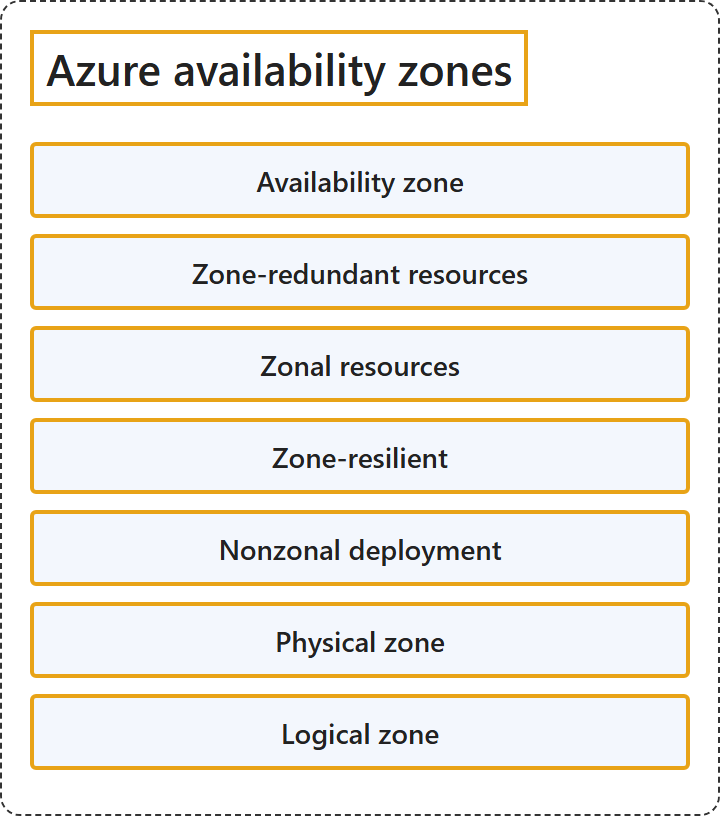

# 3.2 Azure Availability Zones

## Classification

## Glossary

| Term | Definition | 中文解释 | Source |
|---|---|---|---|
| **Availability zone** 可用区 | "An availability zone is a *logical grouping* of **one or more physically separate datacenters within a region**." | 可用区是**区域内一个或多个物理上独立的数据中心**的逻辑分组。 | [Microsoft, 2026, "Datacenters and availability zones" section, para. 1](https://learn.microsoft.com/en-us/azure/reliability/availability-zones-overview#:~:text=An%20availability%20zone%20is%20a%20logical%20grouping%20of) |
| **Zone-redundant resources** 可用区冗余资源 | "Zone-redundant resources are **replicated or distributed across multiple availability zones** by the service." | 可用区冗余资源由服务**复制或分布到多个可用区**。 | [Microsoft, 2026, "Types of availability zone support" section, item 1](https://learn.microsoft.com/en-us/azure/reliability/availability-zones-overview#:~:text=Zone-redundant%20resources%20are%20replicated%20or%20distributed%20across%20multiple) |
| **Zonal resources** 单可用区资源 | "A zonal resource is **deployed to a single availability zone** that **you select yourself**." | 单可用区资源**部署到你自己选择的单个可用区**。 | [Microsoft, 2026, "Types of availability zone support" section, item 2](https://learn.microsoft.com/en-us/azure/reliability/availability-zones-overview#:~:text=A%20zonal%20resource%20is%20deployed%20to%20a%20single) |
| **Zone-resilient** 可用区复原 | "your resource is considered to be *zone-resilient*: that is, it's **resilient to the outage of a single availability zone**." | 资源被视为具有可用区复原能力：也就是说，它**能承受单个可用区的中断**。 | [Microsoft, 2026, "Types of availability zone support" section, para. 2](https://learn.microsoft.com/en-us/azure/reliability/availability-zones-overview#:~:text=your%20resource%20is%20considered%20to%20be%20zone-resilient%3A%20that) |
| **Nonzonal deployment** 非可用区部署 | "If a resource **isn't configured to use availability zones**, either due to the region you use not supporting zones or because of your configuration choices, it's called a *nonzonal* or *regional* deployment." | 如果资源**未配置为使用可用区**（原因可能是所用区域不支持可用区，也可能是你的配置选择），就称为非可用区部署或区域部署。 | [Microsoft, 2026, "Types of availability zone support" section, para. 4](https://learn.microsoft.com/en-us/azure/reliability/availability-zones-overview#:~:text=If%20a%20resource%20isn%27t%20configured%20to%20use%20availability) |
| **Physical zone** 物理可用区 | "Each datacenter is **assigned to a physical zone**." | 每个数据中心都**分配到一个物理可用区**。 | [Microsoft, 2026, "Physical and logical availability zones" section, para. 1](https://learn.microsoft.com/en-us/azure/reliability/availability-zones-overview#:~:text=Each%20datacenter%20is%20assigned%20to%20a%20physical%20zone.) |
| **Logical zone** 逻辑可用区 | "Physical zones are **mapped to logical zones in your Azure subscription**, and different subscriptions might have a different mapping order." | 物理可用区**映射到你的 Azure 订阅中的逻辑可用区**，不同订阅的映射顺序可能不同。 | [Microsoft, 2026, "Physical and logical availability zones" section, para. 1](https://learn.microsoft.com/en-us/azure/reliability/availability-zones-overview#:~:text=Physical%20zones%20are%20mapped%20to%20logical%20zones%20in) |

## References

- Microsoft. (2026, February 11). *What are availability zones?* Microsoft Learn. https://learn.microsoft.com/en-us/azure/reliability/availability-zones-overview
