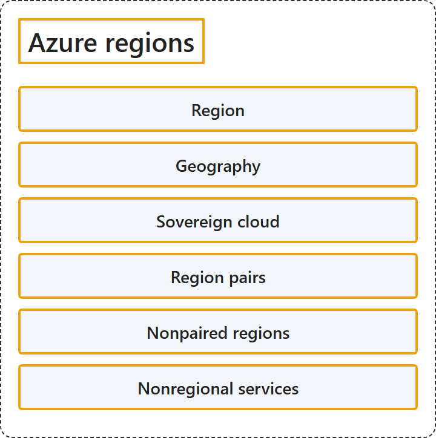

# 3.1 Azure regions

## Classification

## Glossary

| Term | Definition | 中文解释 | Source |
|---|---|---|---|
| **Region** 区域 | "Each region is a **set of physical facilities** that include **datacenters and networking infrastructure**." | 每个区域都是一组**物理设施**，包括**数据中心和网络基础设施**。 | [Microsoft, 2026, para. 1](https://learn.microsoft.com/en-us/azure/reliability/regions-overview#:~:text=Each%20region%20is%20a%20set%20of%20physical%20facilities) |
| **Geography** 地理区域 | "Each geography represents a **data residency boundary**, for example the United States, or Europe, and **may contain one or more regions**." | 每个地理区域代表一个**数据驻留边界**，例如美国或欧洲，并且**可以包含一个或多个区域**。 | [Microsoft, 2026, para. 1](https://learn.microsoft.com/en-us/azure/reliability/regions-overview#:~:text=Each%20geography%20represents%20a%20data%20residency%20boundary%2C%20for) |
| **Sovereign cloud** 主权云 | "However, some regions belong to *sovereign cloud* geographies. Customers in specific geographic areas with **stringent data residency regulations** can access these regions." | 但是，某些区域属于主权云地理区域。位于特定地理区域、受**严格数据驻留法规**约束的客户可以访问这些区域。 | [Microsoft, 2026, "Understand Azure regions and geographies" section, Note](https://learn.microsoft.com/en-us/azure/reliability/regions-overview#:~:text=However%2C%20some%20regions%20belong%20to%20sovereign%20cloud%20geographies.) |
| **Region pairs** 区域对 | "Microsoft **pairs some Azure regions with another Azure region** to form *region pairs*." | Microsoft **把一些 Azure 区域与另一个 Azure 区域配对**，形成区域对。 | [Microsoft, 2026, "Paired and nonpaired regions" section, para. 1](https://learn.microsoft.com/en-us/azure/reliability/regions-overview#:~:text=Microsoft%20pairs%20some%20Azure%20regions%20with%20another%20Azure) |
| **Nonpaired regions** 非配对区域 | "Many newer regions **aren't paired**, and instead **use availability zones as their primary means of redundancy**." | 许多较新的区域**没有配对**，而是**以可用区作为主要的冗余手段**。 | [Microsoft, 2026, "Paired and nonpaired regions" section, para. 2](https://learn.microsoft.com/en-us/azure/reliability/regions-overview#:~:text=Many%20newer%20regions%20aren%27t%20paired%2C%20and%20instead%20use) |
| **Nonregional services** 非区域服务 | "Microsoft deploys nonregional services **across two or more regions**." | Microsoft 把非区域服务**部署在两个或更多区域中**。 | [Microsoft, 2026, "Nonregional services" section, para. 1](https://learn.microsoft.com/en-us/azure/reliability/regions-overview#:~:text=Microsoft%20deploys%20nonregional%20services%20across%20two%20or%20more) |

## References

- Microsoft. (2026, June 26). *What are Azure regions?* Microsoft Learn. https://learn.microsoft.com/en-us/azure/reliability/regions-overview
