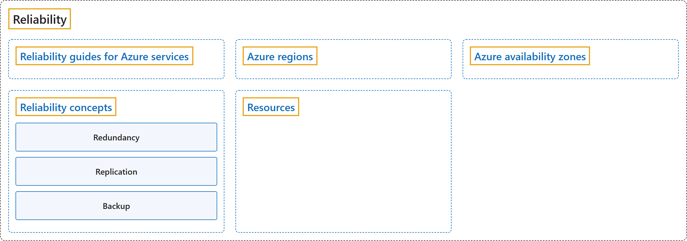

# 3. Reliability

## Classification

## Glossary

| Term | Definition | 中文翻译 | Source |
|---|---|---|---|
| **Reliability** 可靠性 | "*Reliability* is the **ability of a workload to keep meeting business expectations**, **even during failures or disruptions**." | 可靠性是工作负载**持续满足业务期望的能力**，**即使在发生故障或中断时**也是如此。 | [Microsoft, 2026b, para. 1](https://learn.microsoft.com/en-us/azure/reliability/overview#:~:text=is%20the%20ability%20of%20a%20workload%20to%20keep%20meeting%20business%20expectations) |
| **[Reliability guides for Azure services](reliability-guides-for-azure-services.md)** 各 Azure 服务的可靠性指南 | (context) "This article provides links to **reliability guidance** for many **Azure services**." | （语境）本文提供了指向**可靠性指南**的链接，涵盖许多 **Azure 服务**。 | [Microsoft, 2026a, para. 1](https://learn.microsoft.com/en-us/azure/reliability/overview-reliability-guidance#:~:text=This%20article%20provides%20links%20to%20reliability%20guidance) |
| **[Azure regions](azure-regions.md)** Azure 区域 | Defined in [2.1 Physical infrastructure](../core-architectural-components/physical-infrastructure.md) (Regions). | 定义见 2.1 Physical infrastructure（Regions）。 | — |
| **[Azure availability zones](azure-availability-zones.md)** Azure 可用区 | Defined in [2.1 Physical infrastructure](../core-architectural-components/physical-infrastructure.md) (Availability zones). | 定义见 2.1 Physical infrastructure（Availability zones）。 | — |
| **[Reliability concepts](reliability-concepts.md)** 可靠性概念 | — | — | — |
| **[Resources](resources.md)** 资源 | — | — | — |

## Coverage

| Certification | Skill area |
|---|---|
| AZ-104 Microsoft Azure Administrator | [Deploy and manage Azure compute resources (20–25%)](https://learn.microsoft.com/en-us/credentials/certifications/resources/study-guides/az-104#deploy-and-manage-azure-compute-resources-2025) |
| AZ-305 Designing Microsoft Azure Infrastructure Solutions | [Design business continuity solutions (15–20%)](https://learn.microsoft.com/en-us/credentials/certifications/resources/study-guides/az-305#design-business-continuity-solutions-1520) |
| AZ-900 Microsoft Azure Fundamentals | [Describe cloud concepts (25–30%)](https://learn.microsoft.com/en-us/credentials/certifications/resources/study-guides/az-900#describe-cloud-concepts-2530) [Describe Azure architecture and services (35–40%)](https://learn.microsoft.com/en-us/credentials/certifications/resources/study-guides/az-900#describe-azure-architecture-and-services-3540) |

## References

- Microsoft. (n.d.). *Azure reliability documentation* [Table of contents]. Microsoft Learn. Retrieved October 26, 2026, from https://learn.microsoft.com/en-us/azure/reliability/
- Microsoft. (2026a, January 15). *Reliability guides by service*. Microsoft Learn. https://learn.microsoft.com/en-us/azure/reliability/overview-reliability-guidance
- Microsoft. (2026b, August 12). *Reliability in Azure*. Microsoft Learn. https://learn.microsoft.com/en-us/azure/reliability/overview
- Microsoft. (2026c). *Study guide for Exam AZ-104: Microsoft Azure Administrator*. Microsoft Learn. https://learn.microsoft.com/en-us/credentials/certifications/resources/study-guides/az-104
- Microsoft. (2026d). *Study guide for Exam AZ-305: Designing Microsoft Azure Infrastructure Solutions*. Microsoft Learn. https://learn.microsoft.com/en-us/credentials/certifications/resources/study-guides/az-305
- Microsoft. (2026e). *Study guide for Exam AZ-900: Microsoft Azure Fundamentals*. Microsoft Learn. https://learn.microsoft.com/en-us/credentials/certifications/resources/study-guides/az-900
