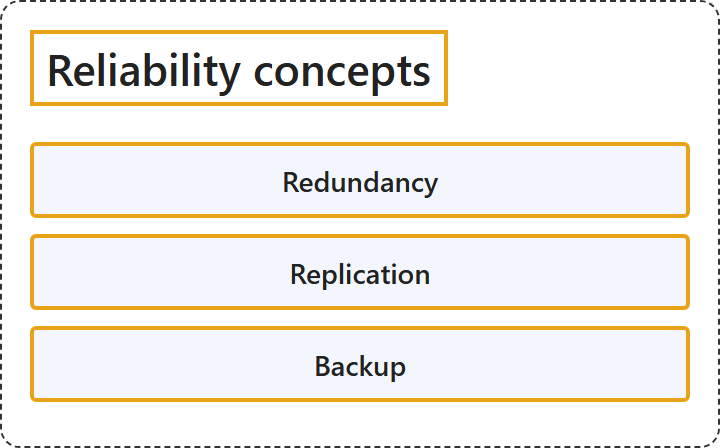

# 3.4 Reliability concepts

Sources: [Shared responsibility for reliability](https://learn.microsoft.com/en-us/azure/reliability/concept-shared-responsibility); [Business continuity, high availability, and disaster recovery](https://learn.microsoft.com/en-us/azure/reliability/concept-business-continuity-high-availability-disaster-recovery); [Redundancy, replication, and backup](https://learn.microsoft.com/en-us/azure/reliability/concept-redundancy-replication-backup); [Failover and failback](https://learn.microsoft.com/en-us/azure/reliability/concept-failover-failback); [Reliability and sovereignty in Azure](https://learn.microsoft.com/en-us/azure/reliability/concept-reliability-sovereignty); [How to read a service-level agreement (SLA)](https://learn.microsoft.com/en-us/azure/reliability/concept-service-level-agreements).

## Classification

## Glossary

| Term | Definition | 中文解释 | Source |
|---|---|---|---|
| **Redundancy** 冗余 | "*Redundancy* is the ability to maintain **multiple identical copies of a service component**, and to use those copies in a way that prevents any one component from becoming a **single point of failure**." | 冗余是维护**服务组件的多个相同副本**的能力，并以某种方式使用这些副本，防止任何一个组件成为**单点故障**。 | [Microsoft, 2025, para. 3](https://learn.microsoft.com/en-us/azure/reliability/concept-redundancy-replication-backup#:~:text=is%20the%20ability%20to%20maintain%20multiple%20identical%20copies%20of%20a%20service%20component) |
| **Replication** 复制 | "*Replication or data redundancy* is the ability to maintain **multiple copies of data**, called **replicas**." | 复制（或数据冗余）是维护**数据的多个副本**的能力，这些副本称为**副本（replica）**。 | [Microsoft, 2025, para. 4](https://learn.microsoft.com/en-us/azure/reliability/concept-redundancy-replication-backup#:~:text=is%20the%20ability%20to%20maintain%20multiple%20copies%20of%20data%2C%20called%20replicas) |
| **Backup** 备份 | "*Backup* is the ability to maintain a **timestamped copy of data** that can be used to **restore data that has been lost**." | 备份是维护**带时间戳的数据副本**的能力，可用来**恢复已丢失的数据**。 | [Microsoft, 2025, para. 5](https://learn.microsoft.com/en-us/azure/reliability/concept-redundancy-replication-backup#:~:text=is%20the%20ability%20to%20maintain%20a%20timestamped%20copy%20of%20data) |

## References

- Microsoft. (2025, February 26). *What are redundancy, replication, and backup?* Microsoft Learn. https://learn.microsoft.com/en-us/azure/reliability/concept-redundancy-replication-backup
