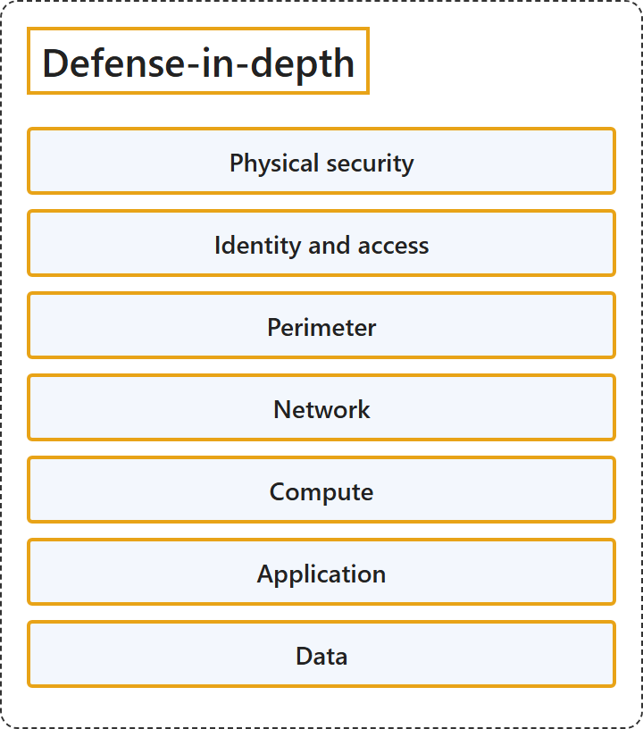

# 18.2 Defense-in-Depth

## Classification

## Glossary

| Term | Definition | 中文翻译 | Source |
|---|---|---|---|
| **Physical security** 物理安全 | "The physical security layer is the **first line of defense** to **protect computing hardware in the datacenter**." | 物理安全层是**第一道防线**，用于**保护数据中心中的计算硬件**。 | [Microsoft, n.d., "Layers of defense-in-depth" section, list item 1](https://learn.microsoft.com/en-us/training/modules/describe-azure-identity-access-security/8-describe-defense-depth#:~:text=The%20physical%20security%20layer%20is%20the%20first%20line%20of%20defense) |
| **Identity and access** 身份和访问 | "The identity and access layer **controls access to infrastructure and change control**." | 身份和访问层**控制对基础结构的访问以及变更控制**。 | [Microsoft, n.d., "Layers of defense-in-depth" section, list item 2](https://learn.microsoft.com/en-us/training/modules/describe-azure-identity-access-security/8-describe-defense-depth#:~:text=The%20identity%20and%20access%20layer%20controls%20access) |
| **Perimeter** 外围 | "The perimeter layer uses **distributed denial of service (DDoS) protection** to **filter large-scale attacks** before they can cause a denial of service for users." | 外围层使用**分布式拒绝服务 (DDoS) 防护**，**过滤大规模攻击**，赶在它们对用户造成拒绝服务之前。 | [Microsoft, n.d., "Layers of defense-in-depth" section, list item 3](https://learn.microsoft.com/en-us/training/modules/describe-azure-identity-access-security/8-describe-defense-depth#:~:text=The%20perimeter%20layer%20uses%20distributed%20denial%20of%20service) |
| **Network** 网络 | "The network layer **limits communication between resources** through **segmentation and access controls**." | 网络层**限制资源之间的通信**，手段是**分段和访问控制**。 | [Microsoft, n.d., "Layers of defense-in-depth" section, list item 4](https://learn.microsoft.com/en-us/training/modules/describe-azure-identity-access-security/8-describe-defense-depth#:~:text=The%20network%20layer%20limits%20communication%20between%20resources) |
| **Compute** 计算 | "The compute layer **secures access to virtual machines**." | 计算层**保护对虚拟机的访问**。 | [Microsoft, n.d., "Layers of defense-in-depth" section, list item 5](https://learn.microsoft.com/en-us/training/modules/describe-azure-identity-access-security/8-describe-defense-depth#:~:text=The%20compute%20layer%20secures%20access%20to%20virtual%20machines) |
| **Application** 应用程序 | "The application layer helps ensure that applications are **secure and free of security vulnerabilities**." | 应用程序层帮助确保应用程序**安全且没有安全漏洞**。 | [Microsoft, n.d., "Layers of defense-in-depth" section, list item 6](https://learn.microsoft.com/en-us/training/modules/describe-azure-identity-access-security/8-describe-defense-depth#:~:text=The%20application%20layer%20helps%20ensure%20that%20applications%20are%20secure) |
| **Data** 数据 | "The data layer **controls access to operational and customer data** that you need to protect." | 数据层**控制对需要保护的运营数据和客户数据的访问**。 | [Microsoft, n.d., "Layers of defense-in-depth" section, list item 7](https://learn.microsoft.com/en-us/training/modules/describe-azure-identity-access-security/8-describe-defense-depth#:~:text=The%20data%20layer%20controls%20access%20to%20operational%20and%20customer%20data) |

## References

- Microsoft. (n.d.). *Describe defense-in-depth* [Training module unit]. Microsoft Learn. Retrieved October 27, 2026, from https://learn.microsoft.com/en-us/training/modules/describe-azure-identity-access-security/8-describe-defense-depth
