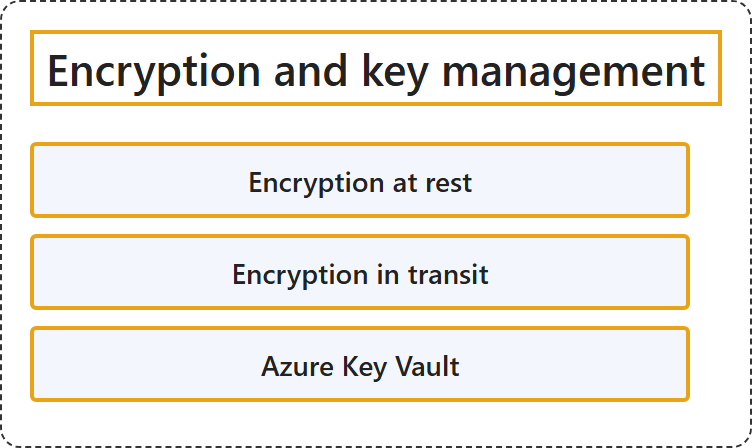

# 18.3 Encryption and key management

## Classification

## Glossary

| Term | Definition | 中文翻译 | Source |
|---|---|---|---|
| **Encryption at rest** 静态加密 | (context) "Encryption at rest is a **common security requirement**. Azure **encrypts data at rest by default** by using **platform-managed keys**." | （语境）静态加密是一项**常见的安全要求**。Azure **默认对静态数据进行加密**，使用的是**平台管理的密钥**。 | [Microsoft, 2026b, para. 2](https://learn.microsoft.com/en-us/azure/security/fundamentals/encryption-atrest#:~:text=Encryption%20at%20rest%20is%20a%20common%20security%20requirement) |
| **Encryption in transit** 传输中加密 | (context) "Azure provides many mechanisms to help **keep data private** as it **moves from one location to another**." | （语境）Azure 提供许多机制，帮助**保持数据私密**，在数据**从一个位置移动到另一个位置**时。 | [Microsoft, 2026c, "Encryption in transit" section, para. 1](https://learn.microsoft.com/en-us/azure/security/fundamentals/encryption-overview#:~:text=Azure%20provides%20many%20mechanisms%20to%20help%20keep%20data%20private) |
| **Azure Key Vault** Azure 密钥保管库 | "**Secrets Management** - Azure Key Vault can be used to **Securely store and tightly control access** to **tokens, passwords, certificates, API keys, and other secrets**" | **机密管理**：Azure 密钥保管库可用于**安全地存储和严格控制访问**，对象是**令牌、密码、证书、API 密钥和其他机密**。 | [Microsoft, 2026a, para. 1, list item 1](https://learn.microsoft.com/en-us/azure/key-vault/general/overview#:~:text=Azure%20Key%20Vault%20can%20be%20used%20to%20Securely%20store) |

## References

- Microsoft. (2026b, July 21). *Azure data encryption at rest*. Microsoft Learn. https://learn.microsoft.com/en-us/azure/security/fundamentals/encryption-atrest
- Microsoft. (2026c, September 18). *Azure encryption overview*. Microsoft Learn. https://learn.microsoft.com/en-us/azure/security/fundamentals/encryption-overview
- Microsoft. (2026a, September 22). *About Azure Key Vault*. Microsoft Learn. https://learn.microsoft.com/en-us/azure/key-vault/general/overview
