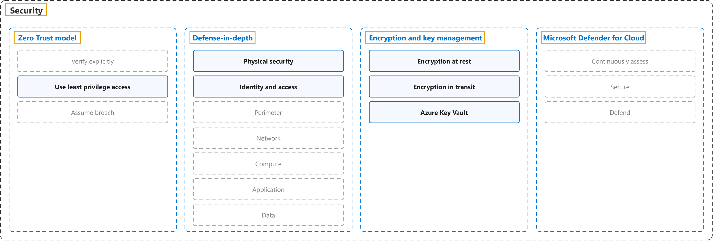

# 13. Security

## Classification

## Glossary

| Term | Definition | 中文翻译 | Source |
|---|---|---|---|
| **Security** 安全 | "**Cybersecurity** is the practice of **protecting your critical systems, data, and networks** from **digital attacks**." | **网络安全**是**保护你的关键系统、数据和网络**、使其免受**数字攻击**的做法。 | [Microsoft, n.d., "Key takeaways" section, list item 1](https://www.microsoft.com/en-us/security/business/security-101/what-is-cybersecurity#:~:text=Cybersecurity%20is%20the%20practice%20of%20protecting) |
| **[Zero Trust model](zero-trust-model.md)** 零信任模型 | "**Zero Trust** is a security model that **assumes the worst case scenario** and **protects resources with that expectation**." | **零信任**是一种安全模型，它**假设最坏的情况**，并**按照这种预期来保护资源**。 | [Microsoft, 2026a, "Describe Zero Trust model" unit, para. 1](https://learn.microsoft.com/en-us/training/modules/describe-azure-identity-access-security/7-describe-zero-trust-model#:~:text=Zero%20Trust%20is%20a%20security%20model) |
| **[Defense-in-depth](defense-in-depth.md)** 纵深防御 | "The objective of **defense-in-depth** is to **protect information** and **prevent it from being stolen** by those who aren't authorized to access it." | **纵深防御**的目标是**保护信息**，**防止它被**无权访问的人**窃取**。 | [Microsoft, 2026a, "Describe defense-in-depth" unit, para. 1](https://learn.microsoft.com/en-us/training/modules/describe-azure-identity-access-security/8-describe-defense-depth#:~:text=The%20objective%20of%20defense-in-depth) |
| **[Encryption and key management](encryption-and-key-management.md)** 加密和密钥管理 | "**Encryption** helps protect **data confidentiality** by **making data unreadable** to unauthorized users." | **加密**通过**让数据对未授权用户不可读**来帮助保护**数据机密性**。 | [Microsoft, 2026a, "Describe encryption and key management in Azure" unit, para. 1](https://learn.microsoft.com/en-us/training/modules/describe-azure-identity-access-security/9a-describe-encryption-key-management#:~:text=Encryption%20helps%20protect%20data%20confidentiality) |
| **[Microsoft Defender for Cloud](microsoft-defender-for-cloud.md)** Microsoft Defender for Cloud | "**Defender for Cloud** is a **security posture management** and **threat protection service**." | **Defender for Cloud** 是一项**安全态势管理**和**威胁防护服务**。 | [Microsoft, 2026a, "Describe Microsoft Defender for Cloud" unit, para. 1](https://learn.microsoft.com/en-us/training/modules/describe-azure-identity-access-security/9-describe-microsoft-defender-for-cloud#:~:text=Defender%20for%20Cloud%20is%20a%20security%20posture) |

## Coverage

| Certification | Skill area |
|---|---|
| AZ-900 Microsoft Azure Fundamentals | [Describe Azure architecture and services (35–40%)](https://learn.microsoft.com/en-us/credentials/certifications/resources/study-guides/az-900#describe-azure-architecture-and-services-3540) |
| AZ-500 Microsoft Azure Security Technologies | [Secure compute, storage, and databases (20–25%)](https://learn.microsoft.com/en-us/credentials/certifications/resources/study-guides/az-500#secure-compute-storage-and-databases-2025) [Secure Azure using Microsoft Defender for Cloud and Microsoft Sentinel (30–35%)](https://learn.microsoft.com/en-us/credentials/certifications/resources/study-guides/az-500#secure-azure-using-microsoft-defender-for-cloud-and-microsoft-sentinel-3035) |

**CST8911 Introduction to Cloud Computing**

| Week | Group | Terms in the course | Source |
|---|---|---|---|
| 1 | Security | security | Lecture 1: slide 4 |
| 2 | Zero Trust model | principle of least privilege | Lab 1: Authentication and SAS (tasks 4–5) |
|  | Encryption and key management | encryption at rest | Reading: Azure Blob Storage (product page) |
| 6 | Security | security (cloud architecture) | Lecture 5: slides 3, 4 |

**CST8912 Cloud Solution Architecture**

| Week | Group | Terms in the course | Source |
|---|---|---|---|
| 1 | Security | security | Introduction to Cloud Solution Architecture: slides 6, 7, 8 |
|  | Microsoft Defender for Cloud | Microsoft Defender for Cloud | Reading: How to connect to Azure |
| 5 | Encryption and key management | Transparent Data Encryption (TDE) Encryption Azure Key Vault | Design Cloud Database Solution: slide 8 Lab 4: Storage account (Steps 10–11), Azure Data Factory (Steps 12–21) |
|  | Microsoft Defender for Cloud | Microsoft Defender for SQL | Lab 4: Azure SQL Database (Steps 1–6) |
| 6 | Security | security | Week 6 – Cloud Architecture best practices: slide 28 |
|  | Defense-in-depth | implement security in every layer | Week 6 – Cloud Architecture best practices: slide 4 |
|  | Encryption and key management | encryption at rest encryption in transit | Week 6 – Cloud Architecture best practices: slide 26 |

**CST8913 Cloud Migration**

| Week | Group | Terms in the course | Source |
|---|---|---|---|
| 2 | Zero Trust model | zero trust Zero Trust principles | Lab 2: Migration execution and operations Reading: Cloud Adoption Framework (Units 9–10) |
|  | Defense-in-depth | physical security | Introduction to Cloud Computing: slide 10 |
|  | Microsoft Defender for Cloud | security posture | Reading: Cloud Adoption Framework (Units 9–10) |
| 3 | Encryption and key management | Azure Key Vault | Target Cloud Architecture: slide 10 |
| 4 | Defense-in-depth | identity and access | Migration Assessment Process: slide 4 |

**CST8916 Remote Data and Real-time Applications**

| Week | Group | Terms in the course | Source |
|---|---|---|---|
| 1 | Security | security | Introduction to Remote Data and Real-time Applications: slide 28 |
| 5 | Encryption and key management | encryption | Popular Cloud Services for Real-time Applications I: slide 41 |

## References

- Microsoft. (n.d.). *What is cybersecurity?* Microsoft Security. Retrieved October 24, 2026, from https://www.microsoft.com/en-us/security/business/security-101/what-is-cybersecurity
- Microsoft. (2026a). *Describe Azure identity, access, and security* [Training module]. Microsoft Learn. https://learn.microsoft.com/en-us/training/modules/describe-azure-identity-access-security/
- Microsoft. (2026b). *Study guide for Exam AZ-500: Microsoft Azure Security Technologies*. Microsoft Learn. https://learn.microsoft.com/en-us/credentials/certifications/resources/study-guides/az-500
