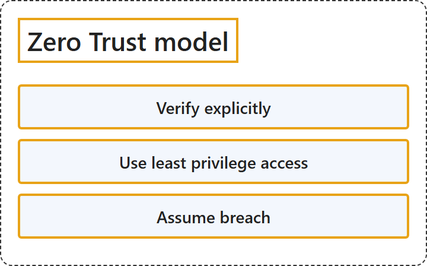

# 18.1 Zero Trust Model

## Classification

## Glossary

| Term | Definition | 中文翻译 | Source |
|---|---|---|---|
| **Verify explicitly** 显式验证 | "**Every access request** is **authenticated and authorized** using **all available signals**." | **每个访问请求**都要**经过身份验证和授权**，依据的是**所有可用信号**。 | [Microsoft, 2026, "Zero Trust principles" section, table row 1](https://learn.microsoft.com/en-us/security/zero-trust/zero-trust-overview#:~:text=Every%20access%20request%20is%20authenticated%20and%20authorized) |
| **Use least privilege access** 使用最低权限访问 | "User and workloads get **only the access they need**, for the **shortest time required**." | 用户和工作负载**只获得所需的访问权限**，并且只在**所需的最短时间内**拥有。 | [Microsoft, 2026, "Zero Trust principles" section, table row 2](https://learn.microsoft.com/en-us/security/zero-trust/zero-trust-overview#:~:text=get%20only%20the%20access%20they%20need) |
| **Assume breach** 假定已遭入侵 | "Security controls are designed with the expectation that **attackers might be operating inside the environment**. Controls focus on **limiting breach impact**, and enabling **rapid threat detection and response**." | 安全控制的设计前提是**攻击者可能已在环境内部活动**。控制措施侧重于**限制入侵的影响**，并实现**快速的威胁检测和响应**。 | [Microsoft, 2026, "Zero Trust principles" section, table row 3](https://learn.microsoft.com/en-us/security/zero-trust/zero-trust-overview#:~:text=attackers%20might%20be%20operating%20inside%20the%20environment) |

## References

- Microsoft. (2026, May 31). *What is Zero Trust?* Microsoft Learn. https://learn.microsoft.com/en-us/security/zero-trust/zero-trust-overview
