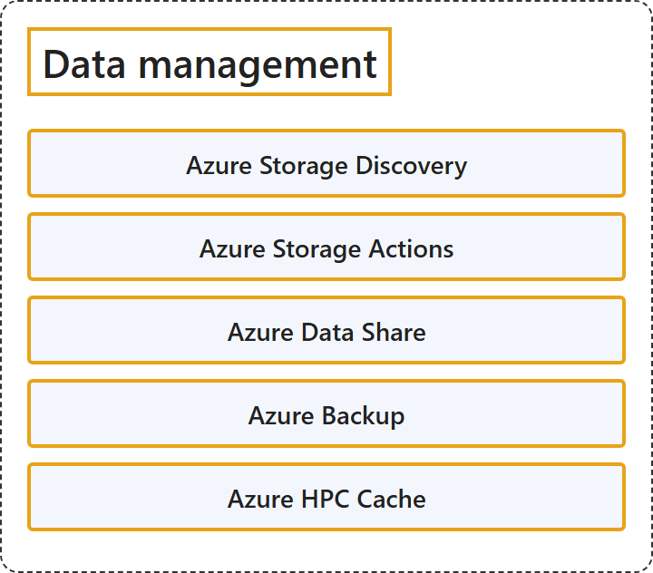

# 8.6 Data Management

## Classification

## Glossary

| Term | Definition | 中文翻译 | Source |
|---|---|---|---|
| **Azure Storage Discovery** Azure 存储发现 | "Azure Storage Discovery is a **fully managed service** that provides **enterprise-wide visibility into your Azure Blob Storage and Azure Data Lake Storage estate**." | Azure 存储发现是一项**完全托管的服务**，提供**对 Azure Blob 存储和 Azure Data Lake Storage 资产的企业级可见性**。 | [Microsoft, 2025c, para. 1](https://learn.microsoft.com/en-us/azure/storage-discovery/overview#:~:text=is%20a%20fully%20managed%20service%20that%20provides%20enterprise-wide%20visibility) |
| **Azure Storage Actions** Azure 存储操作 | "Azure Storage Actions is a **fully managed platform** designed to **automate data management tasks** for Azure Blob Storage and Azure Data Lake Storage." | Azure 存储操作是一个**完全托管的平台**，旨在为 Azure Blob 存储和 Azure Data Lake Storage **自动执行数据管理任务**。 | [Microsoft, 2025b, para. 1](https://learn.microsoft.com/en-us/azure/storage-actions/overview#:~:text=is%20a%20fully%20managed%20platform%20designed%20to%20automate%20data%20management%20tasks) |
| **Azure Data Share** Azure 数据共享 | "Azure Data Share enables organizations to **securely share data** with **multiple customers and partners**." | Azure 数据共享让组织能够**安全地共享数据**，共享对象是**多个客户和合作伙伴**。 | [Microsoft, 2026a, para. 1](https://learn.microsoft.com/en-us/azure/data-share/overview#:~:text=enables%20organizations%20to%20securely%20share%20data) |
| **Azure Backup** Azure 备份 | "Azure Backup is a **native Azure service** that helps you **protect your data and restore it when required**." | Azure 备份是一项**原生 Azure 服务**，帮助你**保护数据并在需要时还原数据**。 | [Microsoft, 2026b, para. 1](https://learn.microsoft.com/en-us/azure/backup/backup-overview#:~:text=is%20a%20native%20Azure%20service%20that%20helps%20you%20protect%20your%20data) |
| **Azure HPC Cache** Azure HPC 缓存 | "Azure HPC Cache **speeds access to your data** for **high-performance computing (HPC) tasks**." | Azure HPC 缓存**加快数据访问速度**，用于**高性能计算 (HPC) 任务**。 | [Microsoft, 2025a, para. 1](https://learn.microsoft.com/en-us/azure/hpc-cache/hpc-cache-overview#:~:text=speeds%20access%20to%20your%20data%20for%20high-performance%20computing) |

## References

- Microsoft. (2025a, September 30). *What is Azure HPC Cache?* Microsoft Learn. https://learn.microsoft.com/en-us/azure/hpc-cache/hpc-cache-overview
- Microsoft. (2025b, August 1). *What is Azure Storage Actions*. Microsoft Learn. https://learn.microsoft.com/en-us/azure/storage-actions/overview
- Microsoft. (2025c, October 9). *What is Azure Storage Discovery?* Microsoft Learn. https://learn.microsoft.com/en-us/azure/storage-discovery/overview
- Microsoft. (2026a, January 9). *What is Azure Data Share?* Microsoft Learn. https://learn.microsoft.com/en-us/azure/data-share/overview
- Microsoft. (2026b, September 16). *What is the Azure Backup service?* Microsoft Learn. https://learn.microsoft.com/en-us/azure/backup/backup-overview
