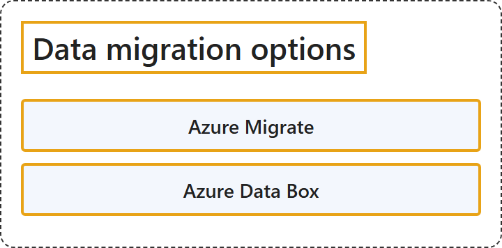

# 8.4 Data migration options

## Classification

## Glossary

| Term | Definition | 中文翻译 | Source |
|---|---|---|---|
| **Azure Migrate** Azure Migrate | "Azure Migrate is a service that helps you **decide on, plan, and execute your migration to Azure**." | Azure Migrate 是一项服务，帮助你**决定、规划并执行向 Azure 的迁移**。 | [Microsoft, 2026b, para. 1](https://learn.microsoft.com/en-us/azure/migrate/migrate-services-overview#:~:text=Azure%20Migrate%20is%20a%20service%20that%20helps%20you%20decide%20on%2C%20plan%2C%20and%20execute) |
| **Azure Data Box** Azure Data Box | "The Microsoft Azure Data Box cloud solution lets you **send terabytes of data into and out of Azure** in a **quick, inexpensive, and reliable way**." | Microsoft Azure Data Box 云解决方案让你**把数 TB 的数据送入和送出 Azure**，方式**快速、廉价、可靠**。 | [Microsoft, 2026a, para. 1](https://learn.microsoft.com/en-us/azure/databox/data-box-overview?pivots=dbx-ng#:~:text=lets%20you%20send%20terabytes%20of%20data%20into%20and%20out%20of%20Azure) |

## References

- Microsoft. (2026a, August 3). *What is Azure Data Box?* Microsoft Learn. https://learn.microsoft.com/en-us/azure/databox/data-box-overview?pivots=dbx-ng
- Microsoft. (2026b, October 13). *What is Azure Migrate?* Microsoft Learn. https://learn.microsoft.com/en-us/azure/migrate/migrate-services-overview
