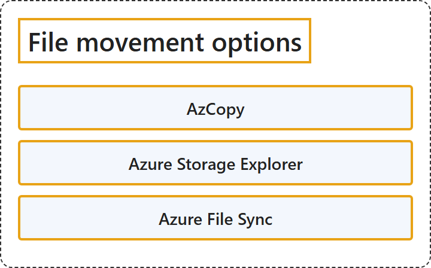

# 8.5 File Movement Options

## Classification

## Glossary

| Term | Definition | 中文翻译 | Source |
|---|---|---|---|
| **AzCopy** AzCopy | "AzCopy is a **command-line utility** that you can use to **copy data to, from, or between storage accounts**." | AzCopy 是一个**命令行实用工具**，可用于**向存储帐户复制数据、从存储帐户复制数据或在存储帐户之间复制数据**。 | [Microsoft, 2026a, para. 1](https://learn.microsoft.com/en-us/azure/storage/common/storage-use-azcopy-v10#:~:text=AzCopy%20is%20a%20command-line%20utility) |
| **Azure Storage Explorer** Azure 存储资源管理器 | "Microsoft Azure Storage Explorer is a **standalone app** that makes it easy to **work with Azure Storage data** on Windows, macOS, and Linux." | Microsoft Azure 存储资源管理器是一个**独立应用**，让你可以在 Windows、macOS 和 Linux 上轻松**处理 Azure 存储数据**。 | [Microsoft, 2026b, "Overview" section, para. 1](https://learn.microsoft.com/en-us/azure/vs-azure-tools-storage-manage-with-storage-explorer#:~:text=is%20a%20standalone%20app%20that%20makes%20it%20easy%20to%20work%20with%20Azure%20Storage%20data) |
| **Azure File Sync** Azure 文件同步 | "Azure File Sync **centralizes your organization's file shares in Azure Files** while **keeping the flexibility, performance, and compatibility of on-premises Windows file servers**." | Azure 文件同步**把组织的文件共享集中到 Azure 文件中**，同时**保留本地 Windows 文件服务器的灵活性、性能和兼容性**。 | [Microsoft, 2026c, para. 1](https://learn.microsoft.com/en-us/azure/storage/file-sync/file-sync-introduction#:~:text=centralizes%20your%20organization) |

## References

- Microsoft. (2026a, October 23). *Get started with AzCopy*. Microsoft Learn. https://learn.microsoft.com/en-us/azure/storage/common/storage-use-azcopy-v10
- Microsoft. (2026b, March 30). *Get started with Storage Explorer*. Microsoft Learn. https://learn.microsoft.com/en-us/azure/vs-azure-tools-storage-manage-with-storage-explorer
- Microsoft. (2026c, August 18). *What is Azure File Sync?* Microsoft Learn. https://learn.microsoft.com/en-us/azure/storage/file-sync/file-sync-introduction
