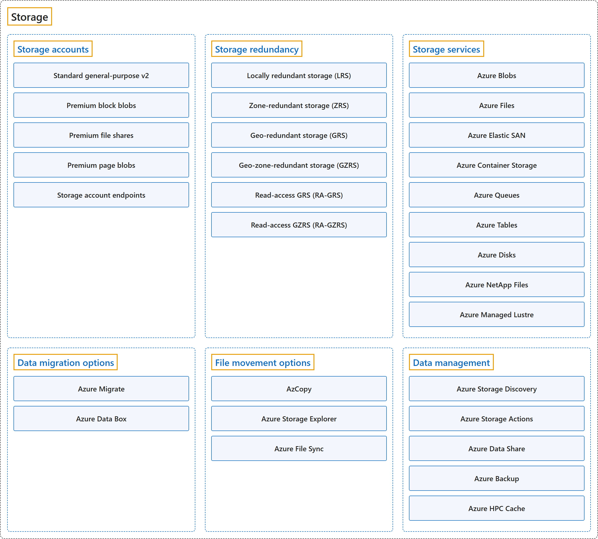

# 8. Storage

## Classification

## Glossary

| Term | Definition | 中文翻译 | Source |
|---|---|---|---|
| **Storage** 存储 | "**Cloud storage** is a way of **saving data on remote servers** where it can be **accessed online** instead of on **local computers or physical hard drives**." | **云存储**是一种**把数据保存在远程服务器上**的方式，数据可以**在线访问**，而不是保存在**本地计算机或物理硬盘**上。 | [Microsoft, n.d.-c, para. 1](https://azure.microsoft.com/en-us/resources/cloud-computing-dictionary/what-is-cloud-storage#:~:text=Cloud%20storage%20is%20a%20way%20of%20saving%20data) |
| **[Storage accounts](storage-accounts.md)** 存储帐户 | "A **storage account** provides a **unique namespace** for your **Azure Storage data** that's **accessible from anywhere in the world** over HTTP or HTTPS." | **存储帐户**提供一个**唯一的命名空间**，用于存放你的 **Azure 存储数据**，可以通过 HTTP 或 HTTPS **从世界任何地方访问**。 | [Microsoft, n.d.-b, "Describe Azure storage accounts" unit, para. 1](https://learn.microsoft.com/en-us/training/modules/describe-azure-storage-services/2-accounts#:~:text=A%20storage%20account%20provides%20a%20unique%20namespace) |
| **[Storage redundancy](storage-redundancy.md)** 存储冗余 | "**Azure Storage** keeps **multiple copies of data** to **protect against** hardware failures, outages, and **regional disasters**." | **Azure 存储**会保留**多个数据副本**，以**防范**硬件故障、服务中断和**区域性灾难**。 | [Microsoft, n.d.-b, "Describe Azure storage redundancy" unit, para. 1](https://learn.microsoft.com/en-us/training/modules/describe-azure-storage-services/3-redundancy#:~:text=Azure%20Storage%20keeps%20multiple%20copies%20of%20data) |
| **[Storage services](storage-services.md)** 存储服务 | "**Azure Storage** includes these **core data services**: Azure Blobs ... Azure Files ... Azure Queues ... Azure Disks ... Azure Tables ..." | **Azure 存储**包括以下**核心数据服务**：Azure Blobs……Azure Files……Azure Queues……Azure Disks……Azure Tables…… | [Microsoft, n.d.-b, "Describe Azure storage services" unit, para. 1](https://learn.microsoft.com/en-us/training/modules/describe-azure-storage-services/4-describe-azure-storage-services#:~:text=Azure%20Storage%20includes%20these%20core%20data%20services) |
| **[Data migration options](data-migration-options.md)** 数据迁移选项 | "Azure supports both **real-time migration** of infrastructure, applications, and data using **Azure Migrate** as well as **asynchronous migration** of data using **Azure Data Box**." | Azure 既支持对基础结构、应用程序和数据进行**实时迁移**（使用 **Azure Migrate**），也支持对数据进行**异步迁移**（使用 **Azure Data Box**）。 | [Microsoft, n.d.-b, "Identify Azure data migration options" unit, para. 1](https://learn.microsoft.com/en-us/training/modules/describe-azure-storage-services/6-identify-azure-data-migration-options#:~:text=Azure%20supports%20both%20real-time%20migration) |
| **[File movement options](file-movement-options.md)** 文件移动选项 | "... Azure also has **tools** designed to help you **move or interact with individual files** or **small file groups**." | ……Azure 还提供一些**工具**，帮助你**移动或处理单个文件**或**小型文件组**。 | [Microsoft, n.d.-b, "Identify Azure file movement options" unit, para. 1](https://learn.microsoft.com/en-us/training/modules/describe-azure-storage-services/7-identify-azure-file-movement-options#:~:text=Azure%20also%20has%20tools%20designed%20to%20help%20you) |
| **[Data management](data-management.md)** 数据管理 | (context) "**Tools and services** for **managing your data in Azure Storage**" | （语境）**工具和服务**，用于**管理 Azure 存储中的数据**。 | [Microsoft, n.d.-a, "Data management" section](https://learn.microsoft.com/en-us/azure/storage/#:~:text=Tools%20and%20services%20for%20managing%20your%20data%20in%20Azure%20Storage) |

## Coverage

| Certification | Skill area |
|---|---|
| AZ-900 Microsoft Azure Fundamentals | [Describe Azure architecture and services (35–40%)](https://learn.microsoft.com/en-us/credentials/certifications/resources/study-guides/az-900#describe-azure-architecture-and-services-3540) |

## References

- Microsoft. (n.d.-a). *Azure Storage documentation*. Microsoft Learn. Retrieved October 27, 2026, from https://learn.microsoft.com/en-us/azure/storage/
- Microsoft. (n.d.-b). *Describe Azure storage services* [Training module]. Microsoft Learn. Retrieved October 22, 2026, from https://learn.microsoft.com/en-us/training/modules/describe-azure-storage-services/
- Microsoft. (n.d.-c). *What is cloud storage?* Microsoft Azure. Retrieved October 22, 2026, from https://azure.microsoft.com/en-us/resources/cloud-computing-dictionary/what-is-cloud-storage
- Microsoft. (2026a). *Introduction to Azure Storage*. Microsoft Learn. https://learn.microsoft.com/en-us/azure/storage/common/storage-introduction
- Microsoft. (2026b). *Study guide for Exam AZ-900: Microsoft Azure Fundamentals*. Microsoft Learn. https://learn.microsoft.com/en-us/credentials/certifications/resources/study-guides/az-900
