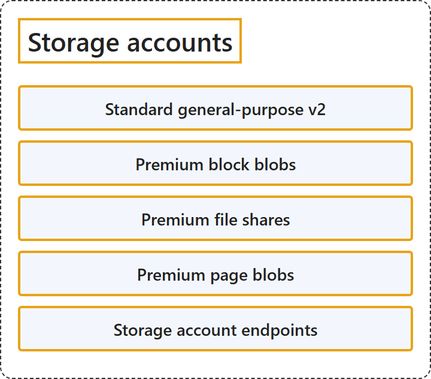

# 8.1 Storage accounts

## Classification

## Glossary

| Term | Definition | 中文翻译 | Source |
|---|---|---|---|
| **Standard general-purpose v2** 标准常规用途 v2 | "**Standard storage account type** for **blobs, file shares, queues, and tables**. Recommended for **most scenarios** that use Azure Storage." | **标准存储帐户类型**，用于 **Blob、文件共享、队列和表**。推荐用于使用 Azure 存储的**大多数场景**。 | [Microsoft, 2026, "Types of storage accounts" section, table row 1](https://learn.microsoft.com/en-us/azure/storage/common/storage-account-overview#:~:text=Standard%20storage%20account%20type%20for%20blobs%2C%20file%20shares%2C%20queues%2C%20and%20tables) |
| **Premium block blobs** 高级块 Blob | "**Premium storage account type** for **block blobs and append blobs**. Recommended for scenarios with **high transaction rates** or that use smaller objects or require consistently low storage latency." | **高级存储帐户类型**，用于**块 Blob 和追加 Blob**。推荐用于**事务率高**、使用较小对象或需要持续低存储延迟的场景。 | [Microsoft, 2026, "Types of storage accounts" section, table row 2](https://learn.microsoft.com/en-us/azure/storage/common/storage-account-overview#:~:text=Premium%20storage%20account%20type%20for%20block%20blobs%20and%20append%20blobs) |
| **Premium file shares** 高级文件共享 | "**Premium storage account type** for **file shares only**. Recommended for **enterprise or high-performance scale applications**." | **高级存储帐户类型**，**仅用于文件共享**。推荐用于**企业级或高性能规模的应用程序**。 | [Microsoft, 2026, "Types of storage accounts" section, table row 3](https://learn.microsoft.com/en-us/azure/storage/common/storage-account-overview#:~:text=Premium%20storage%20account%20type%20for%20file%20shares%20only) |
| **Premium page blobs** 高级页 Blob | "**Premium storage account type** for **page blobs only**." | **高级存储帐户类型**，**仅用于页 Blob**。 | [Microsoft, 2026, "Types of storage accounts" section, table row 4](https://learn.microsoft.com/en-us/azure/storage/common/storage-account-overview#:~:text=Premium%20storage%20account%20type%20for%20page%20blobs%20only) |
| **Storage account endpoints** 存储帐户终结点 | "Every object that you store in Azure Storage has a **URL address that includes your unique account name**. The combination of the **account name and the service endpoint** forms the **endpoints for your storage account**." | 你存储在 Azure 存储中的每个对象都有一个**包含唯一帐户名的 URL 地址**。**帐户名和服务终结点**的组合构成**存储帐户的终结点**。 | [Microsoft, 2026, "Storage account endpoints" section, para. 1](https://learn.microsoft.com/en-us/azure/storage/common/storage-account-overview#:~:text=Every%20object%20that%20you%20store%20in%20Azure%20Storage%20has%20a%20URL%20address) |

## References

- Microsoft. (2026, October 16). *Overview of storage accounts*. Microsoft Learn. https://learn.microsoft.com/en-us/azure/storage/common/storage-account-overview
