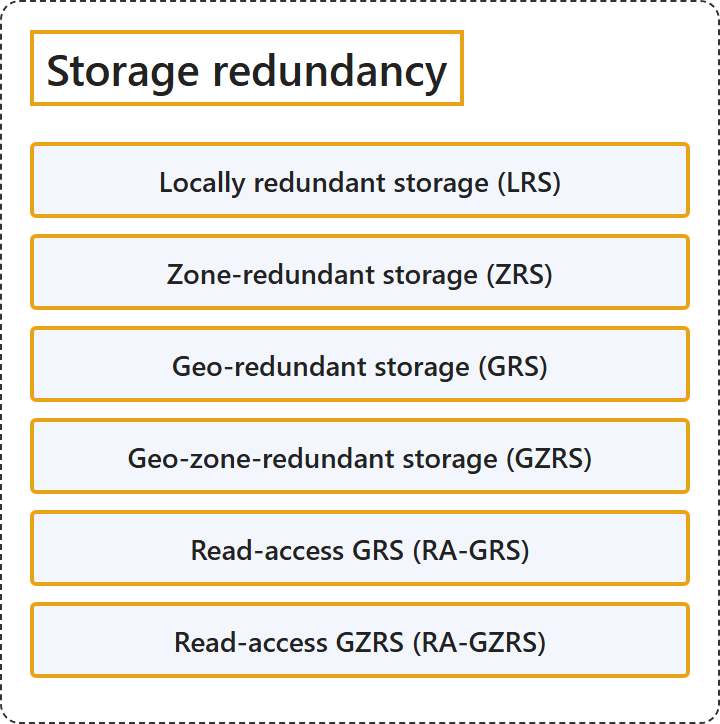

# 8.2 Storage redundancy

## Classification

## Glossary

| Term | Definition | 中文翻译 | Source |
|---|---|---|---|
| **Locally redundant storage (LRS)** 本地冗余存储（LRS） | "**Locally redundant storage (LRS)** replicates the data within your storage accounts to a **single physical datacenter** located in the **primary region** of your choice." | **本地冗余存储 (LRS)** 把存储帐户中的数据复制到**单个物理数据中心**，该数据中心位于你选择的**主要区域**。 | [Microsoft, 2026, "Redundancy in the primary region" section, list item 1](https://learn.microsoft.com/en-us/azure/storage/common/storage-redundancy#:~:text=replicates%20the%20data%20within%20your%20storage%20accounts%20to%20a%20single%20physical%20datacenter) |
| **Zone-redundant storage (ZRS)** 区域冗余存储（ZRS） | "**Zone-redundant storage (ZRS)** copies your data synchronously across **three or more Azure availability zones** in the **primary region**." | **区域冗余存储 (ZRS)** 把数据同步复制到**三个或更多 Azure 可用区**，这些可用区位于**主要区域**。 | [Microsoft, 2026, "Redundancy in the primary region" section, list item 2](https://learn.microsoft.com/en-us/azure/storage/common/storage-redundancy#:~:text=copies%20your%20data%20synchronously%20across%20three%20or%20more%20Azure%20availability%20zones%20in%20the%20primary%20region.%20For) |
| **Geo-redundant storage (GRS)** 异地冗余存储（GRS） | "**Geo-redundant storage (GRS)** copies your data synchronously within one or more Azure availability zones in the primary region **by using LRS**. It then **copies your data asynchronously to the secondary region**." | **异地冗余存储 (GRS)** 在主要区域的一个或多个 Azure 可用区内**使用 LRS** 同步复制数据，然后**把数据异步复制到次要区域**。 | [Microsoft, 2026, "Redundancy in a secondary region" section, list item 1](https://learn.microsoft.com/en-us/azure/storage/common/storage-redundancy#:~:text=copies%20your%20data%20synchronously%20within%20one%20or%20more%20Azure%20availability%20zones%20in%20the%20primary%20region%20by%20using%20LRS) |
| **Geo-zone-redundant storage (GZRS)** 异地区域冗余存储（GZRS） | "**Geo-zone-redundant storage (GZRS)** copies your data synchronously across three or more Azure availability zones in the primary region **by using ZRS**. It then **copies your data asynchronously to the secondary region**." | **异地区域冗余存储 (GZRS)** 在主要区域的三个或更多 Azure 可用区之间**使用 ZRS** 同步复制数据，然后**把数据异步复制到次要区域**。 | [Microsoft, 2026, "Redundancy in a secondary region" section, list item 2](https://learn.microsoft.com/en-us/azure/storage/common/storage-redundancy#:~:text=copies%20your%20data%20synchronously%20across%20three%20or%20more%20Azure%20availability%20zones%20in%20the%20primary%20region%20by%20using%20ZRS) |
| **Read-access GRS (RA-GRS)** 读取访问异地冗余存储（RA-GRS） | "**Read-access geo-redundant storage (RA-GRS)** or read-access geo-zone-redundant storage (RA-GZRS) configurations **permit read access to the secondary region**." | **读取访问异地冗余存储 (RA-GRS)** 或读取访问异地区域冗余存储（RA-GZRS）配置**允许对次要区域进行读取访问**。 | [Microsoft, 2026, "Read access to data in the secondary region" section, para. 2](https://learn.microsoft.com/en-us/azure/storage/common/storage-redundancy#:~:text=configurations%20permit%20read%20access%20to%20the%20secondary%20region) |
| **Read-access GZRS (RA-GZRS)** 读取访问异地区域冗余存储（RA-GZRS） | "Read-access geo-redundant storage (RA-GRS) or **read-access geo-zone-redundant storage (RA-GZRS)** configurations **permit read access to the secondary region**." | 读取访问异地冗余存储（RA-GRS）或**读取访问异地区域冗余存储 (RA-GZRS)** 配置**允许对次要区域进行读取访问**。 | [Microsoft, 2026, "Read access to data in the secondary region" section, para. 2](https://learn.microsoft.com/en-us/azure/storage/common/storage-redundancy#:~:text=configurations%20permit%20read%20access%20to%20the%20secondary%20region) |

## References

- Microsoft. (2026, August 15). *Azure Storage redundancy*. Microsoft Learn. https://learn.microsoft.com/en-us/azure/storage/common/storage-redundancy
