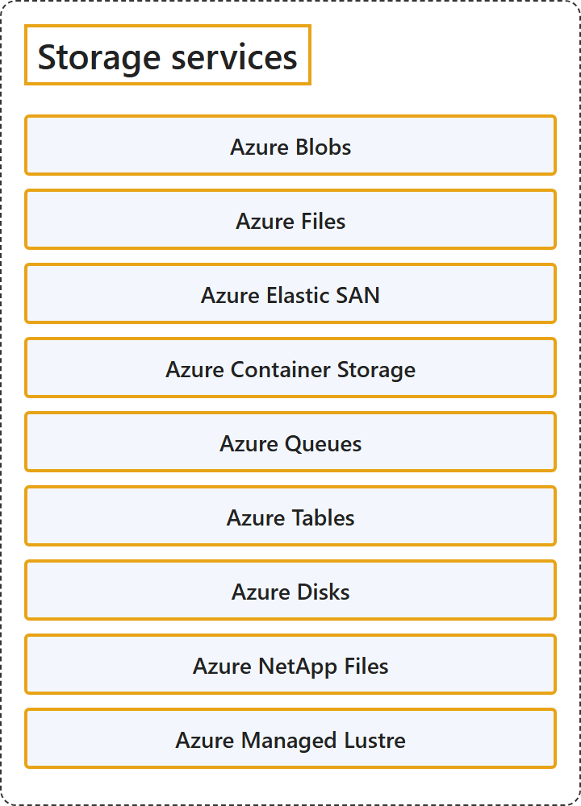

# 8.3 Storage Services

## Classification

## Glossary

| Term | Definition | 中文翻译 | Source |
|---|---|---|---|
| **Azure Blobs** Azure Blob | "Allows **unstructured data** to be **stored and accessed at a massive scale** in block blobs. Also supports **Azure Data Lake Storage** for enterprise big data analytics solutions." | 允许**非结构化数据**以块 Blob 的形式**大规模存储和访问**。还支持 **Azure Data Lake Storage**，用于企业大数据分析解决方案。 | [Microsoft, 2026, "Review options for storing data in Azure" section, table row 3](https://learn.microsoft.com/en-us/azure/storage/common/storage-introduction#:~:text=Allows%20unstructured%20data%20to%20be%20stored%20and%20accessed%20at%20a%20massive%20scale) |
| **Azure Files** Azure 文件 | "Offers **fully managed cloud file shares** that you can **access from anywhere** via the industry standard Server Message Block (SMB) protocol, Network File System (NFS) protocol, and Azure Files REST API." | 提供**完全托管的云文件共享**，可以通过行业标准的服务器消息块（SMB）协议、网络文件系统（NFS）协议和 Azure Files REST API **从任何地方访问**。 | [Microsoft, 2026, "Review options for storing data in Azure" section, table row 1](https://learn.microsoft.com/en-us/azure/storage/common/storage-introduction#:~:text=Offers%20fully%20managed%20cloud%20file%20shares) |
| **Azure Elastic SAN** Azure 弹性 SAN | "Azure Elastic SAN is a **fully integrated solution** that **simplifies deploying, scaling, managing, and configuring a SAN**, while also offering built-in cloud capabilities like high availability." | Azure 弹性 SAN 是一种**完全集成的解决方案**，它**简化了 SAN 的部署、扩展、管理和配置**，同时提供高可用性等内置云功能。 | [Microsoft, 2026, "Review options for storing data in Azure" section, table row 4](https://learn.microsoft.com/en-us/azure/storage/common/storage-introduction#:~:text=Azure%20Elastic%20SAN%20is%20a%20fully%20integrated%20solution) |
| **Azure Container Storage** Azure 容器存储 | "Azure Container Storage is a **volume management, deployment, and orchestration service** that **integrates with Kubernetes** and is built natively for containers." | Azure 容器存储是一种**卷管理、部署和编排服务**，它**与 Kubernetes 集成**，并原生为容器构建。 | [Microsoft, 2026, "Review options for storing data in Azure" section, table row 6](https://learn.microsoft.com/en-us/azure/storage/common/storage-introduction#:~:text=Azure%20Container%20Storage%20is%20a%20volume%20management%2C%20deployment%2C%20and%20orchestration%20service) |
| **Azure Queues** Azure 队列 | "Allows for **asynchronous message queueing** between **application components**." | 支持**异步消息排队**，用于**应用程序组件**之间。 | [Microsoft, 2026, "Review options for storing data in Azure" section, table row 7](https://learn.microsoft.com/en-us/azure/storage/common/storage-introduction#:~:text=Allows%20for%20asynchronous%20message%20queueing) |
| **Azure Tables** Azure 表 | "Allows you to **store structured NoSQL data** in the cloud, providing a **key/attribute store with a schemaless design**." | 允许你在云中**存储结构化的 NoSQL 数据**，提供一种**采用无架构设计的键/属性存储**。 | [Microsoft, 2026, "Review options for storing data in Azure" section, table row 8](https://learn.microsoft.com/en-us/azure/storage/common/storage-introduction#:~:text=Allows%20you%20to%20store%20structured%20NoSQL%20data%20in%20the%20cloud) |
| **Azure Disks** Azure 磁盘 | "Allows data to be **persistently stored and accessed** from an **attached virtual hard disk**." | 允许数据被**持久存储和访问**，访问来源是**附加的虚拟硬盘**。 | [Microsoft, 2026, "Review options for storing data in Azure" section, table row 5](https://learn.microsoft.com/en-us/azure/storage/common/storage-introduction#:~:text=Allows%20data%20to%20be%20persistently%20stored%20and%20accessed%20from%20an%20attached%20virtual%20hard%20disk) |
| **Azure NetApp Files** Azure NetApp 文件 | "Offers a **fully managed, highly available, enterprise-grade NAS service** that can handle the **most demanding, high-performance, low-latency workloads** requiring advanced data management capabilities." | 提供一种**完全托管、高可用的企业级 NAS 服务**，能够处理需要高级数据管理功能的**要求最苛刻的高性能、低延迟工作负载**。 | [Microsoft, 2026, "Review options for storing data in Azure" section, table row 2](https://learn.microsoft.com/en-us/azure/storage/common/storage-introduction#:~:text=Offers%20a%20fully%20managed%2C%20highly%20available%2C%20enterprise-grade%20NAS%20service) |
| **Azure Managed Lustre** Azure 托管 Lustre | "Offers a **fully managed, pay-as-you-go file system** for **high-performance computing (HPC) and AI workloads**." | 提供**完全托管、即用即付的文件系统**，用于**高性能计算 (HPC) 和 AI 工作负载**。 | [Microsoft, 2026, "Review options for storing data in Azure" section, table row 9](https://learn.microsoft.com/en-us/azure/storage/common/storage-introduction#:~:text=Offers%20a%20fully%20managed%2C%20pay-as-you-go%20file%20system) |

## References

- Microsoft. (2026, August 11). *Introduction to Azure Storage*. Microsoft Learn. https://learn.microsoft.com/en-us/azure/storage/common/storage-introduction
