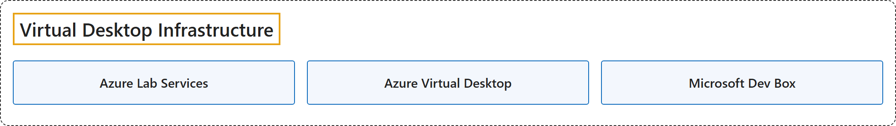

# 19. Virtual Desktop Infrastructure

## Classification

## Glossary

| Term | Definition | 中文翻译 | Source |
|---|---|---|---|
| **Virtual Desktop Infrastructure** 虚拟桌面基础结构 | — | — | [Microsoft, n.d., "Browse Azure products" section, Virtual Desktop Infrastructure](https://learn.microsoft.com/en-us/azure/?product=azure-virtual-desktop) |
| **[Azure Lab Services](azure-lab-services.md)** Azure Lab Services | "Set up **virtual labs** for classes, training, hackathons, and other related scenarios" | 设置**虚拟实验室**，用于课堂、培训、黑客马拉松及其他相关场景。 | [Microsoft, n.d., "Browse Azure products" section, Virtual Desktop Infrastructure, item 1](https://learn.microsoft.com/en-us/azure/#:~:text=Set%20up%20virtual%20labs%20for%20classes%2C%20training%2C%20hackathons%2C%20and%20other%20related%20scenarios) |
| **Azure Virtual Desktop** Azure Virtual Desktop | Defined in [4.4.4 Azure Virtual Desktop](../compute/specialty-workloads.md). | 定义见 4.4.4 Azure Virtual Desktop。 | — |
| **[Microsoft Dev Box](microsoft-dev-box.md)** Microsoft Dev Box | "Streamline development with **secure, ready-to-code workstations in the cloud**" | 用**云中安全、即可编码的工作站**简化开发。 | [Microsoft, n.d., "Browse Azure products" section, Virtual Desktop Infrastructure, item 3](https://learn.microsoft.com/en-us/azure/#:~:text=Streamline%20development%20with%20secure%2C%20ready-to-code%20workstations%20in%20the%20cloud) |

## Coverage

None of the certifications listed in the folder README names this topic's own products in its skills measured.

## References

- Microsoft. (n.d.). *Azure documentation*. Microsoft Learn. Retrieved October 25, 2026, from https://learn.microsoft.com/en-us/azure/
