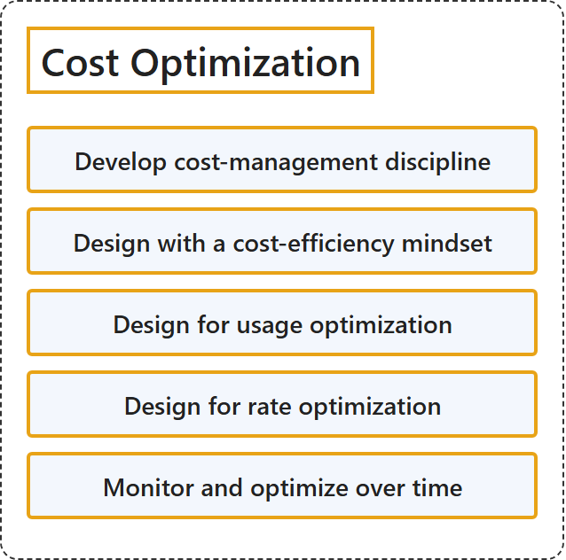

# 25.3 Cost Optimization

## Classification

## Glossary

| Term | Definition | 中文解释 | Source |
|---|---|---|---|
| **Cost Optimization** 成本优化 | "Architecture design is always **driven by business goals** and must **factor in return on investment (ROI) and financial constraints**." | 架构设计始终**由业务目标驱动**，并且必须**考虑投资回报率 (ROI) 和财务约束**。 | [Microsoft, 2025, para. 1](https://learn.microsoft.com/en-us/azure/well-architected/cost-optimization/principles#:~:text=Architecture%20design%20is%20always%20driven%20by) |
| **Develop cost-management discipline** 制定成本管理规则 | "Build a **team culture** that has **awareness of budget, expenses, reporting, and cost tracking**." | 建立一种**团队文化**，**对预算、支出、报告和成本跟踪有清楚的意识**。 | [Microsoft, 2025, "Develop cost-management discipline" section, para. 1](https://learn.microsoft.com/en-us/azure/well-architected/cost-optimization/principles#:~:text=Build%20a%20team%20culture%20that%20has) |
| **Design with a cost-efficiency mindset** 在设计中采用成本效益思维模式 | "**Spend only on what you need** to achieve the **highest return on your investments**." | **只在需要的地方花钱**，以获得**最高的投资回报**。 | [Microsoft, 2025, "Design with a cost-efficiency mindset" section, para. 1](https://learn.microsoft.com/en-us/azure/well-architected/cost-optimization/principles#:~:text=Spend%20only%20on%20what%20you%20need) |
| **Design for usage optimization** 使用优化设计 | "**Maximize the use of resources and operations**. Apply them to the **negotiated functional and nonfunctional requirements** of the solution." | **最大限度地利用资源和运营**。把它们用于解决方案**商定的功能性和非功能性要求**。 | [Microsoft, 2025, "Design for usage optimization" section, para. 1](https://learn.microsoft.com/en-us/azure/well-architected/cost-optimization/principles#:~:text=Maximize%20the%20use%20of%20resources%20and) |
| **Design for rate optimization** 费率优化设计 | "**Increase efficiency** without **redesigning, renegotiating, or sacrificing** functional or nonfunctional requirements." | **提高效率**，同时不**重新设计、重新谈判或牺牲**功能性或非功能性要求。 | [Microsoft, 2025, "Design for rate optimization" section, para. 1](https://learn.microsoft.com/en-us/azure/well-architected/cost-optimization/principles#:~:text=Increase%20efficiency%20without%20redesigning%2C%20renegotiating%2C%20or) |
| **Monitor and optimize over time** 随着时间的推移进行监视和优化 | "Continuously **right-size investment** as your workload **evolves with the ecosystem**." | 持续**合理调整投资规模**，因为工作负载会**随生态系统一起演变**。 | [Microsoft, 2025, "Monitor and optimize over time" section, para. 1](https://learn.microsoft.com/en-us/azure/well-architected/cost-optimization/principles#:~:text=Continuously%20right%2Dsize%20investment%20as%20your%20workload) |

## References

- Microsoft. (2025, May 29). *Cost Optimization design principles*. Microsoft Azure Well-Architected Framework. Microsoft Learn. https://learn.microsoft.com/en-us/azure/well-architected/cost-optimization/principles
