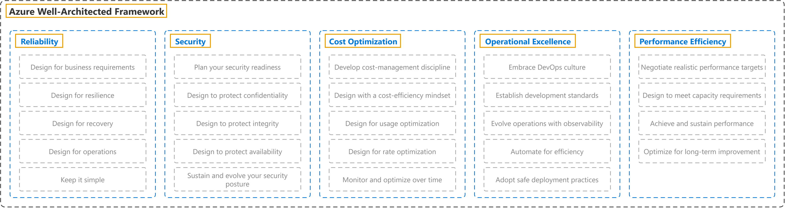

# 17. Azure Well-Architected Framework

## Classification

## Glossary

| Term | Definition | 中文翻译 | Source |
|---|---|---|---|
| **Azure Well-Architected Framework** Azure 架构良好的框架 | "The **Azure Well-Architected Framework** is a set of **quality-driven tenets, architectural decision points, and review tools** intended to help solution architects **build a technical foundation for their workloads**." | **Azure 架构良好的框架**是一套**以质量为导向的原则、架构决策点和评审工具**，帮助解决方案架构师**为工作负载打好技术基础**。 | [Microsoft, 2026, para. 1](https://learn.microsoft.com/en-us/azure/well-architected/#:~:text=The%20Azure%20Well-Architected%20Framework%20is%20a%20set) |
| **[Reliability](reliability.md)** 可靠性 | "Apply reliability guidance to your architecture to make your workload **resilient to malfunction** and to ensure that it **returns to a fully functioning state after a failure** occurs." | 在架构中应用可靠性指导，让工作负载**能抵御故障**，并确保它**在故障发生后恢复到完全正常的状态**。 | [Microsoft, 2025d, para. 1](https://learn.microsoft.com/en-us/azure/well-architected/reliability/#:~:text=Apply%20reliability%20guidance%20to%20your%20architecture) |
| **[Security](security.md)** 安全性 | "Apply security guidance to your architecture to help ensure the **confidentiality, integrity, and availability** of your data and systems." | 在架构中应用安全指导，帮助确保数据和系统的**机密性、完整性和可用性**。 | [Microsoft, 2025e, para. 1](https://learn.microsoft.com/en-us/azure/well-architected/security/#:~:text=Apply%20security%20guidance%20to%20your%20architecture) |
| **[Cost Optimization](cost-optimization.md)** 成本优化 | "Apply cost optimization guidance in your architecture to **sustain and improve your return on investment (ROI)**." | 在架构中应用成本优化指导，以**保持并提高投资回报率（ROI）**。 | [Microsoft, 2025a, para. 1](https://learn.microsoft.com/en-us/azure/well-architected/cost-optimization/#:~:text=Apply%20cost%20optimization%20guidance%20in%20your%20architecture) |
| **[Operational Excellence](operational-excellence.md)** 卓越运营 | "Apply operational excellence guidance to your workload to ensure **workload quality** through **standardized processes and team cohesion**." | 在工作负载中应用卓越运营指导，通过**标准化流程和团队协作**来确保**工作负载质量**。 | [Microsoft, 2025b, para. 1](https://learn.microsoft.com/en-us/azure/well-architected/operational-excellence/#:~:text=Apply%20operational%20excellence%20guidance%20to%20your%20workload) |
| **[Performance Efficiency](performance-efficiency.md)** 性能效率 | "Apply performance efficiency guidance to your architecture to **efficiently meet workload demands**." | 在架构中应用性能效率指导，以**高效地满足工作负载的需求**。 | [Microsoft, 2025c, para. 1](https://learn.microsoft.com/en-us/azure/well-architected/performance-efficiency/#:~:text=Apply%20performance%20efficiency%20guidance%20to%20your%20architecture) |

## Coverage

| Certification | Skill area |
|---|---|
| AZ-305 Designing Microsoft Azure Infrastructure Solutions | [Design business continuity solutions (15–20%)](https://learn.microsoft.com/en-us/credentials/certifications/resources/study-guides/az-305#design-business-continuity-solutions-1520) [Design infrastructure solutions (30–35%)](https://learn.microsoft.com/en-us/credentials/certifications/resources/study-guides/az-305#design-infrastructure-solutions-3035) |

**CST8911 Introduction to Cloud Computing**

| Week | Group | Terms in the course | Source |
|---|---|---|---|
| 7 | Azure Well-Architected Framework | pillar | Lecture 6: slide 3 |
|  | Reliability | reliability | Lecture 6: slide 3 |
|  | Cost Optimization | cost optimization | Lecture 6: slide 3 |
|  | Operational Excellence | operational excellence | Lecture 6: slide 3 |
|  | Performance Efficiency | performance efficiency | Lecture 6: slide 3 |

**CST8912 Cloud Solution Architecture**

| Week | Group | Terms in the course | Source |
|---|---|---|---|
| 1 | Azure Well-Architected Framework | Azure Well-Architected Framework (WAF) five pillars | Introduction to Cloud Solution Architecture: slide 4 |
| 2 | Azure Well-Architected Framework | design principles | Design Cloud Compute Solution: slide 16 |
| 6 | Azure Well-Architected Framework | well-architected cloud | Week 6 – Cloud Architecture best practices: slide 28 |
|  | Reliability | reliability | Week 6 – Cloud Architecture best practices: slide 28 |
|  | Security | security | Week 6 – Cloud Architecture best practices: slide 28 |
|  | Cost Optimization | cost optimization | Week 6 – Cloud Architecture best practices: slide 25 |
|  | Operational Excellence | operational excellence | Week 6 – Cloud Architecture best practices: slide 28 |
|  | Performance Efficiency | performance efficiency | Week 6 – Cloud Architecture best practices: slide 28 |

**CST8913 Cloud Migration**

| Week | Group | Terms in the course | Source |
|---|---|---|---|
| 2 | Azure Well-Architected Framework | Well-Architected Framework (WAF) the five WAF pillars | Reading: Cloud Adoption Framework (Unit 1) |

## References

- Microsoft. (2025a). *Cost Optimization quick links*. Microsoft Azure Well-Architected Framework. https://learn.microsoft.com/en-us/azure/well-architected/cost-optimization/
- Microsoft. (2025b). *Operational Excellence quick links*. Microsoft Azure Well-Architected Framework. https://learn.microsoft.com/en-us/azure/well-architected/operational-excellence/
- Microsoft. (2025c). *Performance Efficiency quick links*. Microsoft Azure Well-Architected Framework. https://learn.microsoft.com/en-us/azure/well-architected/performance-efficiency/
- Microsoft. (2025d). *Reliability quick links*. Microsoft Azure Well-Architected Framework. https://learn.microsoft.com/en-us/azure/well-architected/reliability/
- Microsoft. (2025e). *Security quick links*. Microsoft Azure Well-Architected Framework. https://learn.microsoft.com/en-us/azure/well-architected/security/
- Microsoft. (2026). *Azure Well-Architected Framework*. Microsoft Learn. https://learn.microsoft.com/en-us/azure/well-architected/
