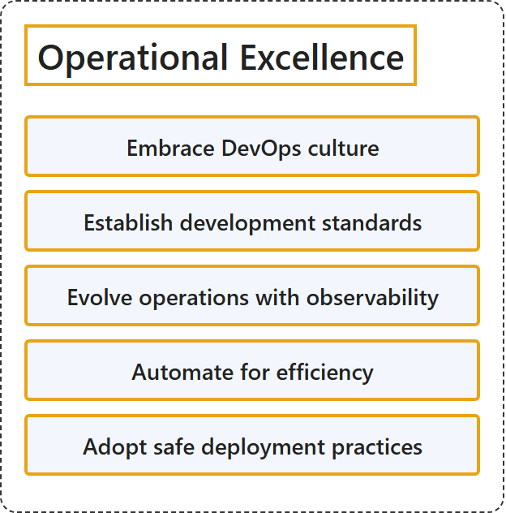

# 25.4 Operational Excellence

## Classification

## Glossary

| Term | Definition | 中文解释 | Source |
|---|---|---|---|
| **Operational Excellence** 卓越运营 | "At the core of the Operational Excellence pillar are **DevOps practices** that **ensure workload quality through standardized workflows and team cohesion**." | 卓越运营支柱的核心是 **DevOps 做法**，它们**通过标准化工作流和团队凝聚力确保工作负载质量**。 | [Microsoft, 2025, para. 1](https://learn.microsoft.com/en-us/azure/well-architected/operational-excellence/principles#:~:text=At%20the%20core%20of%20the%20Operational) |
| **Embrace DevOps culture** 拥抱 DevOps 文化 | "Empower development and operations teams to **continuously improve their system design and processes** by working together with a mindset of **collaboration, shared responsibility, and ownership**." | 让开发和运营团队**持续改进其系统设计和流程**，方法是带着**协作、共担责任和主人翁**的思维方式一起工作。 | [Microsoft, 2025, "Embrace DevOps culture" section, para. 1](https://learn.microsoft.com/en-us/azure/well-architected/operational-excellence/principles#:~:text=Empower%20development%20and%20operations%20teams%20to) |
| **Establish development standards** 建立开发标准 | "**Optimize productivity** by **standardizing development practices**, **enforcing quality gates**, and **tracking progress and success** through systematic change management." | **优化生产力**，方法是**标准化开发做法**、**强制执行质量门禁**，并通过系统化的变更管理**跟踪进度和成效**。 | [Microsoft, 2025, "Establish development standards" section, para. 1](https://learn.microsoft.com/en-us/azure/well-architected/operational-excellence/principles#:~:text=Optimize%20productivity%20by%20standardizing%20development%20practices) |
| **Evolve operations with observability** 通过可观测性改进操作 | "**Gain visibility into the system**, **derive insight**, and **make data-driven decisions**." | **获得对系统的可见性**、**得出见解**，并**做出数据驱动的决策**。 | [Microsoft, 2025, "Evolve operations with observability" section, para. 1](https://learn.microsoft.com/en-us/azure/well-architected/operational-excellence/principles#:~:text=Gain%20visibility%20into%20the%20system%2C%20derive) |
| **Automate for efficiency** 自动执行以提高效率 | "**Replace repetitive manual tasks with software automation** that completes them quicker, with **greater consistency and accuracy**, and **reduces risks**." | **用软件自动化取代重复的手动任务**，让任务完成得更快、**更一致、更准确**，并**降低风险**。 | [Microsoft, 2025, "Automate for efficiency" section, para. 1](https://learn.microsoft.com/en-us/azure/well-architected/operational-excellence/principles#:~:text=Replace%20repetitive%20manual%20tasks%20with%20software) |
| **Adopt safe deployment practices** 采用安全部署做法 | "Achieve **consistency in deployments** by using **guardrails** that **reduce the effect of errors and unexpected conditions**." | 实现**部署的一致性**，方法是使用**防护措施**来**减少错误和意外情况的影响**。 | [Microsoft, 2025, "Adopt safe deployment practices" section, para. 1](https://learn.microsoft.com/en-us/azure/well-architected/operational-excellence/principles#:~:text=Achieve%20consistency%20in%20deployments%20by%20using) |

## References

- Microsoft. (2025, May 6). *Operational Excellence design principles*. Microsoft Azure Well-Architected Framework. Microsoft Learn. https://learn.microsoft.com/en-us/azure/well-architected/operational-excellence/principles
