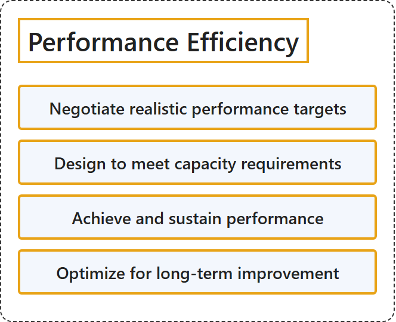

# 25.5 Performance Efficiency

## Classification

## Glossary

| Term | Definition | 中文解释 | Source |
|---|---|---|---|
| **Performance Efficiency** 性能效率 | "Performance efficiency is the **ability of a workload to adapt to changing demands** by **scaling up to meet increased load** without impacting user experience, and **scaling down to conserve resources** during low demand." | 性能效率是**工作负载适应不断变化的需求的能力**：**向上扩展以满足增加的负载**而不影响用户体验，在需求低时**向下缩减以节省资源**。 | [Microsoft, 2025, para. 2](https://learn.microsoft.com/en-us/azure/well-architected/performance-efficiency/principles#:~:text=Performance%20efficiency%20is%20the%20ability%20of) |
| **Negotiate realistic performance targets** 协商现实性能目标 | "The **intended user experience is defined**, and there's a strategy to **develop a benchmark** and **measure targets** against the pre-established business requirements." | **预期的用户体验已经定义**，并且有策略来**制定基准**，并对照预先确定的业务要求**衡量目标**。 | [Microsoft, 2025, "Negotiate realistic performance targets" section, para. 1](https://learn.microsoft.com/en-us/azure/well-architected/performance-efficiency/principles#:~:text=The%20intended%20user%20experience%20is%20defined) |
| **Design to meet capacity requirements** 设计以满足产能要求 | "Provide **enough supply** to address **anticipated demand**." | 提供**足够的供给**来应对**预期的需求**。 | [Microsoft, 2025, "Design to meet capacity requirements" section, para. 1](https://learn.microsoft.com/en-us/azure/well-architected/performance-efficiency/principles#:~:text=Provide%20enough%20supply%20to%20address%20anticipated) |
| **Achieve and sustain performance** 实现和保持性能 | "**Protect against performance degradation** while the system is in use and as it evolves." | 在系统使用和演进的过程中**防止性能下降**。 | [Microsoft, 2025, "Achieve and sustain performance" section, para. 1](https://learn.microsoft.com/en-us/azure/well-architected/performance-efficiency/principles#:~:text=Protect%20against%20performance%20degradation%20while%20the) |
| **Optimize for long-term improvement** 针对长期改进进行优化 | "**Improve system efficiency** within the **defined performance targets** to **increase workload value**." | **提高系统效率**，并保持在**既定的性能目标**之内，以**增加工作负载的价值**。 | [Microsoft, 2025, "Optimize for long-term improvement" section, para. 1](https://learn.microsoft.com/en-us/azure/well-architected/performance-efficiency/principles#:~:text=Improve%20system%20efficiency%20within%20the%20defined) |

## References

- Microsoft. (2025, August 1). *Performance Efficiency design principles*. Microsoft Azure Well-Architected Framework. Microsoft Learn. https://learn.microsoft.com/en-us/azure/well-architected/performance-efficiency/principles
