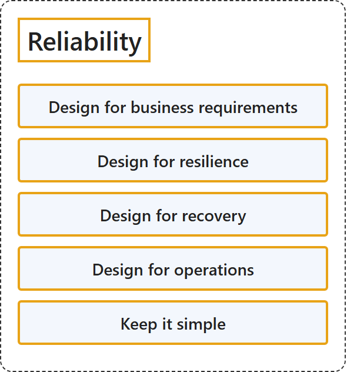

# 25.1 Reliability

## Classification

## Glossary

| Term | Definition | 中文解释 | Source |
|---|---|---|---|
| **Reliability** 可靠性 | "A **reliable workload** must **survive those events** and **continue to consistently provide its intended functionality**." | **可靠的工作负载**必须**挺过这些事件**，并**持续稳定地提供其预期功能**。 | [Microsoft, 2025, para. 1](https://learn.microsoft.com/en-us/azure/well-architected/reliability/principles#:~:text=A%20reliable%20workload%20must%20survive%20those) |
| **Design for business requirements** 为满足业务要求进行设计 | "Get clarity on the workload's **scope**, **user growth**, and most importantly **promises the team has made** to external customers and internal stakeholders." | 明确工作负载的**范围**、**用户增长**，以及最重要的**团队已作出的承诺**，即对外部客户和内部利益干系人的承诺。 | [Microsoft, 2025, "Design for business requirements" section, para. 1](https://learn.microsoft.com/en-us/azure/well-architected/reliability/principles#:~:text=Get%20clarity%20on%20the%20workload%27s%20scope) |
| **Design for resilience** 为复原力而设计 | "The workload must **continue to operate** with **full or reduced functionality**." | 工作负载必须**继续运行**，功能可以是**完整的或降低的**。 | [Microsoft, 2025, "Design for resilience" section, para. 1](https://learn.microsoft.com/en-us/azure/well-architected/reliability/principles#:~:text=The%20workload%20must%20continue%20to%20operate) |
| **Design for recovery** 为恢复进行设计 | "The workload must be able to **anticipate and recover from most failures**, of all magnitudes, with **minimal disruption** to the user experience and business objectives." | 工作负载必须能够**预测大多数故障并从中恢复**，无论故障规模大小，并且对用户体验和业务目标造成的**干扰最小**。 | [Microsoft, 2025, "Design for recovery" section, para. 1](https://learn.microsoft.com/en-us/azure/well-architected/reliability/principles#:~:text=The%20workload%20must%20be%20able%20to) |
| **Design for operations** 运营设计 | "**Shift left** in operations to **anticipate failure conditions**." | 在运营中**左移**，以**预测故障情况**。 | [Microsoft, 2025, "Design for operations" section, para. 1](https://learn.microsoft.com/en-us/azure/well-architected/reliability/principles#:~:text=Shift%20left%20in%20operations%20to%20anticipate) |
| **Keep it simple** 保持简单 | "**Avoid overengineering** the architecture design, application code, and operations." | **避免过度设计**架构、应用程序代码和运营。 | [Microsoft, 2025, "Keep it simple" section, para. 1](https://learn.microsoft.com/en-us/azure/well-architected/reliability/principles#:~:text=Avoid%20overengineering%20the%20architecture%20design%2C%20application) |

## References

- Microsoft. (2025, September 30). *Reliability design principles*. Microsoft Azure Well-Architected Framework. Microsoft Learn. https://learn.microsoft.com/en-us/azure/well-architected/reliability/principles
