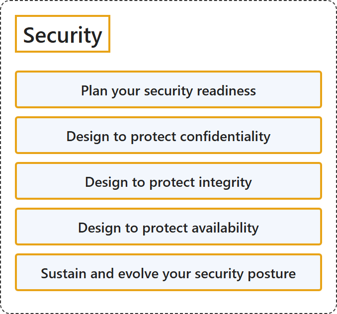

# 25.2 Security

## Classification

## Glossary

| Term | Definition | 中文解释 | Source |
|---|---|---|---|
| **Security** 安全性 | "A **secure workload** is **resilient to attacks** and incorporates the interrelated security **principles of confidentiality, integrity, and availability** (also known as the CIA triad) in addition to meeting business goals." | **安全的工作负载**除了满足业务目标，还能**抵御攻击**，并纳入相互关联的**机密性、完整性和可用性安全原则**（也称为 CIA 三元组）。 | [Microsoft, 2023, para. 1](https://learn.microsoft.com/en-us/azure/well-architected/security/principles#:~:text=A%20secure%20workload%20is%20resilient%20to) |
| **Plan your security readiness** 规划安全就绪情况 | "Strive to **adopt and implement security practices** in architectural design decisions and operations with **minimal friction**." | 力求在架构设计决策和运营中**采用并实施安全做法**，同时**把摩擦降到最低**。 | [Microsoft, 2023, "Plan your security readiness" section, para. 1](https://learn.microsoft.com/en-us/azure/well-architected/security/principles#:~:text=Strive%20to%20adopt%20and%20implement%20security) |
| **Design to protect confidentiality** 保护机密性的设计 | "**Prevent exposure** to privacy, regulatory, application, and proprietary information through **access restrictions and obfuscation techniques**." | **防止暴露**隐私、法规、应用程序和专有信息，手段是**访问限制和混淆技术**。 | [Microsoft, 2023, "Design to protect confidentiality" section, para. 1](https://learn.microsoft.com/en-us/azure/well-architected/security/principles#:~:text=Prevent%20exposure%20to%20privacy%2C%20regulatory%2C%20application) |
| **Design to protect integrity** 保护完整性的设计 | "**Prevent corruption** of design, implementation, operations, and data to avoid disruptions that can stop the system from delivering its intended utility or cause it to operate outside the prescribed limits. The system should **provide information assurance** throughout the workload lifecycle." | **防止破坏**设计、实现、运营和数据，以免中断让系统无法提供预期效用，或让它在规定的限制之外运行。系统应在整个工作负载生命周期中**提供信息保障**。 | [Microsoft, 2023, "Design to protect integrity" section, para. 1](https://learn.microsoft.com/en-us/azure/well-architected/security/principles#:~:text=Prevent%20corruption%20of%20design%2C%20implementation%2C%20operations) |
| **Design to protect availability** 保护可用性的设计 | "**Prevent or minimize system and workload downtime and degradation** in the event of a security incident by using **strong security controls**. You must **maintain data integrity** during the incident and after the system recovers." | **防止或尽量减少系统和工作负载的停机与降级**，在发生安全事件时依靠**强有力的安全控制**做到这一点。在事件期间和系统恢复之后，都必须**保持数据完整性**。 | [Microsoft, 2023, "Design to protect availability" section, para. 1](https://learn.microsoft.com/en-us/azure/well-architected/security/principles#:~:text=Prevent%20or%20minimize%20system%20and%20workload) |
| **Sustain and evolve your security posture** 维持和改善安全状况 | "Incorporate **continuous improvement** and apply vigilance to **stay ahead of attackers** who are continuously evolving their attack strategies." | 引入**持续改进**并保持警惕，以**领先于攻击者**，他们的攻击策略在不断演变。 | [Microsoft, 2023, "Sustain and evolve your security posture" section, para. 1](https://learn.microsoft.com/en-us/azure/well-architected/security/principles#:~:text=Incorporate%20continuous%20improvement%20and%20apply%20vigilance) |

## References

- Microsoft. (2023, November 15). *Security design principles*. Microsoft Azure Well-Architected Framework. Microsoft Learn. https://learn.microsoft.com/en-us/azure/well-architected/security/principles
