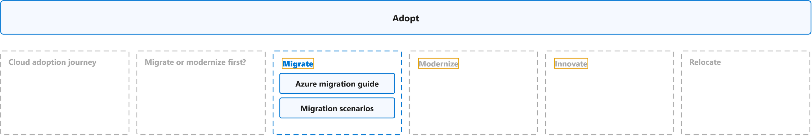
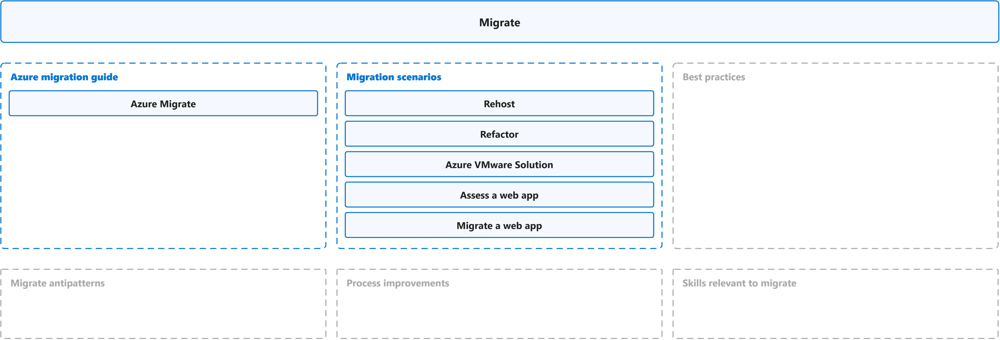
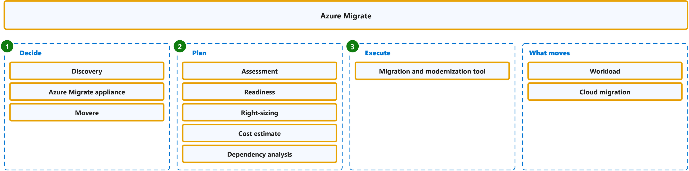
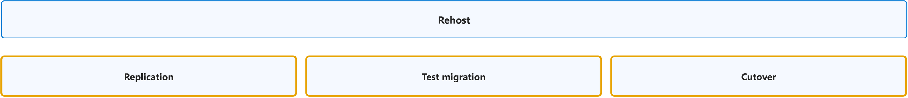
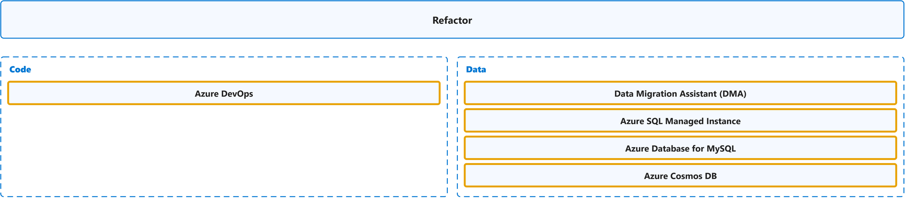
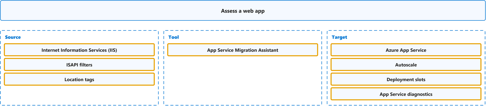

# Adopt

Study notes on [Cloud Adoption Framework, Adopt](https://github.com/MicrosoftDocs/cloud-adoption-framework/blob/a5351162040659171fbb4f5674ce36ac9259deb3/docs/adopt/index.md), which CST8913 Cloud Migration (Algonquin College, Fall 2026) uses in weeks 2, 4, 5 and 6. Each section links the official page it follows; a section the course has not covered yet is a placeholder. Start from the figure: the framed terms are the ones to learn, and the table below it defines them in the same order, each with a citation linked to the passage and a Chinese translation in which each key word has the same colour as in the English. The main verb of each sentence has a red wavy underline, in the English and in the Chinese.

## [Overview](https://github.com/MicrosoftDocs/cloud-adoption-framework/blob/a5351162040659171fbb4f5674ce36ac9259deb3/docs/adopt/index.md)

| Term | Definition | 中文翻译 | Source |
|---|---|---|---|
| **Migrate (CAF)** 迁移（CAF 阶段） | "**Migration** changes **where or how** a workload runs. **Modernization** changes the workload to achieve a better outcome. An **initiative** can do both." | **迁移**会改变工作负载的**运行位置或运行方式**。**现代化**会改变工作负载，以获得更好的结果。一项**举措**可以同时做到这两点。 | [Microsoft, n.d., "1.3 Modernization versus migration" section, para. 1](https://learn.microsoft.com/en-us/azure/cloud-adoption-framework/modernize/prepare-organization-cloud-modernization#13-modernization-versus-migration:~:text=Migration%20changes%20where%20or%20how%20a%20workload%20runs.%20Modernization%20changes) |
| **Modernize** 现代化 | "**Modernization** improves an **existing workload or workload component** to better meet current or future **business requirements**. It can change different parts of a workload, such as its **platform, application, data, or operating model**." | **现代化**会改进**现有工作负载或工作负载组件**，以更好地满足当前或未来的**业务需求**。它可以改变工作负载的不同部分，例如其**平台、应用程序、数据或运营模式**。 | [Microsoft, n.d., "1. What is modernization?" section, para. 1](https://learn.microsoft.com/en-us/azure/cloud-adoption-framework/modernize/prepare-organization-cloud-modernization#1-what-is-modernization:~:text=Modernization%20improves%20an%20existing%20workload%20or%20workload%20component%20to%20better) |
| **Innovate** 创新（现称云原生） | "A **cloud-native solution** creates **business value** by **building new workloads** or enhancing existing ones. Whether you're developing a new application or adding new features to an existing system, **cloud-native development** is a journey through planning, building, deploying, and optimizing your workloads." | **云原生解决方案**创造**业务价值**，方式是**构建新工作负载**或增强现有工作负载。无论你是在开发新应用程序，还是在为现有系统添加新功能，**云原生开发**都是一段贯穿规划、构建、部署和优化工作负载的旅程。 | [Microsoft, n.d., para. 1](https://learn.microsoft.com/en-us/azure/cloud-adoption-framework/cloud-native/plan-cloud-native-solutions#:~:text=A%20cloud%2Dnative%20solution%20creates%20business%20value%20by%20building%20new%20workloads) |

## Cloud adoption journey

To be added.

## Migrate or modernize first?

To be added.

## [Migrate](https://github.com/MicrosoftDocs/cloud-adoption-framework/blob/a5351162040659171fbb4f5674ce36ac9259deb3/docs/migrate/index.md)

### [Azure Migrate](https://learn.microsoft.com/en-us/azure/migrate/migrate-services-overview#migration-phases)

| Term | Definition | 中文翻译 | Source |
|---|---|---|---|
| **Azure Migrate** Azure Migrate 迁移中心 | "**Azure Migrate** is a service that helps you **decide on, plan, and execute** your migration to Azure. Azure Migrate helps you find the **best migration path**, assess for Azure readiness and cost of hosting workloads on Azure, and perform the migration with **minimal downtime and risk**." | **Azure Migrate** 是一项服务，可帮助你**决定、规划和执行**到 Azure 的迁移。Azure Migrate 可帮助你找到**最佳迁移路径**，评估 Azure 就绪性以及在 Azure 上托管工作负载的成本，并以**最短的停机时间和最低的风险**执行迁移。 | [Microsoft, n.d., para. 1](https://learn.microsoft.com/en-us/azure/migrate/migrate-services-overview#:~:text=Azure%20Migrate%20is%20a%20service%20that%20helps%20you%20decide%20on) |
| **discovery** 发现 | "The first step in a **migration journey** is to **identify your workloads**. This process of identification is called **discovery**." | **迁移之旅**的第一步是**识别你的工作负载**。这一识别过程称为**发现**。 | [Microsoft, n.d., "Decide" section, para. 1](https://learn.microsoft.com/en-us/azure/migrate/migrate-services-overview#decide:~:text=The%20first%20step%20in%20a%20migration%20journey%20is%20to) |
| **Azure Migrate appliance** Azure Migrate 设备（发现用虚拟机） | "The **Azure Migrate appliance** is a **virtual appliance** that can be deployed on a server in your datacenter. The appliance collects the **configuration and performance data** for your servers and **continually sends** it to the Azure Migrate service." | **Azure Migrate 设备**是一种**虚拟设备**，可部署在你数据中心的服务器上。该设备收集服务器的**配置和性能数据**，并**持续将其发送**到 Azure Migrate 服务。 | [Microsoft, n.d., "Decide" section, para. 2](https://learn.microsoft.com/en-us/azure/migrate/migrate-services-overview#decide:~:text=The%20Azure%20Migrate%20appliance%20is%20a%20virtual%20appliance%20that%20can) |
| **Movere** Movere（已退役的发现评估工具） | "Movere: The **Movere service** **retired** on March 1, 2024. Users should use **Azure Migrate** for the **discovery and assessment** of on-premises workloads." | Movere：**Movere 服务**已于 2024 年 3 月 1 日**停用**。用户应使用 **Azure Migrate** 来**发现和评估**本地工作负载。 | [Microsoft, n.d., "Update (April 2024)" section, bullet 1](https://learn.microsoft.com/en-us/azure/migrate/whats-new?view=migrate#update-april-2024:~:text=Movere%3A%20The%20Movere%20service%20retired%20on%20March%201) |
| **assessment** 评估报告 | "An **assessment** with the **Discovery and assessment tool** measures the **readiness** and estimates the **effect** of migrating on-premises servers to Azure." | **评估**（使用**发现和评估工具**进行）会衡量**就绪情况**，并估算将本地服务器迁移到 Azure 的**影响**。 | [Microsoft, n.d., "What's an assessment?" section, para. 1](https://learn.microsoft.com/en-us/azure/migrate/concepts-assessment-calculation?view=migrate-classic#whats-an-assessment:~:text=An%20assessment%20with%20the%20Discovery%20and%20assessment%20tool%20measures%20the) |
| **readiness** 就绪性（Azure 就绪度） | "**Azure readiness**: Assess whether **on-premises servers**, SQL servers, and **web apps** are **ready for migration** to Azure." | **Azure 就绪度**：评估**本地服务器**、SQL 服务器和 **Web 应用**是否已**准备好迁移**到 Azure。 | [Microsoft, n.d., "Plan" section, bullet 1](https://learn.microsoft.com/en-us/azure/migrate/migrate-services-overview#plan:~:text=Azure%20readiness%3A%20Assess%20whether%20on%2Dpremises%20servers%2C%20SQL%20servers) |
| **sizing** 规格估算（合理定型） | "**Right-sizing**: Estimate the **size of Azure virtual machines (VMs**), the **Azure SQL configuration**, and the number of **Azure VMware Solution nodes** after migration." | **合理定型**：估算 **Azure 虚拟机（VM）的大小**、**Azure SQL 配置**，以及迁移后 **Azure VMware Solution 节点**的数量。 | [Microsoft, n.d., "Plan" section, bullet 2](https://learn.microsoft.com/en-us/azure/migrate/migrate-services-overview#plan:~:text=Right%2Dsizing%3A%20Estimate%20the%20size%20of%20Azure%20virtual%20machines) |
| **cost estimate** 成本估算 | "**Azure cost estimation**: Estimate costs for running **on-premises servers** in Azure." | **Azure 成本估算**：估算在 Azure 中运行**本地服务器**的成本。 | [Microsoft, n.d., "Plan" section, bullet 3](https://learn.microsoft.com/en-us/azure/migrate/migrate-services-overview#plan:~:text=Azure%20cost%20estimation%3A%20Estimate%20costs%20for%20running%20on%2Dpremises%20servers) |
| **dependency analysis** 依赖分析 | "**Dependency analysis**: Understand the **network dependencies** between servers in your datacenter so that you can make **high-confidence migration plans** without missing any **critical dependency**." | **依赖分析**：了解数据中心内服务器之间的**网络依赖关系**，以便制定**高可信度的迁移计划**，而不会遗漏任何**关键依赖关系**。 | [Microsoft, n.d., "Plan" section, bullet 4](https://learn.microsoft.com/en-us/azure/migrate/migrate-services-overview#plan:~:text=Dependency%20analysis%3A%20Understand%20the%20network%20dependencies%20between%20servers) |
| **Migration and modernization tool** 迁移和现代化工具 | "The **Migration and modernization tool** is **purpose-built** for **server migration** to Azure. It's **optimized for migration**." | **迁移和现代化工具**​**专为**​**服务器迁移**到 Azure 而构建。它**针对迁移进行了优化**。 | [Microsoft, n.d., "What's the difference between Azure Migrate and Azure Site Recovery?" section, bullet 2](https://learn.microsoft.com/en-us/azure/migrate/resources-faq#whats-the-difference-between-azure-migrate-and-azure-site-recovery:~:text=The%20Migration%20and%20modernization%20tool%20is%20purpose%2Dbuilt%20for%20server%20migration) |
| **workload** 工作负载 | "A **workload** is a collection of **IT components**, such as servers, **virtual machines** (VMs), cloud services, applications, code, data, or appliances, that support one or more **business processes**." | **工作负载**是一组 **IT 组件**，例如服务器、**虚拟机**（VM）、云服务、应用程序、代码、数据或设备，这些组件支持一个或多个**业务流程**。 | [Microsoft, n.d., "Discover workload inventory" section, bullet 1](https://learn.microsoft.com/en-us/azure/cloud-adoption-framework/plan/discover-existing-workload-inventory#discover-workload-inventory:~:text=A%20workload%20is%20a%20collection%20of%20IT%20components%2C%20such) |
| **cloud migration** 云迁移 | "**Cloud migration** is the process of moving **applications and data** from one location—often a company's private, **on-premises servers**—to a **public cloud provider's servers**, but it can also entail moving resources between different clouds." | **云迁移**是将**应用程序和数据**从一个位置（通常是公司私有的**本地服务器**）迁移到**公有云提供商的服务器**的过程，但它也可能涉及在不同云之间迁移资源。 | [Microsoft, n.d., "Cloud migration definition" section, para. 1](https://azure.microsoft.com/en-us/resources/cloud-computing-dictionary/what-is-cloud-migration#:~:text=Cloud%20migration%20is%20the%20process%20of%20moving%20applications%20and%20data) |

### [Rehost](https://github.com/MicrosoftDocs/cloud-adoption-framework/blob/cb2149769f66/docs/migrate/azure-best-practices/contoso-migration-overview.md#migration-patterns)

| Term | Definition | 中文翻译 | Source |
|---|---|---|---|
| **replication** 复制 | "During **initial replication**, a **VM snapshot** is created. Disk data from the snapshot is replicated to **replica managed disks (seed disks**) in Azure. After initial replication finishes, **delta replication** begins." | 在**初始复制**期间，会创建**虚拟机快照**。快照中的磁盘数据会复制到 Azure 中的**副本托管磁盘（种子磁盘**）。初始复制完成后，**增量复制**开始。 | [Microsoft, n.d., "Track migrations" section, bullet 2 ("Replication occurs as follows"), sub-bullet 2](https://learn.microsoft.com/en-us/azure/migrate/tutorial-migrate-vmware#track-migrations:~:text=During%20initial%20replication%2C%20a%20VM%20snapshot%20is%20created.%20Disk%20data) |
| **test migration** 测试迁移 | "**Test migration** **simulates the migration** by creating an Azure VM using **replicated data** (usually migrating to a **non-production VNet** in your Azure subscription)." | **测试迁移**会**模拟迁移**，方法是使用**复制的数据**创建 Azure 虚拟机（通常迁移到你 Azure 订阅中的**非生产虚拟网络**）。 | [Microsoft, n.d., "Run a test migration" section, bullet 2](https://learn.microsoft.com/en-us/azure/migrate/tutorial-migrate-vmware#run-a-test-migration:~:text=Test%20migration%20simulates%20the%20migration%20by%20creating%20an%20Azure%20VM) |
| **cutover** 切换 | "You can perform **final migrations (Cutover**) for these servers. ... By default Azure Migrate **shuts down the source** (on-premises or AVS) VM, and runs an **on-demand replication** to **synchronize** any VM changes that occurred since the last replication occurred." | 你可以对这些服务器执行**最终迁移（切换**）。……默认情况下，Azure Migrate 会**关闭源**（本地或 AVS）虚拟机，并运行**按需复制**，以**同步**自上次复制以来发生的任何虚拟机更改。 | [Microsoft, n.d., "Track migrations" section, bullet 3 ("Completion"), sub-bullet 1](https://learn.microsoft.com/en-us/azure/migrate/tutorial-migrate-vmware#track-migrations:~:text=You%20can%20perform%20final%20migrations%20%28Cutover%29%20for%20these%20servers) |

### [Refactor](https://github.com/MicrosoftDocs/cloud-adoption-framework/blob/cb2149769f66/docs/migrate/azure-best-practices/contoso-migration-overview.md#migration-patterns)

| Term | Definition | 中文翻译 | Source |
|---|---|---|---|
| **Azure DevOps** Azure DevOps | "Provides a **continuous integration and continuous deployment (CI/CD) pipeline** for app development. The pipeline starts with a **Git repository** for managing app code, a **build system** for producing packages and other build artifacts, and a **Release Management system** to deploy changes in dev, test, and production environments." | 为应用开发提供**持续集成和持续部署 (CI/CD) 管道**。该管道首先包括：用于管理应用代码的 **Git 仓库**、用于生成包和其他生成项目的**生成系统**，以及用于在开发、测试和生产环境中部署更改的 **Release Management 系统**。 | [Microsoft, 2019, "Azure services" section, table 1, row 4 (Azure DevOps), Description](https://github.com/MicrosoftDocs/cloud-adoption-framework/blob/cb2149769f66/docs/migrate/azure-best-practices/contoso-migration-refactor-web-app-sql.md#azure-services:~:text=Provides%20a%20continuous%20integration%20and%20continuous%20deployment%20%28CI%2FCD%29%20pipeline) |
| **Data Migration Assistant (DMA)** 数据迁移助手 | "**Data Migration Assistant** is a **standalone tool** to assess SQL servers. It helps pinpoint **potential problems** that block migration. It finds **unsupported features**, new features that can benefit you after migration, and the right path for database migration." | **数据迁移助手**是用于评估 SQL 服务器的**独立工具**。它有助于找出阻碍迁移的**潜在问题**。它会找出**不受支持的功能**、迁移后可为你带来好处的新功能，以及数据库迁移的正确路径。 | [Microsoft, n.d., "Integrated tools and features" section, table 1, row 3 (Data Migration Assistant), Details](https://learn.microsoft.com/en-us/azure/migrate/migrate-services-overview#integrated-tools-and-features:~:text=Data%20Migration%20Assistant%20is%20a%20standalone%20tool%20to%20assess) |
| **Azure SQL Managed Instance** Azure SQL 托管实例 | "**Azure SQL Managed Instance** is a **PaaS service** that has **near 100% compatibility** with the latest Enterprise Edition SQL Server Database Engine. ... SQL Managed Instance enables existing SQL Server customers to **lift and shift** their on-premises applications to the cloud with minimal application and database changes." | **Azure SQL 托管实例**是一项 **PaaS 服务**，与最新的企业版 SQL Server 数据库引擎具有**近乎 100% 的兼容性**。……SQL 托管实例使现有 SQL Server 客户能够以最少的应用程序和数据库更改，将其本地应用程序**直接迁移**到云中。 | [Microsoft, n.d., "Overview" section, para. 1](https://learn.microsoft.com/en-us/azure/azure-sql/managed-instance/sql-managed-instance-paas-overview#overview:~:text=Azure%20SQL%20Managed%20Instance%20is%20a%20PaaS%20service%20that%20has) |
| **Azure Database for MySQL** Azure MySQL 数据库 | "Azure Database for MySQL **flexible server** is a **fully managed**, **production-ready** **relational database service** in the Microsoft Cloud." | Azure MySQL 数据库**灵活服务器**是一种**完全托管**的、**可用于生产**的**关系数据库服务**，位于 Microsoft 云中。 | [Microsoft, n.d., para. 1](https://learn.microsoft.com/en-us/azure/mysql/flexible-server/overview#:~:text=Azure%20Database%20for%20MySQL%20flexible%20server%20is%20a%20fully%20managed) |
| **Azure Cosmos DB** Azure Cosmos DB（非关系数据库） | "**Azure Cosmos DB** is a fully managed **NoSQL and vector database**. It offers **single-digit millisecond response times**, **automatic and instant scalability**, along with guaranteed speed at any scale." | **Azure Cosmos DB** 是一种完全托管的 **NoSQL 和矢量数据库**。它提供**个位数毫秒级的响应时间**、**自动且即时的可扩展性**，以及在任何规模下都有保证的速度。 | [Microsoft, n.d., "...for free" section, para. 1](https://learn.microsoft.com/en-us/azure/cosmos-db/overview#for-free:~:text=Azure%20Cosmos%20DB%20is%20a%20fully%20managed%20NoSQL%20and%20vector%20database) |

### [Azure VMware Solution](https://learn.microsoft.com/en-us/azure/azure-vmware/introduction#hosts-clusters-and-private-clouds)

| Term | Definition | 中文翻译 | Source |
|---|---|---|---|
| **Azure VMware Solution (AVS)** Azure VMware 解决方案 | "**Azure VMware Solution** provides **private clouds** that contain **VMware vSphere clusters** built from **dedicated bare-metal Azure infrastructure**." | **Azure VMware 解决方案**提供**私有云**，其中包含 **VMware vSphere 群集**，这些群集基于**专用裸机 Azure 基础结构**构建。 | [Microsoft, n.d., para. 1](https://learn.microsoft.com/en-us/azure/azure-vmware/introduction#:~:text=Azure%20VMware%20Solution%20provides%20private%20clouds%20that%20contain%20VMware%20vSphere) |
| **Azure ExpressRoute** ExpressRoute 专线 | "**ExpressRoute** lets you extend your **on-premises networks** into the **Microsoft cloud** over a **private connection** with the help of a connectivity provider." | **ExpressRoute** 让你可以将**本地网络**扩展到 **Microsoft 云**，方式是通过**专用连接**，并借助连接服务提供商的帮助。 | [Microsoft, n.d., para. 1](https://learn.microsoft.com/en-us/azure/expressroute/expressroute-introduction#:~:text=ExpressRoute%20lets%20you%20extend%20your%20on%2Dpremises%20networks%20into%20the) |
| **Azure VMware Solution private cloud** AVS 私有云 | "**Azure VMware Solution private cloud**: Offers compute, networking, and storage resources by using **VMware software**, including **vCenter Server**, NSX software-defined networking, vSAN software-defined storage, and **Azure bare-metal ESXi hosts**." | **Azure VMware Solution 私有云**：使用 **VMware 软件**提供计算、网络和存储资源，包括 **vCenter Server**、NSX 软件定义网络、vSAN 软件定义存储和 **Azure 裸机 ESXi 主机**。 | [Microsoft, n.d., second list, bullet 4](https://learn.microsoft.com/en-us/azure/azure-vmware/architecture-private-clouds#:~:text=Offers%20compute%2C%20networking%2C%20and%20storage%20resources%20by%20using%20VMware%20software) |
| **vCenter Server** vCenter 服务器 | "**VMware vCenter Server** for **managing ESXi and vSAN**." | **VMware vCenter Server**，用于**管理 ESXi 和 vSAN**。 | [Microsoft, n.d., bullet 2](https://learn.microsoft.com/en-us/azure/azure-vmware/architecture-private-clouds#:~:text=VMware%20vCenter%20Server%20for%20managing%20ESXi%20and%20vSAN) |
| **VMware NSX** NSX 网络 | "**VMware NSX** **software-defined networking** for **vSphere workload virtual machines (VMs**)." | **VMware NSX** **软件定义网络**，用于 **vSphere 工作负载虚拟机 (VM**)。 | [Microsoft, n.d., bullet 3](https://learn.microsoft.com/en-us/azure/azure-vmware/architecture-private-clouds#:~:text=VMware%20NSX%20software%2Ddefined%20networking%20for%20vSphere%20workload%20virtual%20machines) |
| **VMware vSAN** vSAN 存储 | "**VMware vSAN** **datastore** for **vSphere workload VMs**." | **VMware vSAN** **数据存储**，供 **vSphere 工作负载虚拟机**使用。 | [Microsoft, n.d., bullet 4](https://learn.microsoft.com/en-us/azure/azure-vmware/architecture-private-clouds#:~:text=VMware%20vSAN%20datastore%20for%20vSphere%20workload%20VMs) |
| **cluster** 集群 | "**Azure VMware Solution clusters** are based on a **hyperconverged infrastructure**. ... An Azure VMware Solution cluster requires a **minimum number of three hosts**." | **Azure VMware Solution 集群**基于**超融合基础结构**。……Azure VMware Solution 集群**至少需要三台主机**。 | [Microsoft, n.d., "Hosts, clusters, and private clouds" section, para. 1 and para. 2](https://learn.microsoft.com/en-us/azure/azure-vmware/introduction#hosts-clusters-and-private-clouds:~:text=Azure%20VMware%20Solution%20clusters%20are%20based%20on%20a%20hyperconverged%20infrastructure) |
| **ESXi host** ESXi 主机 | "**Dedicated** **bare-metal server hosts** provisioned with **VMware vSphere Hypervisor (ESXi**)." | **专用**​**裸机服务器主机**，预配了 **VMware vSphere Hypervisor (ESXi**)。 | [Microsoft, n.d., bullet 1](https://learn.microsoft.com/en-us/azure/azure-vmware/architecture-private-clouds#:~:text=Dedicated%20bare%2Dmetal%20server%20hosts%20provisioned%20with%20VMware%20vSphere%20Hypervisor) |

### [Assess a web app](https://web.archive.org/web/20221202123525/https://learn.microsoft.com/en-us/training/modules/migrate-app-service-migration-assistant/3-understand-assessment)

| Term | Definition | 中文翻译 | Source |
|---|---|---|---|
| **Internet Information Services (IIS)** IIS 网站服务器 | "**Internet Information Services (IIS**) 7 and later provide a **request-processing architecture** which includes: ... A **Web server engine** that can be customized by **adding or removing modules**." | **Internet Information Services（IIS**）7 及更高版本提供一种**请求处理架构**，其中包括：……一个 **Web 服务器引擎**，可通过**添加或删除模块**对其进行自定义。 | [Microsoft, n.d., "Introduction" section, para. 1](https://learn.microsoft.com/en-us/iis/get-started/introduction-to-iis/introduction-to-iis-architecture#introduction:~:text=Internet%20Information%20Services) |
| **ISAPI filter** ISAPI 筛选器 | "For example, some developers built features like monitoring, logging, and security on top of **ISAPI filters**. The filters provided access to **incoming requests** before they were passed to the **ASP.NET application**." | 例如，一些开发人员在 **ISAPI 筛选器**之上构建了监视、日志记录和安全等功能。这些筛选器可在**传入请求**传递给 **ASP.NET 应用程序**之前访问这些请求。 | [Microsoft, 2022, "Why perform an assessment?" section, para. 1, sentences 2 and 3](https://web.archive.org/web/20221202123525/https://learn.microsoft.com/en-us/training/modules/migrate-app-service-migration-assistant/3-understand-assessment#why-perform-an-assessment:~:text=For%20example%2C%20some%20developers%20built%20features%20like%20monitoring%2C%20logging) |
| **location tag** 位置标签 | "**Location tags** allow you to keep **configuration** for all web apps hosted on a server in a **single file** rather than hosted in **individual web.config files** for each web app." | **位置标签**让你可以将服务器上托管的所有 Web 应用的**配置**保存在**单个文件**中，而不是托管在每个 Web 应用**各自的 web.config 文件**中。 | [Microsoft, 2022, "What types of problems does the assessment check for?" section, table 1, row 4 (Location tags), Explanation](https://web.archive.org/web/20221202123525/https://learn.microsoft.com/en-us/training/modules/migrate-app-service-migration-assistant/3-understand-assessment#what-types-of-problems-does-the-assessment-check-for:~:text=Location%20tags%20allow%20you%20to%20keep%20configuration%20for%20all) |
| **App Service Migration Assistant** 应用服务迁移助手 | "The **Azure App Service Migration Assistant** is part of a **larger suite of applications** that help organizations with their **transition to the cloud**. The Migration Assistant provides a **guided wizard-like user experience** that performs two tasks:" | **Azure 应用服务迁移助手**是一个**更大的应用程序套件**的一部分，这些应用程序可帮助组织**向云过渡**。迁移助手提供**引导式的类向导用户体验**，可执行以下两项任务： | [Microsoft, 2022, "What is the Azure App Service Migration Assistant?" section, para. 1](https://web.archive.org/web/20221202123525/https://learn.microsoft.com/en-us/training/modules/migrate-app-service-migration-assistant/3-understand-assessment#what-is-the-azure-app-service-migration-assistant:~:text=The%20Azure%20App%20Service%20Migration%20Assistant%20is%20part%20of%20a) |
| **Azure App Service** Azure 应用服务 | "**Azure App Service** is a **fully managed platform** for your web apps. You can use it to **run and scale** your web apps with minimal setup. Microsoft manages the **infrastructure**, operating system updates, load balancing, and scale-up/scale-down logic as needed." | **Azure 应用服务**是适用于 Web 应用的**完全托管平台**。你可以使用它以最少的设置**运行和缩放** Web 应用。Microsoft 根据需要管理**基础结构**、操作系统更新、负载均衡以及纵向扩展/纵向缩减逻辑。 | [Microsoft, 2022, "Why move a web application to Azure App Service?" section, para. 1](https://web.archive.org/web/20221202123525/https://learn.microsoft.com/en-us/training/modules/migrate-app-service-migration-assistant/3-understand-assessment#why-move-a-web-application-to-azure-app-service:~:text=Azure%20App%20Service%20is%20a%20fully%20managed%20platform%20for) |
| **autoscale** 自动缩放 | "The **autoscale feature** allows an **administrator** to set the **maximum number of instances** that the web app should be allowed to scale to, as well as the **traffic thresholds**." | **自动缩放功能**允许**管理员**设置 Web 应用应允许缩放到的**最大实例数**，以及**流量阈值**。 | [Microsoft, 2022, "Why move a web application to Azure App Service?" section, para. 4](https://web.archive.org/web/20221202123525/https://learn.microsoft.com/en-us/training/modules/migrate-app-service-migration-assistant/3-understand-assessment#why-move-a-web-application-to-azure-app-service:~:text=The%20autoscale%20feature%20allows%20an%20administrator%20to%20set%20the) |
| **deployment slots** 部署槽位 | "**Deployment slots** allow operations or DevOps to deploy a **new version** of the web application to a **live testing or staging environment**, where manual or automated **integration tests** can be performed." | **部署槽位**允许运维人员或 DevOps 将 Web 应用程序的**新版本**部署到**实时测试或过渡环境**，在其中可以执行手动或自动**集成测试**。 | [Microsoft, 2022, "Why move a web application to Azure App Service?" section, para. 5](https://web.archive.org/web/20221202123525/https://learn.microsoft.com/en-us/training/modules/migrate-app-service-migration-assistant/3-understand-assessment#why-move-a-web-application-to-azure-app-service:~:text=Deployment%20slots%20allow%20operations%20or%20DevOps%20to%20deploy%20a) |
| **App Service diagnostics** App Service 诊断 | "**App Service diagnostics** provide an **interactive interface** where the troubleshooter can answer a few questions. The interface produces a **full diagnostic report** that's specific to the **type of problem** that your application is encountering." | **App Service 诊断**提供**交互式界面**，故障排除人员可在其中回答几个问题。该界面会生成一份**完整的诊断报告**，专门针对应用程序所遇到的**问题类型**。 | [Microsoft, 2022, "Why move a web application to Azure App Service?" section, para. 6](https://web.archive.org/web/20221202123525/https://learn.microsoft.com/en-us/training/modules/migrate-app-service-migration-assistant/3-understand-assessment#why-move-a-web-application-to-azure-app-service:~:text=App%20Service%20diagnostics%20provide%20an%20interactive%20interface%20where%20the) |

### [Migrate a web app](https://web.archive.org/web/20221207041943/https://learn.microsoft.com/en-us/training/modules/migrate-app-service-migration-assistant/5-understand-migration)

| Term | Definition | 中文翻译 | Source |
|---|---|---|---|
| **App Service plan** App Service 计划 | "An **Azure App Service plan** defines a set of **compute resources** for a **web app** to run." | **Azure App Service 计划**定义了一组**计算资源**，供 **Web 应用**运行。 | [Microsoft, n.d., para. 1](https://learn.microsoft.com/en-us/azure/app-service/overview-hosting-plans#:~:text=An%20Azure%20App%20Service%20plan%20defines%20a%20set%20of%20compute) |
| **hybrid connection** 混合连接 | "Within **App Service**, **Hybrid Connections** can be used to access application resources in any network that can make **outbound calls** to Azure over port 443." | 在 **App Service** 中，**混合连接**可用于访问任何能够通过端口 443 向 Azure 发起**出站调用**的网络中的应用程序资源。 | [Microsoft, n.d., para. 2](https://learn.microsoft.com/en-us/azure/app-service/app-service-hybrid-connections#:~:text=Within%20App%20Service%2C%20Hybrid%20Connections%20can%20be%20used%20to%20access) |
| **Hybrid Connection Manager** 混合连接管理器 | "**Hybrid Connection Manager** connects your **web app** running in Azure App Service to **Azure Service Bus Relay** to facilitate a connection with your **on-premises database endpoint**." | **混合连接管理器**将在 Azure App Service 中运行的 **Web 应用**连接到 **Azure Service Bus Relay**，以便与**本地数据库终结点**建立连接。 | [Microsoft, 2022, "Database migration" section, para. 3](https://web.archive.org/web/20221207041943/https://learn.microsoft.com/en-us/training/modules/migrate-app-service-migration-assistant/5-understand-migration#database-migration:~:text=Hybrid%20Connection%20Manager%20connects%20your%20web%20app%20running%20in) |

## Modernize

To be added.

## Innovate

To be added.

## Relocate

To be added.
