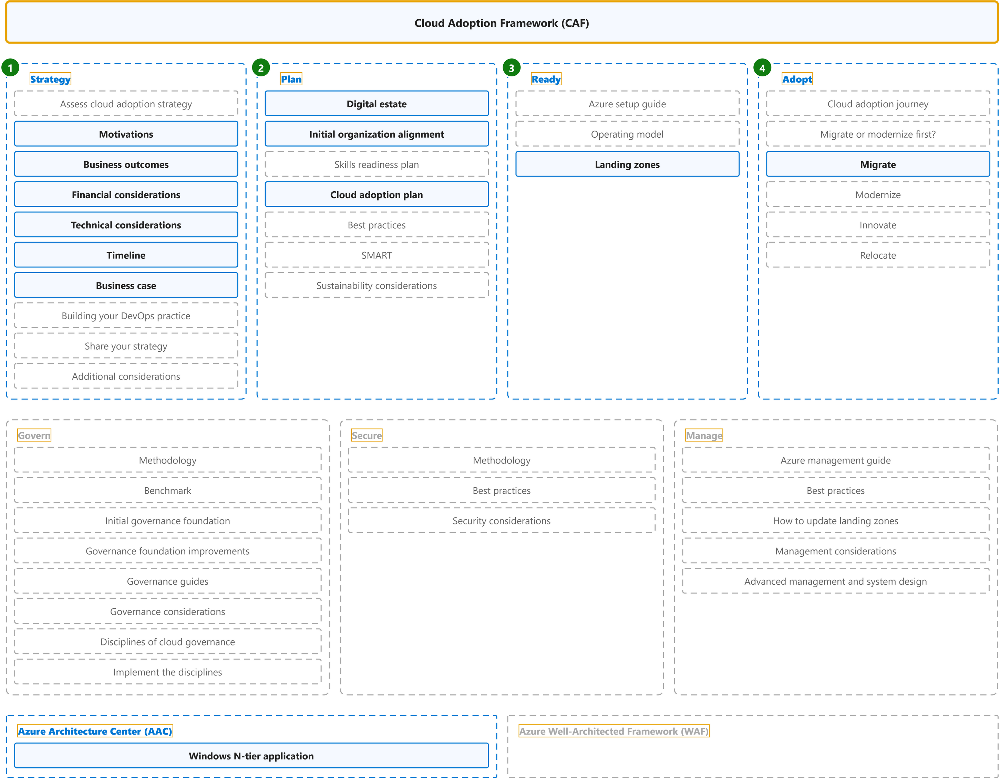

# Cloud Adoption Framework

Study notes on [Cloud Adoption Framework for Azure](https://learn.microsoft.com/en-us/azure/cloud-adoption-framework/overview), which CST8913 Cloud Migration (Algonquin College, Fall 2026) uses in weeks 2 and 3. Each section links the official page it follows; a section the course has not covered yet is a placeholder. Start from the figure: the framed terms are the ones to learn, and the table below it defines them in the same order, each with a citation linked to the passage and a Chinese translation in which each key word has the same colour as in the English. The main verb of each sentence has a red wavy underline, in the English and in the Chinese.

## [Overview](https://learn.microsoft.com/en-us/azure/cloud-adoption-framework/overview)

| Term | Definition | 中文翻译 | Source |
|---|---|---|---|
| **Cloud Adoption Framework (CAF)** 云采用框架 | "The Microsoft **Cloud Adoption Framework (CAF**) helps **decision makers** make better decisions, faster. It provides **proven guidance** to **reduce risk**, accelerate adoption, and create a foundation that supports current and future workloads." | Microsoft **云采用框架（CAF**）可帮助**决策者**更快地做出更好的决策。它提供**经过验证的指导**，以**降低风险**、加速采用，并建立支持当前和未来工作负载的基础。 | [Microsoft, n.d., para. 1](https://learn.microsoft.com/en-us/azure/cloud-adoption-framework/overview#:~:text=The%20Microsoft%20Cloud%20Adoption%20Framework%20%28CAF%29%20helps%20decision%20makers%20make) |
| **Strategy** 策略阶段 | "1. **Strategy**: What should our **Azure adoption** look like?" | 1. **策略阶段**：我们的 **Azure 采用**应该是什么样子？ | [Microsoft, n.d., "How the Cloud Adoption Framework works" section, table, row 1](https://learn.microsoft.com/en-us/azure/cloud-adoption-framework/overview#how-the-cloud-adoption-framework-works:~:text=What%20should%20our%20Azure%20adoption%20look%20like) |
| **Plan** 计划 | "Successful cloud adoption ... requires a **cloud adoption plan**. A cloud adoption plan converts your **cloud strategy** into an **actionable plan** that's specific to your goals." | 成功的云采用……需要一份**云采用计划**。云采用计划会将你的**云策略**转化为针对你的目标的**可执行计划**。 | [Microsoft, n.d., para. 1](https://learn.microsoft.com/en-us/azure/cloud-adoption-framework/plan/prepare-organization-for-cloud#:~:text=Successful%20cloud%20adoption) |
| **Ready** 就绪 | "The **Ready phase** of the Cloud Adoption Framework helps you design your **Azure landing zone** to meet your organization's **requirements**." | 云采用框架的**就绪阶段**可帮助你设计 **Azure 落地区**，以满足组织的**要求**。 | [Microsoft, n.d., para. 1](https://learn.microsoft.com/en-us/azure/cloud-adoption-framework/ready/landing-zone/#:~:text=The%20Ready%20phase%20of%20the%20Cloud%20Adoption%20Framework%20helps%20you) |
| **CAF Adopt phase** CAF 采用阶段 | "4. **Adopt**: How will we **migrate**, **modernize**, and **build workloads**?" | 4. **采用**：我们将如何**迁移**、**现代化**和**构建工作负载**？ | [Microsoft, n.d., "How the Cloud Adoption Framework works" section, table, row 4](https://learn.microsoft.com/en-us/azure/cloud-adoption-framework/overview#how-the-cloud-adoption-framework-works:~:text=How%20will%20we%20migrate%2C%20modernize%2C%20and%20build%20workloads) |
| **Govern** 治理 | "**Cloud governance** is how an organization **controls its use of cloud services** by establishing **guardrails**. These guardrails are a set of **policies, procedures, and tools** that define acceptable and unacceptable cloud activities." | **云治理**是组织**控制其云服务使用**的方式，具体做法是建立**护栏**。这些护栏是一组**策略、过程和工具**，用于定义可接受和不可接受的云活动。 | [Microsoft, n.d., para. 1](https://learn.microsoft.com/en-us/azure/cloud-adoption-framework/govern/build-cloud-governance-team#:~:text=Cloud%20governance%20is%20how%20an%20organization%20controls%20its%20use%20of) |
| **CAF Secure phase** CAF 安全阶段 | "The **Cloud Adoption Framework** for Azure **Secure methodology** provides a **structured approach** for securing your **Azure cloud estate**." | Azure **云采用框架**的**安全方法**提供了一种**结构化方式**，用于保护你的 **Azure 云资产**。 | [Microsoft, n.d., para. 1](https://learn.microsoft.com/en-us/azure/cloud-adoption-framework/secure/overview#:~:text=The%20Cloud%20Adoption%20Framework%20for%20Azure%20Secure%20methodology%20provides) |
| **Manage** 管理 | "Managing your **Azure environment** isn't just about **keeping the lights on**. It's about maintaining **governance and security** while ensuring your cloud stays aligned with **business goals** over time." | 管理你的 **Azure 环境**不仅仅是**维持系统正常运转**。它关乎在保持**治理和安全**的同时，确保你的云随着时间推移始终与**业务目标**保持一致。 | [Microsoft, n.d., para. 1](https://learn.microsoft.com/en-us/azure/cloud-adoption-framework/manage/ready-cloud-operations#:~:text=Managing%20your%20Azure%20environment%20isn%27t%20just%20about%20keeping%20the%20lights) |
| **Azure Architecture Center** Azure 架构中心 | "The **Azure Architecture Center** is a **catalog** of solution ideas, example workloads, **reference architectures**, technology decision guides, and architecture guides that help **cloud architects and engineers** build workloads ..." | **Azure 架构中心**是一个**目录**，其中包含解决方案构想、示例工作负载、**参考架构**、技术决策指南和架构指南，可帮助**云架构师和工程师**构建工作负载…… | [Microsoft, n.d., para. 1](https://learn.microsoft.com/en-us/azure/architecture/#:~:text=Design%20solutions%20on%20Azure%20by%20using%20established%20patterns) |
| **Azure Well-Architected Framework** Azure 良好架构框架 | "The **Azure Well-Architected Framework** is a **design framework** that can improve the **quality of a workload** by helping it to: Be **resilient, available, and recoverable**. Be as secure as you need it to be." | **Azure 良好架构框架**是一个**设计框架**，可以提高**工作负载的质量**，方法是帮助它做到：**具有复原能力、可用且可恢复**。按你的需要达到相应的安全程度。 | [Microsoft, n.d., para. 1](https://learn.microsoft.com/en-us/azure/well-architected/what-is-well-architected-framework#:~:text=The%20Azure%20Well%2DArchitected%20Framework%20is%20a%20design%20framework) |
