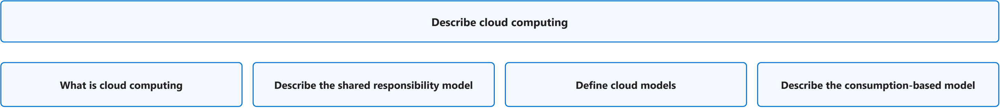
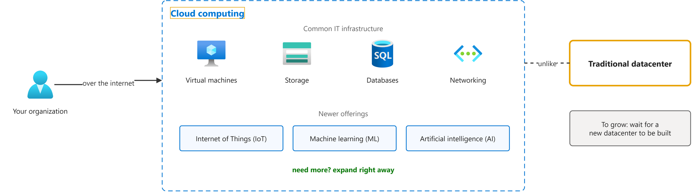
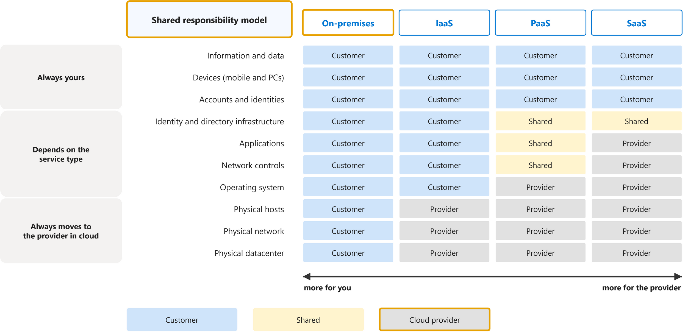
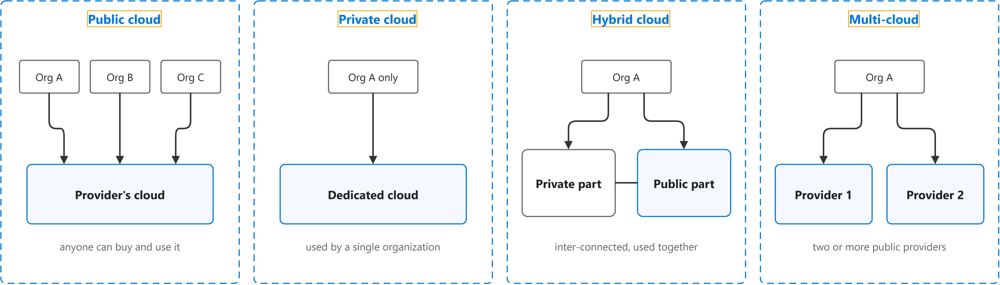
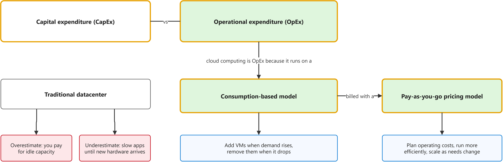

# Describe cloud computing

Study notes on [Microsoft Learn module (AZ-900)](https://learn.microsoft.com/en-us/training/modules/describe-cloud-compute/), which CST8913 Cloud Migration (Algonquin College, Fall 2026) uses in week 2. Each section links the official page it follows; a section the course has not covered yet is a placeholder. Start from the figure: the framed terms are the ones to learn, and the table below it defines them in the same order, each with a citation linked to the passage and a Chinese translation in which each key word has the same colour as in the English. The main verb of each sentence has a red wavy underline, in the English and in the Chinese.

## [Overview](https://learn.microsoft.com/en-us/training/modules/describe-cloud-compute/)

## [What is cloud computing](https://web.archive.org/web/20250108132404/https://learn.microsoft.com/en-us/training/modules/describe-cloud-compute/3-what-cloud-compute)

| Term | Definition | 中文翻译 | Source |
|---|---|---|---|
| **cloud computing** 云计算 | "**Cloud computing** is the **delivery of computing services** over the internet. Computing services include common **IT infrastructure** such as **virtual machines**, storage, databases, and networking." | **云计算**是通过互联网**交付计算服务**。计算服务包括常见的 **IT 基础结构**，例如**虚拟机**、存储、数据库和网络。 | [Microsoft, n.d., para. 1](https://web.archive.org/web/20250108132404/https://learn.microsoft.com/en-us/training/modules/describe-cloud-compute/3-what-cloud-compute#:~:text=Cloud%20computing%20is%20the%20delivery%20of%20computing%20services%20over) |
| **datacenter** 数据中心 | "The **physical infrastructure** for Azure starts with **datacenters**. These datacenters are facilities with **servers arranged in racks**, with **dedicated power**, cooling, and networking infrastructure ..." | Azure 的**物理基础结构**从**数据中心**开始。这些数据中心是一些设施，其中的**服务器排列在机架中**，并配有**专用的电力**、冷却和网络基础结构…… | [Microsoft, n.d., "Physical infrastructure" section, para. 1](https://learn.microsoft.com/en-us/training/modules/describe-core-architectural-components-of-azure/5-describe-azure-physical-infrastructure#physical-infrastructure:~:text=The%20physical%20infrastructure%20for%20Azure%20starts%20with%20datacenters) |

## [Describe the shared responsibility model](https://web.archive.org/web/20250108163106/https://learn.microsoft.com/en-us/training/modules/describe-cloud-compute/4-describe-shared-responsibility-model)

| Term | Definition | 中文翻译 | Source |
|---|---|---|---|
| **shared responsibility model** 责任共担模型 | "With the **shared responsibility model**, these responsibilities get shared between the **cloud provider** and the **consumer**." | 在**责任共担模型**中，这些责任由**云提供商**和**使用者**共同承担。 | [Microsoft, n.d., para. 3](https://web.archive.org/web/20250108163106/https://learn.microsoft.com/en-us/training/modules/describe-cloud-compute/4-describe-shared-responsibility-model#:~:text=With%20the%20shared%20responsibility%20model%2C%20these%20responsibilities%20get%20shared) |
| **on-premises** 本地部署 | "With an **on-premises** **datacenter**, you’re **responsible for everything**." | 对于**本地部署**的**数据中心**，你要**对一切负责**。 | [Microsoft, n.d., para. 6](https://web.archive.org/web/20250108163106/https://learn.microsoft.com/en-us/training/modules/describe-cloud-compute/4-describe-shared-responsibility-model#:~:text=With%20an%20on%2Dpremises%20datacenter) |
| **cloud provider** 云服务商 | "**Physical security**, power, cooling, and **network connectivity** are the responsibility of the **cloud provider**." | **物理安全**、电力、冷却和**网络连接**由**云服务商**负责。 | [Microsoft, n.d., para. 3](https://web.archive.org/web/20250108163106/https://learn.microsoft.com/en-us/training/modules/describe-cloud-compute/4-describe-shared-responsibility-model#:~:text=Physical%20security%2C%20power%2C%20cooling%2C%20and%20network%20connectivity%20are%20the) |

## [Define cloud models](https://web.archive.org/web/20250108133733/https://learn.microsoft.com/en-us/training/modules/describe-cloud-compute/5-define-cloud-models)

| Term | Definition | 中文翻译 | Source |
|---|---|---|---|
| **public cloud** 公有云 | "A **public cloud** is built, controlled, and maintained by a **third-party cloud provider**. With a public cloud, anyone that wants to **purchase cloud services** can **access and use resources**." | **公有云**由**第三方云提供商**构建、控制和维护。借助公有云，任何想要**购买云服务**的人都可以**访问和使用资源**。 | [Microsoft, n.d., "Public cloud" section, para. 1](https://web.archive.org/web/20250108133733/https://learn.microsoft.com/en-us/training/modules/describe-cloud-compute/5-define-cloud-models#public-cloud:~:text=A%20public%20cloud%20is%20built%2C%20controlled%2C%20and%20maintained%20by) |
| **private cloud** 私有云 | "It’s a **cloud** (**delivering IT services** over the internet) that’s used by a **single entity**." | 它是一种**云**（通过互联网**交付 IT 服务**），由**单个实体**使用。 | [Microsoft, n.d., "Private cloud" section, para. 1](https://web.archive.org/web/20250108133733/https://learn.microsoft.com/en-us/training/modules/describe-cloud-compute/5-define-cloud-models#private-cloud:~:text=delivering%20IT%20services%20over%20the%20internet) |
| **hybrid cloud** 混合云 | "A **hybrid cloud** is a **computing environment** that uses both **public and private clouds** in an inter-connected environment." | **混合云**是一种**计算环境**，它在互连的环境中同时使用**公有云和私有云**。 | [Microsoft, n.d., "Hybrid cloud" section, para. 1](https://web.archive.org/web/20250108133733/https://learn.microsoft.com/en-us/training/modules/describe-cloud-compute/5-define-cloud-models#hybrid-cloud:~:text=A%20hybrid%20cloud%20is%20a%20computing%20environment%20that%20uses) |
| **multi-cloud** 多云 | "In a **multi-cloud** scenario, you use **multiple public cloud providers**." | 在**多云**场景中，你使用**多个公有云提供商**。 | [Microsoft, n.d., "Multi-cloud" section, para. 1](https://web.archive.org/web/20250108133733/https://learn.microsoft.com/en-us/training/modules/describe-cloud-compute/5-define-cloud-models#multi-cloud:~:text=In%20a%20multi%2Dcloud%20scenario%2C%20you%20use%20multiple%20public%20cloud) |

## [Describe the consumption-based model](https://web.archive.org/web/20250108094515/https://learn.microsoft.com/en-us/training/modules/describe-cloud-compute/6-describe-consumption-based-model)

| Term | Definition | 中文翻译 | Source |
|---|---|---|---|
| **capital expenditure (CapEx)** 资本支出 | "**CapEx** is typically a **one-time, up-front expenditure** to **purchase or secure** **tangible resources**." | **CapEx** 通常是**一次性的前期支出**，用于**购买或获取**​**有形资源**。 | [Microsoft, n.d., para. 2](https://web.archive.org/web/20250108094515/https://learn.microsoft.com/en-us/training/modules/describe-cloud-compute/6-describe-consumption-based-model#:~:text=CapEx%20is%20typically%20a%20one%2Dtime%2C%20up%2Dfront%20expenditure%20to%20purchase) |
| **operational expenditure (OpEx)** 运营支出 | "In contrast, **OpEx** is spending money on **services or products** **over time**." | 相比之下，**OpEx** 是在**服务或产品**上**随时间推移**持续花钱。 | [Microsoft, n.d., para. 3](https://web.archive.org/web/20250108094515/https://learn.microsoft.com/en-us/training/modules/describe-cloud-compute/6-describe-consumption-based-model#:~:text=In%20contrast%2C%20OpEx%20is%20spending%20money%20on%20services%20or) |
| **consumption-based model** 按用量计费模式 | "**Cloud computing** falls under **OpEx** because cloud computing operates on a **consumption-based model**." | **云计算**属于 **OpEx**，因为云计算基于**按用量计费模式**运行。 | [Microsoft, n.d., para. 4](https://web.archive.org/web/20250108094515/https://learn.microsoft.com/en-us/training/modules/describe-cloud-compute/6-describe-consumption-based-model#:~:text=Cloud%20computing%20falls%20under%20OpEx%20because%20cloud%20computing%20operates) |
| **pay-as-you-go pricing model** 按需付费定价模式 | "**Cloud computing** is the delivery of computing services over the internet by using a **pay-as-you-go pricing model**. You typically pay only for the **cloud services** you use" | **云计算**是指通过 Internet、使用**按需付费定价模式**交付计算服务。你通常只需为所使用的**云服务**付费 | [Microsoft, n.d., "Compare cloud pricing models" section, para. 1](https://web.archive.org/web/20250108094515/https://learn.microsoft.com/en-us/training/modules/describe-cloud-compute/6-describe-consumption-based-model#compare-cloud-pricing-models:~:text=by%20using%20a%20pay%2Das%2Dyou%2Dgo%20pricing%20model) |
