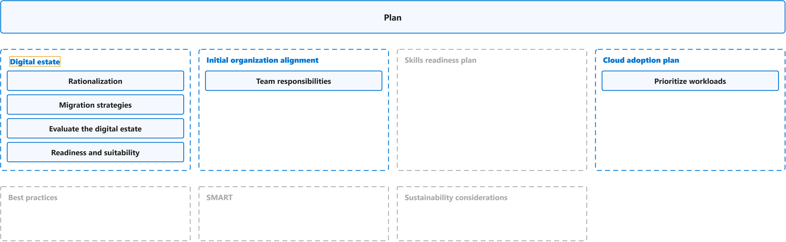
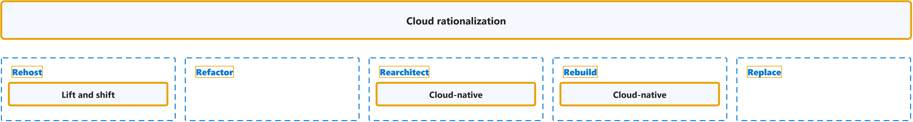
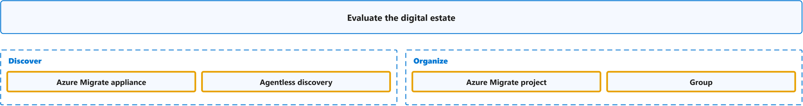
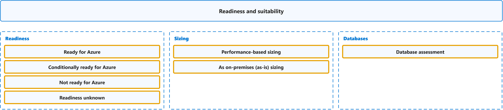
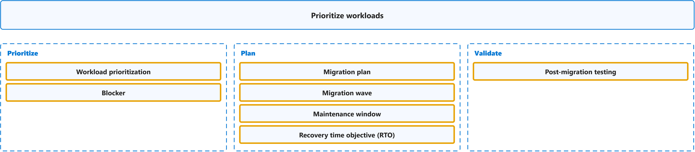

# Plan

Study notes on [Cloud Adoption Framework, Plan](https://github.com/MicrosoftDocs/cloud-adoption-framework/blob/a5351162040659171fbb4f5674ce36ac9259deb3/docs/plan/index.md), which CST8913 Cloud Migration (Algonquin College, Fall 2026) uses in weeks 2 and 4. Each section links the official page it follows; a section the course has not covered yet is a placeholder. Start from the figure: the framed terms are the ones to learn, and the table below it defines them in the same order, each with a citation linked to the passage and a Chinese translation in which each key word has the same colour as in the English. The main verb of each sentence has a red wavy underline, in the English and in the Chinese.

## [Overview](https://github.com/MicrosoftDocs/cloud-adoption-framework/blob/a5351162040659171fbb4f5674ce36ac9259deb3/docs/plan/index.md)

| Term | Definition | 中文翻译 | Source |
|---|---|---|---|
| **digital estate** 数字资产 | "For each of these outcomes, the first step starts with a **clear understanding** of the **assets** (applications, data, and VMs) you are responsible for today. Those assets collectively are referred to as your **digital estate**." | 对于上述每种结果，第一步都是**清楚了解**你目前负责的**资产**（应用程序、数据和虚拟机）。这些资产统称为你的**数字资产**。 | [Microsoft, 2022, "Understand your digital estate" section, para. 1](https://web.archive.org/web/20220804114917/https://docs.microsoft.com/en-us/learn/modules/cloud-adoption-framework-plan/4-exercise-digital-estate-assessment#understand-your-digital-estate:~:text=For%20each%20of%20these%20outcomes%2C%20the%20first%20step%20starts) |

## Digital estate

### [Rationalization](https://github.com/MicrosoftDocs/cloud-adoption-framework/blob/e29e30c4ebd52d8446d00f5dfdee5742328c2c11/docs/digital-estate/5-rs-of-rationalization.md)

| Term | Definition | 中文翻译 | Source |
|---|---|---|---|
| **cloud rationalization** 云合理化 | "**Cloud rationalization** is the process of **evaluating assets** to determine the **best way** to **migrate or modernize** each asset in the cloud." | **云合理化**是这样一个过程：**评估资产**，从而确定以**最佳方式**在云中**迁移或现代化**每项资产。 | [Microsoft, 2023, March 1, para. 1](https://github.com/MicrosoftDocs/cloud-adoption-framework/blob/e29e30c4ebd52d8446d00f5dfdee5742328c2c11/docs/digital-estate/5-rs-of-rationalization.md#:~:text=Cloud%20rationalization%20is%20the%20process%20of%20evaluating%20assets%20to%20determine) |
| **Rehost** 重新托管 | "Also known as a **lift and shift migration**, a **rehost effort** moves a **current state asset** to the chosen cloud provider with **minimal change** to the overall architecture." | 也称为**直接迁移（lift and shift**）的**重新托管工作**，会将**当前状态的资产**迁移到所选的云提供商，并对整体架构做**最小的更改**。 | [Microsoft, 2023, March 1, "Rehost" section, para. 1](https://github.com/MicrosoftDocs/cloud-adoption-framework/blob/e29e30c4ebd52d8446d00f5dfdee5742328c2c11/docs/digital-estate/5-rs-of-rationalization.md#rehost:~:text=Also%20known%20as%20a%20lift%20and%20shift%20migration%2C%20a%20rehost%20effort) |
| **lift and shift** 平移迁移 | "**Lift-and-shift migration**: You set up **cloud resources** similar to your **on-premises datacenter**, and then move your workloads to the **IaaS infrastructure**." | **平移迁移**：你设置**云资源**，使其与你的**本地数据中心**类似，然后将你的工作负载移到 **IaaS 基础结构**。 | [Microsoft, n.d., "Scenarios" section, bullet 1](https://learn.microsoft.com/en-us/training/modules/describe-cloud-service-types/2-describe-infrastructure-service#scenarios:~:text=Lift%2Dand%2Dshift%20migration) |
| **Refactor** 重构 | "**Platform as a service (PaaS**) options can reduce the **operational costs** that are associated with many applications. It's a good idea to **slightly refactor** an application to fit a **PaaS-based model**." | **平台即服务（PaaS**）选项可以降低与许多应用程序相关的**运营成本**。一个好主意是**稍微重构**应用程序，使其适应**基于 PaaS 的模型**。 | [Microsoft, 2023, March 1, "Refactor" section, para. 1](https://github.com/MicrosoftDocs/cloud-adoption-framework/blob/e29e30c4ebd52d8446d00f5dfdee5742328c2c11/docs/digital-estate/5-rs-of-rationalization.md#refactor:~:text=Platform%20as%20a%20service%20%28PaaS%29%20options%20can%20reduce%20the%20operational%20costs) |
| **Rearchitect** 重新架构 | "Some **aging applications** **aren't compatible** with cloud providers. This incompatibility is because of the **architectural decisions** that were made when the application was built. In these cases, the application might need to be **rearchitected** before transformation." | 一些**老旧的应用程序**与云提供商**不兼容**。这种不兼容是由于构建应用程序时所做的**架构决策**造成的。在这些情况下，应用程序可能需要先**重新架构**，然后再进行转型。 | [Microsoft, 2023, March 1, "Rearchitect" section, para. 1](https://github.com/MicrosoftDocs/cloud-adoption-framework/blob/e29e30c4ebd52d8446d00f5dfdee5742328c2c11/docs/digital-estate/5-rs-of-rationalization.md#rearchitect:~:text=Some%20aging%20applications%20aren%27t%20compatible%20with%20cloud%20providers) |
| **cloud-native** 云原生 | "**Cloud-native** architecture and technologies are an approach to designing, constructing, and **operating workloads** that are **built in the cloud** and **take full advantage of the cloud computing model**." | **云原生**架构和技术是一种设计、构建和**运营工作负载**的方法，这些工作负载**在云中构建**，并**充分利用云计算模型**。 | [Microsoft, n.d., para. 3](https://learn.microsoft.com/en-us/dotnet/architecture/cloud-native/definition#:~:text=Cloud%2Dnative%20architecture%20and%20technologies%20are%20an%20approach%20to%20designing) |
| **Rebuild** 重建 | "In some scenarios, the **delta** that must be overcome to carry an application forward can be too large to justify **further investment**. ... To resolve the issue, create a **new code base** to align with a **cloud-native approach**." | 在某些场景中，要推动应用程序继续前进所必须克服的**差距**可能过大，以致无法证明**进一步投资**是合理的。……为了解决这个问题，请创建**新的代码库**，以与**云原生方法**保持一致。 | [Microsoft, 2023, March 1, "Rebuild" section, para. 1](https://github.com/MicrosoftDocs/cloud-adoption-framework/blob/e29e30c4ebd52d8446d00f5dfdee5742328c2c11/docs/digital-estate/5-rs-of-rationalization.md#rebuild:~:text=In%20some%20scenarios%2C%20the%20delta%20that%20must%20be%20overcome%20to%20carry) |
| **Replace** 替换 | "Sometimes **software as a service (SaaS**) applications can provide all the **necessary functionality** for the hosted application. In these scenarios, a workload can be scheduled for **future replacement**, which removes it from the **transformation effort**." | 有时，**软件即服务（SaaS**）应用程序可以为托管的应用程序提供所有**必要的功能**。在这些场景中，可以将工作负载安排在**将来替换**，从而将其从**转型工作**中移除。 | [Microsoft, 2023, March 1, "Replace" section, para. 1](https://github.com/MicrosoftDocs/cloud-adoption-framework/blob/e29e30c4ebd52d8446d00f5dfdee5742328c2c11/docs/digital-estate/5-rs-of-rationalization.md#replace:~:text=Sometimes%20software%20as%20a%20service%20%28SaaS%29%20applications%20can%20provide%20all) |

### [Migration strategies](https://learn.microsoft.com/en-us/azure/cloud-adoption-framework/plan/select-cloud-migration-strategy)

| Term | Definition | 中文翻译 | Source |
|---|---|---|---|
| **migration strategy** 迁移策略 | "A **migration strategy** defines how **each workload** transitions to **Azure** based on its **business driver**." | **迁移策略**定义**每个工作负载**如何过渡到 **Azure**，依据是其**业务驱动因素**。 | [Microsoft, n.d., "Select the right migration strategy" section, para. 1](https://learn.microsoft.com/en-us/azure/cloud-adoption-framework/plan/select-cloud-migration-strategy#select-the-right-migration-strategy:~:text=A%20migration%20strategy%20defines%20how%20each%20workload%20transitions%20to%20Azure) |
| **business goal** 业务目标 | "**Business goals** are high-level outcomes the **organization** wants to achieve from **cloud adoption**, such as adopting AI, increasing agility, accelerating innovation, **reducing costs**, and improving resilience." | **业务目标**是**组织**希望通过**云采用**实现的高层级成果，例如采用 AI、提高敏捷性、加速创新、**降低成本**和提升复原能力。 | [Microsoft, n.d., "Determine business drivers before migration" section, step 1](https://learn.microsoft.com/en-us/azure/cloud-adoption-framework/plan/select-cloud-migration-strategy#determine-business-drivers-before-migration:~:text=Business%20goals%20are%20high%2Dlevel%20outcomes%20the%20organization%20wants%20to%20achieve) |
| **business driver** 业务驱动因素 | "A **business driver** defines why a **workload** needs to **change** in order to support a **specific business goal**." | **业务驱动因素**定义了**工作负载**为何需要**变更**，以支持**特定业务目标**。 | [Microsoft, n.d., "Determine business drivers before migration" section, para. 1](https://learn.microsoft.com/en-us/azure/cloud-adoption-framework/plan/select-cloud-migration-strategy#determine-business-drivers-before-migration:~:text=A%20business%20driver%20defines%20why%20a%20workload%20needs%20to%20change) |
| **Retire** 停用 | "**Retire** **decommissions workloads** that **no longer provide business value**." | **停用**会**让工作负载退役**，这些工作负载**不再提供业务价值**。 | [Microsoft, n.d., "1. Retire (decommission)" section, para. 1](https://learn.microsoft.com/en-us/azure/cloud-adoption-framework/plan/select-cloud-migration-strategy#1-retire-decommission:~:text=Retire%20decommissions%20workloads%20that%20no%20longer%20provide%20business%20value) |
| **Replatform** 更换平台 | "**Replatforming** moves workloads to a **modern hosting environment** with **minimal code changes**." | **更换平台**会将工作负载迁移到**现代托管环境**，同时只需**最少的代码更改**。 | [Microsoft, n.d., "3. Replatform (modernize hosting environment)" section, para. 1](https://learn.microsoft.com/en-us/azure/cloud-adoption-framework/plan/select-cloud-migration-strategy#3-replatform-modernize-hosting-environment:~:text=Replatforming%20moves%20workloads%20to%20a%20modern%20hosting%20environment%20with%20minimal) |
| **Retain** 保留 | "A **retain strategy** keeps workloads in their **current environment** when they're **stable, compliant**, and meet all current and future business needs with **no near-term driver to move**." | **保留策略**会将工作负载保留在其**当前环境**中，前提是它们**稳定、合规**，满足所有当前和未来的业务需求，并且**近期没有迁移的驱动因素**。 | [Microsoft, n.d., "8. Retain (keep as is)" section, para. 1](https://learn.microsoft.com/en-us/azure/cloud-adoption-framework/plan/select-cloud-migration-strategy#8-retain-keep-as-is:~:text=A%20retain%20strategy%20keeps%20workloads%20in%20their%20current%20environment%20when) |

### [Evaluate the digital estate](https://web.archive.org/web/20220804114917/https://docs.microsoft.com/en-us/learn/modules/cloud-adoption-framework-plan/4-exercise-digital-estate-assessment#evaluate-the-digital-estate)

| Term | Definition | 中文翻译 | Source |
|---|---|---|---|
| **Azure Migrate appliance** Azure Migrate 设备（发现用虚拟机） | Defined on [Adopt](adopt.md#azure-migrate). | 定义见该页。 | See that page |
| **agentless discovery** 无代理发现 | "Azure Migrate uses a lightweight **Azure Migrate appliance** to perform **agentless discovery** of on-premises VMware VMs, Hyper-V VMs, other virtualized machines, and **physical servers**. **Continuous discovery** collects machine configuration information, and performance metadata, as well as application data." | Azure Migrate 使用轻量级的 **Azure Migrate 设备**执行**无代理发现**，对象是本地 VMware VM、Hyper-V VM、其他虚拟化计算机和**物理服务器**。**持续发现**会收集计算机配置信息和性能元数据以及应用程序数据。 | [Microsoft, 2022, "Workloads in use" section, para. 1](https://web.archive.org/web/20220804114917/https://docs.microsoft.com/en-us/learn/modules/cloud-adoption-framework-plan/4-exercise-digital-estate-assessment#workloads-in-use:~:text=Azure%20Migrate%20uses%20a%20lightweight%20Azure%20Migrate%20appliance%20to) |
| **Azure Migrate project** Azure Migrate 项目 | "A **project** is used to store **discovery, assessment, and migration metadata** collected from the **environment** you're assessing or migrating." | **项目**用于存储**发现、评估和迁移元数据**，这些元数据收集自你正在评估或迁移的**环境**。 | [Microsoft, n.d., para. 2](https://learn.microsoft.com/en-us/azure/migrate/quickstart-create-project?view=migrate#:~:text=A%20project%20is%20used%20to%20store%20discovery%2C%20assessment%2C%20and) |
| **group (Azure Migrate)** 分组（服务器组） | "With your **application inventory** and **dependency analysis** done, you can create **high-confidence groups of servers** and start **assessing** them." | 完成**应用程序清单**和**依赖分析**后，你可以创建**高可信度的服务器组**，并开始对其进行**评估**。 | [Microsoft, 2022, "Dependencies between workloads" section, para. 1, sentence 5](https://web.archive.org/web/20220804114917/https://docs.microsoft.com/en-us/learn/modules/cloud-adoption-framework-plan/4-exercise-digital-estate-assessment#dependencies-between-workloads:~:text=With%20your%20application%20inventory%20and%20dependency%20analysis%20done%2C%20you) |

### [Readiness and suitability](https://web.archive.org/web/20220804114917/https://docs.microsoft.com/en-us/learn/modules/cloud-adoption-framework-plan/4-exercise-digital-estate-assessment#readiness-and-suitability-analysis)

| Term | Definition | 中文翻译 | Source |
|---|---|---|---|
| **Ready for Azure** 可迁移（Azure 就绪） | "**Ready for Azure**: Machines can be migrated **as-is** to Azure, **without any changes**." | **Azure 就绪**：计算机可以**按原样**迁移到 Azure，**无需任何更改**。 | [Microsoft, 2022, "Readiness and suitability analysis" section, bullet 1](https://web.archive.org/web/20220804114917/https://docs.microsoft.com/en-us/learn/modules/cloud-adoption-framework-plan/4-exercise-digital-estate-assessment#readiness-and-suitability-analysis:~:text=Ready%20for%20Azure%3A%20Machines%20can%20be%20migrated%20as%2Dis%20to%20Azure) |
| **Conditionally ready for Azure** 有条件可迁移 | "**Conditionally ready for Azure**: Machines can be migrated to Azure, but need **minor changes** in accordance with the **remediation guidance** provided in the assessment." | **有条件地为 Azure 就绪**：计算机可以迁移到 Azure，但需要进行**少量更改**，更改须遵循评估中提供的**修正指南**。 | [Microsoft, 2022, "Readiness and suitability analysis" section, bullet 2](https://web.archive.org/web/20220804114917/https://docs.microsoft.com/en-us/learn/modules/cloud-adoption-framework-plan/4-exercise-digital-estate-assessment#readiness-and-suitability-analysis:~:text=Conditionally%20ready%20for%20Azure%3A%20Machines%20can%20be%20migrated%20to) |
| **Not ready for Azure** 不可迁移（未就绪） | "**Not ready for Azure**: Machines **can't be migrated to Azure as-is**. Issues must be fixed in accordance with **remediation guidance** before migration." | **未为 Azure 就绪**：计算机**无法按原样迁移到 Azure**。迁移前必须按照**修正指南**修复问题。 | [Microsoft, 2022, "Readiness and suitability analysis" section, bullet 3](https://web.archive.org/web/20220804114917/https://docs.microsoft.com/en-us/learn/modules/cloud-adoption-framework-plan/4-exercise-digital-estate-assessment#readiness-and-suitability-analysis:~:text=Not%20ready%20for%20Azure%3A%20Machines%20can%27t%20be%20migrated%20to) |
| **Readiness unknown** 就绪性未知 | "**Readiness unknown**: Azure Migrate **can't determine machine readiness**, because of **insufficient metadata**." | **就绪性未知**：Azure Migrate **无法确定计算机的就绪性**，原因是**元数据不足**。 | [Microsoft, 2022, "Readiness and suitability analysis" section, bullet 4](https://web.archive.org/web/20220804114917/https://docs.microsoft.com/en-us/learn/modules/cloud-adoption-framework-plan/4-exercise-digital-estate-assessment#readiness-and-suitability-analysis:~:text=Readiness%20unknown%3A%20Azure%20Migrate%20can%27t%20determine%20machine%20readiness) |
| **performance-based sizing** 按性能定规格 | "The **performance-based sizing** option in Azure Migrate assessments helps you to **right-size VMs**, and should be used as a **best practice** for optimizing workloads in Azure." | Azure Migrate 评估中的**按性能定规格**选项可帮助你**合理调整虚拟机规格**，并且应作为在 Azure 中优化工作负载的**最佳做法**加以使用。 | [Microsoft, 2022, "Get compute costs" section, para. 1](https://web.archive.org/web/20220804114917/https://docs.microsoft.com/en-us/learn/modules/cloud-adoption-framework-plan/4-exercise-digital-estate-assessment#get-compute-costs:~:text=The%20performance%2Dbased%20sizing%20option%20in%20Azure%20Migrate%20assessments%20helps) |
| **as on-premises (as-is) sizing** 按本地配置定规格 | "You can get **sizing recommendations** based on **performance history** (to optimize resources as you migrate), or based on **on-premises machine settings** without performance history." | 你可以获取**规格建议**，依据可以是**性能历史记录**（以便在迁移时优化资源），也可以是不含性能历史记录的**本地计算机设置**。 | [Microsoft, 2022, "Sizing recommendations" section, para. 1, sentence 2](https://web.archive.org/web/20220804114917/https://docs.microsoft.com/en-us/learn/modules/cloud-adoption-framework-plan/4-exercise-digital-estate-assessment#sizing-recommendations:~:text=You%20can%20get%20sizing%20recommendations%20based%20on%20performance%20history) |
| **database assessment** 数据库评估 | "Using **database assessments**, you can assess the readiness of your **SQL Server data estate** for migration to **Azure SQL Database**, or **Azure SQL Managed Instance**." | 使用**数据库评估**，你可以评估 **SQL Server 数据资产**迁移到 **Azure SQL 数据库**或 **Azure SQL 托管实例**的就绪情况。 | [Microsoft, 2022, "Readiness and suitability analysis" section, para. 2](https://web.archive.org/web/20220804114917/https://docs.microsoft.com/en-us/learn/modules/cloud-adoption-framework-plan/4-exercise-digital-estate-assessment#readiness-and-suitability-analysis:~:text=Using%20database%20assessments%2C%20you%20can%20assess%20the%20readiness%20of) |

## Initial organization alignment

### [Team responsibilities](https://learn.microsoft.com/en-us/azure/cloud-adoption-framework/organize/raci-alignment)

| Term | Definition | 中文翻译 | Source |
|---|---|---|---|
| **RACI matrix** RACI 责任分配矩阵 | "**Align responsibilities** by developing a **cross-team matrix** that identifies **responsible, accountable, consulted, and informed (RACI**) parties." | **协调职责**：制定一个**跨团队矩阵**，用于确定**负责、批准、咨询和知情（RACI**）的各方。 | [Microsoft, n.d., para. 1](https://learn.microsoft.com/en-us/azure/cloud-adoption-framework/organize/raci-alignment#:~:text=Align%20responsibilities%20by%20developing%20a%20cross%2Dteam%20matrix%20that) |
| **Responsible** 负责执行（R） | "The teams that are **responsible** for the **outcomes**." | **负责**产出**结果**的团队。 | [Microsoft, n.d., "Align responsibilities across teams" section, bullet 8](https://learn.microsoft.com/en-us/azure/cloud-adoption-framework/organize/raci-alignment#align-responsibilities-across-teams:~:text=The%20teams%20that%20are%20responsible%20for%20the%20outcomes) |
| **Accountable** 最终负责（A） | "The **one team** that is **accountable** for a function." | **唯一一个团队**，对某项职能**最终负责**。 | [Microsoft, n.d., "Align responsibilities across teams" section, bullet 7](https://learn.microsoft.com/en-us/azure/cloud-adoption-framework/organize/raci-alignment#align-responsibilities-across-teams:~:text=The%20one%20team%20that%20is%20accountable%20for%20a%20function) |
| **Consulted** 咨询（C） | "The teams that should be **consulted** during **planning**." | 应被**咨询**的团队，在**规划**期间。 | [Microsoft, n.d., "Align responsibilities across teams" section, bullet 9](https://learn.microsoft.com/en-us/azure/cloud-adoption-framework/organize/raci-alignment#align-responsibilities-across-teams:~:text=The%20teams%20that%20should%20be%20consulted%20during%20planning) |
| **Informed** 知会（I） | "The teams that should be **informed** when **work is completed**." | 应被**告知**的团队，在**工作完成**时。 | [Microsoft, n.d., "Align responsibilities across teams" section, bullet 10](https://learn.microsoft.com/en-us/azure/cloud-adoption-framework/organize/raci-alignment#align-responsibilities-across-teams:~:text=The%20teams%20that%20should%20be%20informed%20when%20work%20is%20completed) |
| **cloud adoption team** 云采用团队 | "The nucleus of all **cloud adoption efforts** is the **cloud adoption team**. This team drives the **technical changes** that enable adoption." | 所有**云采用工作**的核心是**云采用团队**。该团队推动实现采用的**技术变革**。 | [Microsoft, n.d., "Cloud adoption team only" section, para. 1](https://learn.microsoft.com/en-us/azure/cloud-adoption-framework/organize/organization-structures#cloud-adoption-team-only:~:text=The%20nucleus%20of%20all%20cloud%20adoption%20efforts%20is%20the) |
| **cloud governance team** 云治理团队 | "...a **cloud governance team** is dedicated to ensuring **excellence** in the solutions that are adopted. The cloud governance team is **accountable** for **platform maturity**, platform operations, governance, and automation." | ……**云治理团队**致力于确保所采用解决方案的**卓越**品质。云治理团队**负责**​**平台成熟度**、平台运维、治理和自动化。 | [Microsoft, n.d., "Best practice: minimum viable product (MVP)" section, bullet 2](https://learn.microsoft.com/en-us/azure/cloud-adoption-framework/organize/organization-structures#best-practice-minimum-viable-product-mvp:~:text=Cloud%20governance%20team%3A%20To%20balance%20the%20cloud%20adoption%20team) |
| **central IT team** 中央 IT 团队 | "As adoption scales, the **cloud governance team** might struggle to keep pace with the flow of innovation from **multiple cloud adoption teams**... At this stage, it's common for companies to shift **cloud responsibilities** to an existing **central IT team**." | 随着采用规模扩大，**云治理团队**可能难以跟上来自**多个云采用团队**的创新步伐……在此阶段，公司通常会将**云职责**转移给现有的**中央 IT 团队**。 | [Microsoft, n.d., "Central IT team" section, para. 1](https://learn.microsoft.com/en-us/azure/cloud-adoption-framework/organize/organization-structures#central-it-team:~:text=As%20adoption%20scales%2C%20the%20cloud%20governance%20team%20might%20struggle) |
| **cloud center of excellence (CCoE)** 云卓越中心 | "At the highest state of **maturity**, a **cloud center of excellence** aligns teams around a modern **cloud-first operating model**. This approach provides **centralized IT functions** like governance, security, platform, and automation." | 在最高**成熟度**状态下，**云卓越中心**围绕现代的**云优先运营模式**协调各团队。这种方法提供**集中式 IT 职能**，例如治理、安全、平台和自动化。 | [Microsoft, n.d., "Cloud center of excellence" section, para. 1](https://learn.microsoft.com/en-us/azure/cloud-adoption-framework/organize/organization-structures#cloud-center-of-excellence:~:text=At%20the%20highest%20state%20of%20maturity%2C%20a%20cloud%20center%20of%20excellence) |
| **solution delivery** 方案交付 | "**Cloud adoption functions** enable the **implementation** of **technical solutions** in the cloud." | **云采用职能**支持在云中**实施**​**技术解决方案**。 | [Microsoft, 2020, May 15, "Cloud adoption functions" section, para. 1](https://github.com/MicrosoftDocs/cloud-adoption-framework/blob/a5351162040659171fbb4f5674ce36ac9259deb3/docs/organize/cloud-adoption.md#cloud-adoption-functions:~:text=Cloud%20adoption%20functions%20enable%20the%20implementation%20of%20technical%20solutions) |
| **platform operations** 平台运维 | "**Operate** and **manage** the **cloud platform**." | **运行**并**管理**​**云平台**。 | [Microsoft, 2022, August 31, "Technical tasks" section, bullet 3](https://github.com/MicrosoftDocs/cloud-adoption-framework/blob/a5351162040659171fbb4f5674ce36ac9259deb3/docs/organize/central-it.md#technical-tasks:~:text=Operate%20and%20manage%20the%20cloud%20platform) |

## Skills readiness plan

To be added.

## Cloud adoption plan

### [Prioritize workloads](https://web.archive.org/web/20220804114917/https://docs.microsoft.com/en-us/learn/modules/cloud-adoption-framework-plan/4-exercise-digital-estate-assessment#prioritize-workloads)

| Term | Definition | 中文翻译 | Source |
|---|---|---|---|
| **workload prioritization** 工作负载优先级排序 | "After you've collected information about your **inventory**, you can identify **which applications and workloads to migrate first**. ... To **prioritize migration order**, consider factors such as complexity, time-to-migrate, **business urgency**, production considerations, compliance, security requirements, and application knowledge." | 收集有关**清单**的信息后，你可以确定**首先迁移哪些应用程序和工作负载**。……若要**确定迁移顺序的优先级**，请考虑复杂性、迁移所需时间、**业务紧迫性**、生产注意事项、合规性、安全要求和应用程序知识等因素。 | [Microsoft, 2022, "Prioritize workloads" section, paras. 1 and 2](https://web.archive.org/web/20220804114917/https://docs.microsoft.com/en-us/learn/modules/cloud-adoption-framework-plan/4-exercise-digital-estate-assessment#prioritize-workloads:~:text=After%20you%27ve%20collected%20information%20about%20your%20inventory%2C%20you%20can) |
| **blocker** 阻碍项 | "Before you migrate, **review and mitigate** any **compatibility issues** or **unsupported features** that might **block the migration**." | 在迁移之前，请**检查并缓解**任何**兼容性问题**或**不受支持的功能**，它们可能会**阻碍迁移**。 | [Microsoft, 2022, "Evaluate gaps and blockers" section, para. 1, sentence 3](https://web.archive.org/web/20220804114917/https://docs.microsoft.com/en-us/learn/modules/cloud-adoption-framework-plan/4-exercise-digital-estate-assessment#evaluate-gaps-and-blockers:~:text=Before%20you%20migrate%2C%20review%20and%20mitigate%20any%20compatibility%20issues) |
| **migration plan** 迁移计划 | "Create an effective **cloud migration plan** that includes detailed information about the applications you want to migrate, **application and database availability**, **downtime constraints**, and **migration milestones**." | 制定有效的**云迁移计划**，其中包括有关要迁移的应用程序的详细信息、**应用程序和数据库可用性**、**停机时间限制**以及**迁移里程碑**。 | [Microsoft, 2022, "Finalize the migration plan" section, para. 2](https://web.archive.org/web/20220804114917/https://docs.microsoft.com/en-us/learn/modules/cloud-adoption-framework-plan/4-exercise-digital-estate-assessment#finalize-the-migration-plan:~:text=Create%20an%20effective%20cloud%20migration%20plan%20that%20includes%20detailed) |
| **migration wave** 迁移批次（波次） | "To improve your odds of success, plan a series of subsequent **waves of migrations**. Identify a **small set of prioritized workloads** to migrate, test, and release to production in a **two-week sprint**." | 为了提高成功几率，请规划一系列后续的**迁移波次**。确定**一小组优先工作负载**，在为期**两周的冲刺**中完成迁移、测试并发布到生产环境。 | [Microsoft, 2022, "Output of the exercise" section, para. 3](https://web.archive.org/web/20220804114917/https://docs.microsoft.com/en-us/learn/modules/cloud-adoption-framework-plan/4-exercise-digital-estate-assessment#output-of-the-exercise:~:text=To%20improve%20your%20odds%20of%20success%2C%20plan%20a%20series%20of) |
| **maintenance window** 维护窗口 | "Build a **migration roadmap**. Declare a **maintenance window** to migrate your applications and databases with **minimal to zero downtime**, and to limit the potential operational and **business impact** during migration." | 制定**迁移路线图**。声明一个**维护窗口**，以便在**停机时间极短甚至为零**的情况下迁移应用程序和数据库，并限制迁移期间可能产生的运营和**业务影响**。 | [Microsoft, 2022, "Finalize the migration plan" section, para. 4](https://web.archive.org/web/20220804114917/https://docs.microsoft.com/en-us/learn/modules/cloud-adoption-framework-plan/4-exercise-digital-estate-assessment#finalize-the-migration-plan:~:text=Build%20a%20migration%20roadmap.%20Declare%20a%20maintenance%20window%20to) |
| **recovery time objective (RTO)** 恢复时间目标 | "**Recovery time objective (RTO**): The **maximum acceptable time** that an application can be unavailable after an incident." | **恢复时间目标（RTO**）：应用程序在发生事件后可以不可用的**最长可接受时间**。 | [Microsoft, n.d., table 2 (Term, Definition), row 6](https://learn.microsoft.com/en-us/azure/well-architected/reliability/metrics#:~:text=The%20maximum%20acceptable%20time%20that%20an%20application%20can%20be%20unavailable) |
| **post-migration testing** 迁移后测试 | "A **post-migration testing plan** should include **functional, integration, security, and performance testing** and **use cases**." | **迁移后测试计划**应包括**功能测试、集成测试、安全测试和性能测试**以及**用例**。 | [Microsoft, 2022, "Finalize the migration plan" section, para. 3](https://web.archive.org/web/20220804114917/https://docs.microsoft.com/en-us/learn/modules/cloud-adoption-framework-plan/4-exercise-digital-estate-assessment#finalize-the-migration-plan:~:text=A%20post%2Dmigration%20testing%20plan%20should%20include%20functional%2C%20integration) |

## Best practices

To be added.

## Strategic Migration Assessment and Readiness Tool (SMART)

To be added.

## Sustainability considerations

To be added.
