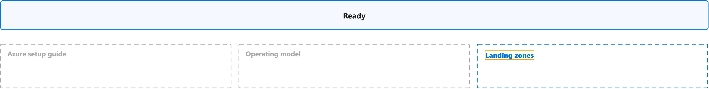
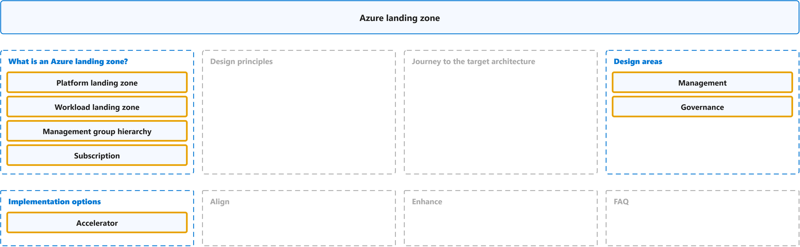

# Ready

Study notes on [Cloud Adoption Framework, Ready](https://github.com/MicrosoftDocs/cloud-adoption-framework/blob/a5351162040659171fbb4f5674ce36ac9259deb3/docs/ready/index.md), which CST8913 Cloud Migration (Algonquin College, Fall 2026) uses in week 3. Each section links the official page it follows; a section the course has not covered yet is a placeholder. Start from the figure: the framed terms are the ones to learn, and the table below it defines them in the same order, each with a citation linked to the passage and a Chinese translation in which each key word has the same colour as in the English. The main verb of each sentence has a red wavy underline, in the English and in the Chinese.

## [Overview](https://github.com/MicrosoftDocs/cloud-adoption-framework/blob/a5351162040659171fbb4f5674ce36ac9259deb3/docs/ready/index.md)

| Term | Definition | 中文翻译 | Source |
|---|---|---|---|
| **landing zone** 落地区 | "An **Azure landing zone** is a proven and flexible **architecture** for governing, securing, and scaling a **multi-subscription Azure environment**." | **Azure 落地区**是一种经过验证且灵活的**架构**，用于治理、保护和扩展**多订阅 Azure 环境**。 | [Microsoft, n.d., para. 1, sentence 2](https://learn.microsoft.com/en-us/azure/cloud-adoption-framework/ready/landing-zone/#:~:text=An%20Azure%20landing%20zone%20is%20a%20proven%20and%20flexible%20architecture) |

## Azure setup guide

To be added.

## Operating model

To be added.

## [Landing zones](https://learn.microsoft.com/en-us/azure/cloud-adoption-framework/ready/landing-zone/)

| Term | Definition | 中文翻译 | Source |
|---|---|---|---|
| **platform landing zone** 平台落地区 | "The **centralized foundation** that establishes **governance**, security, and **shared resources** for all your Azure workloads." | **集中式基础**，为所有 Azure 工作负载建立**治理**、安全和**共享资源**。 | [Microsoft, n.d., bullet 1](https://learn.microsoft.com/en-us/azure/cloud-adoption-framework/ready/landing-zone/#:~:text=The%20centralized%20foundation%20that%20establishes%20governance%2C%20security%2C%20and%20shared) |
| **workload landing zone** 工作负载落地区 | "The environments where **workload teams** **deploy and operate** **workload resources** within the guardrails of the **platform landing zone**." | **工作负载团队**在其中**部署和运营**​**工作负载资源**的环境，位于**平台落地区**的护栏之内。 | [Microsoft, n.d., bullet 2](https://learn.microsoft.com/en-us/azure/cloud-adoption-framework/ready/landing-zone/#:~:text=The%20environments%20where%20workload%20teams%20deploy%20and%20operate%20workload%20resources) |
| **management group hierarchy** 管理组层级 | "The **management group hierarchy** provides the **governance structure** for the Azure environment. It organizes all of your **Azure subscriptions** and applies **governance standards** to those subscriptions." | **管理组层级**为 Azure 环境提供**治理结构**。它组织你的所有 **Azure 订阅**，并对这些订阅应用**治理标准**。 | [Microsoft, n.d., "Platform landing zone" section, bullet 1](https://learn.microsoft.com/en-us/azure/cloud-adoption-framework/ready/landing-zone/#platform-landing-zone:~:text=The%20management%20group%20hierarchy%20provides%20the%20governance%20structure%20for%20the) |
| **subscription** 订阅 | "In Azure, **subscriptions** are a **unit of management, billing, and scale**. Subscriptions let you organize **resource groups** and **control billing separately from access**." | 在 Azure 中，**订阅**是**管理、计费和缩放的单位**。订阅让你能够组织**资源组**，并**将计费与访问分开控制**。 | [Microsoft, n.d., "Azure subscriptions" section, para. 1](https://learn.microsoft.com/en-us/training/modules/describe-core-architectural-components-of-azure/6-describe-azure-management-infrastructure#azure-subscriptions:~:text=In%20Azure%2C%20subscriptions%20are%20a%20unit%20of%20management%2C%20billing) |
| **management** 管理（运维） | "This **design area** establishes a **foundation for operations management** across your Azure, hybrid, or **multicloud environments**." | 此**设计领域**​**为运营管理奠定基础**，范围涵盖你的 Azure、混合或**多云环境**。 | [Microsoft, n.d., para. 1](https://learn.microsoft.com/en-us/azure/cloud-adoption-framework/ready/landing-zone/design-area/management#:~:text=This%20design%20area%20establishes%20a%20foundation%20for%20operations%20management) |
| **governance** 治理 | "Use **Azure governance** to establish the **tooling** that you need to support cloud governance, **compliance auditing**, and **automated guardrails**." | 使用 **Azure 治理**来建立所需的**工具**，以支持云治理、**合规性审核**和**自动化防护措施**。 | [Microsoft, n.d., para. 1](https://learn.microsoft.com/en-us/azure/cloud-adoption-framework/ready/landing-zone/design-area/governance#:~:text=Use%20Azure%20governance%20to%20establish%20the%20tooling%20that%20you) |
| **accelerator** 加速器 | "Microsoft-provided **accelerators** for both **platform landing zone** and workload landing zone scenarios use **infrastructure as code** to deploy **Azure environments** based on recommended practices." | Microsoft 提供的**加速器**适用于**平台落地区**和工作负载落地区两种场景，它们使用**基础结构即代码**来部署 **Azure 环境**，所依据的是建议做法。 | [Microsoft, n.d., bullet 3](https://learn.microsoft.com/en-us/azure/cloud-adoption-framework/ready/landing-zone/#:~:text=Microsoft%2Dprovided%20accelerators%20for%20both%20platform%20landing%20zone%20and%20workload) |
