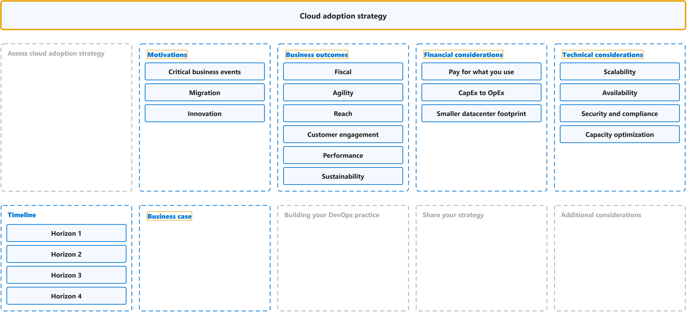
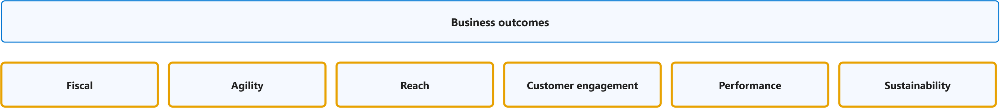
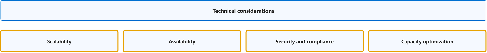

# Strategy

Study notes on [Cloud Adoption Framework, Strategy](https://github.com/MicrosoftDocs/cloud-adoption-framework/blob/a5351162040659171fbb4f5674ce36ac9259deb3/docs/strategy/index.md), which CST8913 Cloud Migration (Algonquin College, Fall 2026) uses in weeks 2 and 3. Each section links the official page it follows; a section the course has not covered yet is a placeholder. Start from the figure: the framed terms are the ones to learn, and the table below it defines them in the same order, each with a citation linked to the passage and a Chinese translation in which each key word has the same colour as in the English. The main verb of each sentence has a red wavy underline, in the English and in the Chinese.

## [Overview](https://github.com/MicrosoftDocs/cloud-adoption-framework/blob/a5351162040659171fbb4f5674ce36ac9259deb3/docs/strategy/index.md)

| Term | Definition | 中文翻译 | Source |
|---|---|---|---|
| **cloud adoption strategy** 云采用策略 | "A **cloud adoption strategy** directs how your business adopts cloud technology. It connects **executive intent** to **measurable outcomes** and sets the **standards** that every workload team operates within." | **云采用策略**指导你的企业如何采用云技术。它将**高管意图**与**可衡量的成果**联系起来，并设定每个工作负载团队在其中运作的**标准**。 | [Microsoft, n.d., para. 1](https://learn.microsoft.com/en-us/azure/cloud-adoption-framework/strategy/#:~:text=A%20cloud%20adoption%20strategy%20directs%20how%20your%20business%20adopts) |
| **motivation** 动机 | "Various **motivations** can drive **business transformations** that are supported by cloud adoption. Several motivations likely apply **at the same time**." | 各种**动机**可以推动由云采用所支持的**业务转型**。可能**同时**有多个动机适用。 | [Microsoft, 2022, October 18, "Motivations" section, para. 1](https://github.com/MicrosoftDocs/cloud-adoption-framework/blob/a5351162040659171fbb4f5674ce36ac9259deb3/docs/strategy/motivations.md#motivations:~:text=Various%20motivations%20can%20drive%20business%20transformations%20that%20are) |
| **business outcome** 业务成果 | "This article series is designed to help customers identify **business outcomes** that are **concise, defined**, and drive **observable results** or change in business performance, supported by a **specific measure**." | 本系列文章旨在帮助客户确定**业务成果**，这些成果应**简洁、明确**，并能推动**可观察的结果**或业务绩效的变化，且有**具体的衡量指标**作为支撑。 | [Microsoft, 2022, October 18, para. 1](https://github.com/MicrosoftDocs/cloud-adoption-framework/blob/a5351162040659171fbb4f5674ce36ac9259deb3/docs/strategy/business-outcomes/index.md#:~:text=This%20article%20series%20is%20designed%20to%20help%20customers%20identify) |
| **financial considerations** 财务考量 | "A **digital transformation** goes hand-in-hand with a **financial transformation**. When you're making the shift to the cloud, there are **financial considerations** around how the cloud will impact your **financial position**, accounting KPIs, and processes..." | **数字化转型**与**财务转型**相辅相成。当你向云转变时，存在一些**财务考量**，涉及云将如何影响你的**财务状况**、会计 KPI 和流程…… | [Microsoft, 2022, October 18, para. 1](https://github.com/MicrosoftDocs/cloud-adoption-framework/blob/a5351162040659171fbb4f5674ce36ac9259deb3/docs/strategy/financial-considerations/index.md#:~:text=A%20digital%20transformation%20goes%20hand%2Din%2Dhand%20with%20a%20financial%20transformation) |
| **technical considerations** 技术考量 | "When you're making the **shift to the cloud**, there are **technical considerations** around how it will help improve how you **manage and maintain** your cloud and workloads." | 当你**向云转变**时，存在一些**技术考量**，涉及它将如何帮助你改进对云和工作负载的**管理与维护**方式。 | [Microsoft, 2022, October 18, para. 1](https://github.com/MicrosoftDocs/cloud-adoption-framework/blob/a5351162040659171fbb4f5674ce36ac9259deb3/docs/strategy/technical-considerations/index.md#:~:text=When%20you%27re%20making%20the%20shift%20to%20the%20cloud%2C%20there) |
| **business case** 商业论证 | "A **business case** provides a view of the **technical and financial timeline** of your environment. Developing a business case includes building a **financial plan** that takes technical considerations into account and aligns with **business outcomes**." | **商业论证**提供了你环境的**技术和财务时间线**视图。制定商业论证包括构建一份**财务计划**，该计划考虑技术考量并与**业务成果**保持一致。 | [Microsoft, 2022, August 5, para. 3](https://github.com/MicrosoftDocs/cloud-adoption-framework/blob/a5351162040659171fbb4f5674ce36ac9259deb3/docs/strategy/cloud-migration-business-case.md#:~:text=A%20business%20case%20provides%20a%20view%20of%20the%20technical) |

## Assess cloud adoption strategy

To be added.

## [Motivations](https://github.com/MicrosoftDocs/cloud-adoption-framework/blob/a5351162040659171fbb4f5674ce36ac9259deb3/docs/strategy/motivations.md)

| Term | Definition | 中文翻译 | Source |
|---|---|---|---|
| **critical business event** 关键业务事件 | "When responding to **critical business events** is the **highest priority**, it's important to get started with **migration** early, often in parallel with **strategy and planning efforts**." | 当应对**关键业务事件**是**最高优先级**时，务必尽早开始**迁移**，并且通常与**策略和规划工作**并行进行。 | [Microsoft, 2022, October 18, "Classify your motivations" section, para. 2](https://github.com/MicrosoftDocs/cloud-adoption-framework/blob/a5351162040659171fbb4f5674ce36ac9259deb3/docs/strategy/motivations.md#classify-your-motivations:~:text=When%20responding%20to%20critical%20business%20events%20is%20the%20highest) |
| **migration motivation** 迁移动机 | "The **migration motivations** listed near the top of the **motivations table** are the **most common reasons** for adopting the cloud but not necessarily the **most significant**." | **迁移动机**列于**动机表**的顶部附近，它们是采用云的**最常见原因**，但不一定是**最重要**的原因。 | [Microsoft, 2022, October 18, "Migration" section, para. 1](https://github.com/MicrosoftDocs/cloud-adoption-framework/blob/a5351162040659171fbb4f5674ce36ac9259deb3/docs/strategy/motivations.md#migration:~:text=The%20migration%20motivations%20listed%20near%20the%20top%20of%20the) |
| **innovation motivation** 创新动机 | "Data is the **new commodity**, and **modern applications** are the **supply chain** driving that data into various experiences. In today's business market, it's hard to find a **transformative product or service** that isn't built on top of data, insights, and customer experiences." | 数据是**新的商品**，而**现代应用程序**是将这些数据输送到各种体验中的**供应链**。在当今的商业市场中，很难找到不是建立在数据、见解和客户体验之上的**变革性产品或服务**。 | [Microsoft, 2022, October 18, "Innovation" section, para. 1](https://github.com/MicrosoftDocs/cloud-adoption-framework/blob/a5351162040659171fbb4f5674ce36ac9259deb3/docs/strategy/motivations.md#innovation:~:text=Data%20is%20the%20new%20commodity%2C%20and%20modern%20applications%20are) |

## [Business outcomes](https://github.com/MicrosoftDocs/cloud-adoption-framework/blob/a5351162040659171fbb4f5674ce36ac9259deb3/docs/strategy/business-outcomes/index.md)

| Term | Definition | 中文翻译 | Source |
|---|---|---|---|
| **fiscal outcome** 财务成果 | "**Financial or fiscal performance** is the **cleanest business outcome** for many business leaders, but **not the only one**." | 对于许多业务领导者来说，**财务或财政绩效**是**最清晰的业务成果**，但并**不是唯一的**成果。 | [Microsoft, 2022, October 18, "Fiscal outcomes" section, para. 1](https://github.com/MicrosoftDocs/cloud-adoption-framework/blob/a5351162040659171fbb4f5674ce36ac9259deb3/docs/strategy/business-outcomes/index.md#fiscal-outcomes:~:text=Financial%20or%20fiscal%20performance%20is%20the%20cleanest%20business%20outcome) |
| **agility outcome** 敏捷成果 | "Today's **fast-changing business environment** places a **premium on time**. The ability to respond to and **drive market change** quickly is the fundamental measure of **business agility**." | 当今**快速变化的商业环境**非常**重视时间**。快速响应并**推动市场变化**的能力，是衡量**业务敏捷性**的基本指标。 | [Microsoft, 2022, October 18, "Agility outcomes" section, para. 1](https://github.com/MicrosoftDocs/cloud-adoption-framework/blob/a5351162040659171fbb4f5674ce36ac9259deb3/docs/strategy/business-outcomes/index.md#agility-outcomes:~:text=Today%27s%20fast%2Dchanging%20business%20environment%20places%20a%20premium%20on%20time) |
| **reach outcome** 覆盖范围成果 | "In a constantly **shrinking market**, **global reach** (ability to support global customers and users) can be measured by **compliance** in geographies that are relevant to the business." | 在不断**缩小的市场**中，**全球覆盖范围**（支持全球客户和用户的能力）可以通过在与业务相关的地理区域中的**合规性**来衡量。 | [Microsoft, 2022, October 18, "Reach outcomes" section, para. 1](https://github.com/MicrosoftDocs/cloud-adoption-framework/blob/a5351162040659171fbb4f5674ce36ac9259deb3/docs/strategy/business-outcomes/index.md#reach-outcomes:~:text=In%20a%20constantly%20shrinking%20market%2C%20global%20reach) |
| **customer engagement outcome** 客户互动成果 | "**Social marketplaces** are redefining **winners and losers** at an unheard-of pace. Responding to **user needs** is a key measure of **customer engagement**." | **社交市场**正以前所未有的速度重新定义**赢家和输家**。响应**用户需求**是衡量**客户互动**的关键指标。 | [Microsoft, 2022, October 18, "Customer engagement outcomes" section, para. 1](https://github.com/MicrosoftDocs/cloud-adoption-framework/blob/a5351162040659171fbb4f5674ce36ac9259deb3/docs/strategy/business-outcomes/index.md#customer-engagement-outcomes:~:text=Social%20marketplaces%20are%20redefining%20winners%20and%20losers%20at%20an) |
| **performance outcome** 性能成果 | "**Performance and reliability** are **assumed**. When either falters, **reputation damage** can be painful and **long-lasting**." | **性能和可靠性**被视为**理所当然**。当其中任何一个出现问题时，**声誉损害**可能是痛苦且**长期**的。 | [Microsoft, 2022, October 18, "Performance outcomes" section, para. 1](https://github.com/MicrosoftDocs/cloud-adoption-framework/blob/a5351162040659171fbb4f5674ce36ac9259deb3/docs/strategy/business-outcomes/index.md#performance-outcomes:~:text=Performance%20and%20reliability%20are%20assumed) |
| **sustainability outcome** 可持续性成果 | "**Environmental sustainability** is quickly moving from a "nice to have" function of **Corporate Social Responsibility (CSR**) to a **centerpiece of business strategy**, increasingly **embedded** into everything a company does." | **环境可持续性**正迅速从**企业社会责任（CSR**）中的“锦上添花”功能，转变为**业务战略的核心**，并日益**融入**公司所做的一切。 | [Microsoft, 2022, October 18, "Sustainability outcomes" section, para. 1](https://github.com/MicrosoftDocs/cloud-adoption-framework/blob/a5351162040659171fbb4f5674ce36ac9259deb3/docs/strategy/business-outcomes/index.md#sustainability-outcomes:~:text=Environmental%20sustainability%20is%20quickly%20moving%20from%20a) |

## [Financial considerations](https://github.com/MicrosoftDocs/cloud-adoption-framework/blob/a5351162040659171fbb4f5674ce36ac9259deb3/docs/strategy/financial-considerations/index.md)

## [Technical considerations](https://github.com/MicrosoftDocs/cloud-adoption-framework/blob/a5351162040659171fbb4f5674ce36ac9259deb3/docs/strategy/technical-considerations/index.md)

| Term | Definition | 中文翻译 | Source |
|---|---|---|---|
| **scalability** 可扩展性 | "**Scalability**, or the ability to **scale out your resources** depending on usage, utilization, and demand, is one of the **foremost technical benefits** of moving to the cloud." | **可扩展性**，即根据使用情况、利用率和需求**横向扩展你的资源**的能力，是迁移到云的**首要技术优势**之一。 | [Microsoft, 2022, October 18, "Scalability" section, para. 1](https://github.com/MicrosoftDocs/cloud-adoption-framework/blob/a5351162040659171fbb4f5674ce36ac9259deb3/docs/strategy/technical-considerations/index.md#scalability:~:text=Scalability%2C%20or%20the%20ability%20to%20scale%20out%20your%20resources%20depending) |
| **high availability** 高可用性 | "**On-premises**, it's more costly to build **highly available infrastructure**. It's **less costly** to architect highly available infrastructure in the cloud." | **在本地**，构建**高可用基础结构**的成本更高。在云中设计高可用基础结构的**成本更低**。 | [Microsoft, 2022, October 18, "Availability" section, para. 1](https://github.com/MicrosoftDocs/cloud-adoption-framework/blob/a5351162040659171fbb4f5674ce36ac9259deb3/docs/strategy/technical-considerations/index.md#availability:~:text=On%2Dpremises%2C%20it%27s%20more%20costly%20to%20build%20highly%20available%20infrastructure) |
| **security and compliance** 安全与合规 | "When it comes to **security and compliance**, Microsoft is continually expanding our **security infrastructure and toolsets** to **keep you on par** with what's transpiring with respect to **security threats on global networks**." | 在**安全与合规**方面，Microsoft 正在不断扩展我们的**安全基础结构和工具集**，让你能够**跟上**​**全球网络上安全威胁**的动态。 | [Microsoft, 2022, October 18, "Security and compliance" section, para. 1](https://github.com/MicrosoftDocs/cloud-adoption-framework/blob/a5351162040659171fbb4f5674ce36ac9259deb3/docs/strategy/technical-considerations/index.md#security-and-compliance:~:text=When%20it%20comes%20to%20security%20and%20compliance%2C%20Microsoft%20is) |
| **capacity optimization** 容量优化 | "**Capacity optimization**, where you **only pay** for the **resources you utilize** over time, is **another technical benefit** of the cloud." | **容量优化**，即你**只需**为一段时间内**实际使用的资源**付费，是云的**另一项技术优势**。 | [Microsoft, 2022, October 18, "Capacity optimization" section, para. 1](https://github.com/MicrosoftDocs/cloud-adoption-framework/blob/a5351162040659171fbb4f5674ce36ac9259deb3/docs/strategy/technical-considerations/index.md#capacity-optimization:~:text=Capacity%20optimization%2C%20where%20you%20only%20pay%20for%20the) |

## [Timeline](https://github.com/MicrosoftDocs/cloud-adoption-framework/blob/a5351162040659171fbb4f5674ce36ac9259deb3/docs/strategy/digital-transformation-timeline.md)

| Term | Definition | 中文翻译 | Source |
|---|---|---|---|
| **adoption horizons** 采用视野（分阶段推进） | "To create clarity and alignment, it's suggested that **complex digital transformation projects** align to an organization's **horizons** or **phased program delivery**. In this type of approach, the company commits to a **single motivation category** for a time-bound period." | 为了实现清晰性和一致性，建议**复杂的数字化转型项目**与组织的**视野**或**分阶段的项目交付**保持一致。在这种方法中，公司在限定的时间段内致力于**单一的动机类别**。 | [Microsoft, 2021, May 1, "De-risk with cloud adoption horizons" section, para. 3](https://github.com/MicrosoftDocs/cloud-adoption-framework/blob/a5351162040659171fbb4f5674ce36ac9259deb3/docs/strategy/digital-transformation-timeline.md#de-risk-with-cloud-adoption-horizons:~:text=To%20create%20clarity%20and%20alignment%2C%20it%27s%20suggested%20that%20complex) |
| **Horizon 1 migration and modernization** 视野 1：迁移与现代化 | "**Prioritize** the **datacenter exit** with a focus on modern **platform as a service (PaaS**) solutions over a basic **lift-and-shift migration**." | **优先考虑**​**退出数据中心**，重点关注现代的**平台即服务（PaaS**）解决方案，而不是基础的**平移迁移**。 | [Microsoft, 2021, May 1, "Example of a cloud adoption plan with four horizons" section, table, row 1, Objective](https://github.com/MicrosoftDocs/cloud-adoption-framework/blob/a5351162040659171fbb4f5674ce36ac9259deb3/docs/strategy/digital-transformation-timeline.md#example-of-a-cloud-adoption-plan-with-four-horizons:~:text=Prioritize%20the%20datacenter%20exit%20with%20a%20focus%20on%20modern%20platform) |
| **Horizon 2 operation modernization** 视野 2：运营现代化 | "Prioritize **operational improvements** built on **cloud-native governance**, **operations management**, security, and **compliance capabilities**." | 优先考虑**运营改进**，这些改进建立在**云原生的治理**、**运营管理**、安全和**合规功能**之上。 | [Microsoft, 2021, May 1, "Example of a cloud adoption plan with four horizons" section, table, row 2, Objective](https://github.com/MicrosoftDocs/cloud-adoption-framework/blob/a5351162040659171fbb4f5674ce36ac9259deb3/docs/strategy/digital-transformation-timeline.md#example-of-a-cloud-adoption-plan-with-four-horizons:~:text=Prioritize%20operational%20improvements%20built%20on%20cloud%2Dnative%20governance) |
| **Horizon 3 advanced modernization** 视野 3：深度现代化 | "With **post-migration** and **operational improvements**, the team will have **sufficient data and cloud skills** to perform **deeper modernization** of complex architectures." | 借助**迁移后**的改进和**运营改进**，团队将拥有**足够的数据和云技能**，对复杂架构执行**更深入的现代化**。 | [Microsoft, 2021, May 1, "Example of a cloud adoption plan with four horizons" section, table, row 3, Objective](https://github.com/MicrosoftDocs/cloud-adoption-framework/blob/a5351162040659171fbb4f5674ce36ac9259deb3/docs/strategy/digital-transformation-timeline.md#example-of-a-cloud-adoption-plan-with-four-horizons:~:text=With%20post%2Dmigration%20and%20operational%20improvements%2C%20the%20team%20will%20have) |
| **Horizon 4 innovation and growth** 视野 4：创新与增长 | "Redirect capital reduction from **datacenter exits** and **new skills** in central IT to focus on **accelerating continued innovation**." | 将**退出数据中心**带来的资本削减和中央 IT 部门的**新技能**重新调配，以专注于**加速持续创新**。 | [Microsoft, 2021, May 1, "Example of a cloud adoption plan with four horizons" section, table, row 4, Objective](https://github.com/MicrosoftDocs/cloud-adoption-framework/blob/a5351162040659171fbb4f5674ce36ac9259deb3/docs/strategy/digital-transformation-timeline.md#example-of-a-cloud-adoption-plan-with-four-horizons:~:text=Redirect%20capital%20reduction%20from%20datacenter%20exits%20and%20new%20skills%20in) |

## [Business case](https://github.com/MicrosoftDocs/cloud-adoption-framework/blob/a5351162040659171fbb4f5674ce36ac9259deb3/docs/strategy/cloud-migration-business-case.md)

## Building your DevOps practice

To be added.

## Share your strategy

To be added.

## Additional considerations

To be added.
