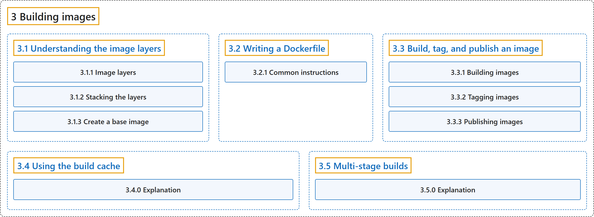

# 3 Building images

## Classification

## Glossary

| Term | Definition | 中文翻译 | Source |
|---|---|---|---|
| **3 Building images** 构建镜像 | (context) "Learn how to **build production-ready images that are lean and efficient Docker images**, essential for minimizing overhead and enhancing deployment in production environments." | （语境）学习如何**构建可用于生产、精简高效的 Docker 镜像**，这对减少开销、改进生产环境中的部署至关重要。 | [Docker Inc., n.d.-b, "About this series", para. 1](https://docs.docker.com/get-started/docker-concepts/building-images/#:~:text=Learn%20how%20to%20build%20production-ready%20images%20that) |
| **[3.1 Understanding the image layers](understanding-image-layers.md)** 理解镜像层 | (context) "As you learned in [What is an image?](https://docs.docker.com/get-started/docker-concepts/the-basics/what-is-an-image/), **container images are composed of layers**." | （语境）正如你在 [What is an image?](https://docs.docker.com/get-started/docker-concepts/the-basics/what-is-an-image/) 中学到的，**容器镜像由层组成**。 | [Docker Inc., n.d.-d, "Explanation", para. 1](https://docs.docker.com/get-started/docker-concepts/building-images/understanding-image-layers/#:~:text=As%20you%20learned%20in%20%5BWhat%20is%20an) |
| **[3.2 Writing a Dockerfile](writing-a-dockerfile.md)** 编写 Dockerfile | (context) "A Dockerfile is **a text-based document that's used to create a container image**." | （语境）Dockerfile 是**一个用于创建容器镜像的文本文档**。 | [Docker Inc., n.d.-f, "Explanation", para. 1](https://docs.docker.com/get-started/docker-concepts/building-images/writing-a-dockerfile/#:~:text=A%20Dockerfile%20is%20a%20text-based%20document%20that%27s) |
| **[3.3 Build, tag, and publish an image](build-tag-and-publish-an-image.md)** 构建、标记和发布镜像 | (No definition) | （无定义） | [Docker Inc., n.d.-a, "Build, tag, and publish an image"](https://docs.docker.com/get-started/docker-concepts/building-images/build-tag-and-publish-an-image/) |
| **[3.4 Using the build cache](using-the-build-cache.md)** 使用构建缓存 | "Using the build cache effectively lets you **achieve faster builds by reusing results from previous builds and skipping unnecessary work**." | 有效地使用构建缓存，可以**通过复用之前构建的结果并跳过不必要的工作来加快构建**。 | [Docker Inc., n.d.-e, "Explanation", para. 3](https://docs.docker.com/get-started/docker-concepts/building-images/using-the-build-cache/#:~:text=Using%20the%20build%20cache%20effectively%20lets%20you) |
| **[3.5 Multi-stage builds](multi-stage-builds.md)** 多阶段构建 | "Multi-stage builds **introduce multiple stages in your Dockerfile, each with a specific purpose**." | 多阶段构建**在 Dockerfile 中引入多个阶段，每个阶段有特定用途**。 | [Docker Inc., n.d.-c, "Explanation", para. 2](https://docs.docker.com/get-started/docker-concepts/building-images/multi-stage-builds/#:~:text=Multi-stage%20builds%20introduce%20multiple%20stages%20in%20your) |

## References

Docker Inc. (n.d.-a). *Build, tag, and publish an image*. Docker Docs. Retrieved October 31, 2026, from <https://docs.docker.com/get-started/docker-concepts/building-images/build-tag-and-publish-an-image/>

Docker Inc. (n.d.-b). *Building images*. Docker Docs. Retrieved October 31, 2026, from <https://docs.docker.com/get-started/docker-concepts/building-images/>

Docker Inc. (n.d.-c). *Multi-stage builds*. Docker Docs. Retrieved October 31, 2026, from <https://docs.docker.com/get-started/docker-concepts/building-images/multi-stage-builds/>

Docker Inc. (n.d.-d). *Understanding the image layers*. Docker Docs. Retrieved October 31, 2026, from <https://docs.docker.com/get-started/docker-concepts/building-images/understanding-image-layers/>

Docker Inc. (n.d.-e). *Using the build cache*. Docker Docs. Retrieved October 31, 2026, from <https://docs.docker.com/get-started/docker-concepts/building-images/using-the-build-cache/>

Docker Inc. (n.d.-f). *Writing a Dockerfile*. Docker Docs. Retrieved October 31, 2026, from <https://docs.docker.com/get-started/docker-concepts/building-images/writing-a-dockerfile/>
