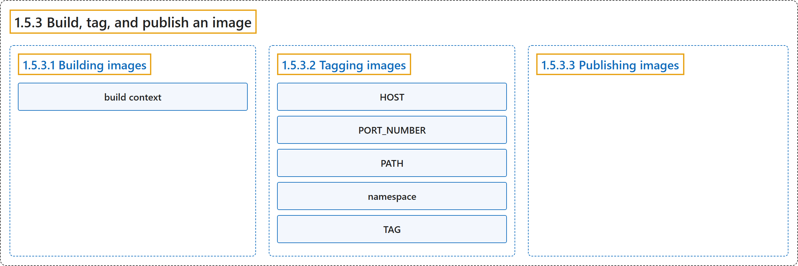

# 1.5.3 Build, tag, and publish an image

## Classification

## Glossary

| Term | Definition | 中文翻译 | Source |
|---|---|---|---|
| **1.5.3 Build, tag, and publish an image** 构建、标记和发布镜像 | (No definition) | （无定义） | [Docker Inc., n.d., "Build, tag, and publish an image"](https://docs.docker.com/get-started/docker-concepts/building-images/build-tag-and-publish-an-image/) |
| **1.5.3.1 Building images** 构建镜像 | "Building images - **the process of building an image based on a `Dockerfile`**" | 构建镜像：**基于 `Dockerfile` 构建镜像的过程** | [Docker Inc., n.d., "Explanation", para. 2](https://docs.docker.com/get-started/docker-concepts/building-images/build-tag-and-publish-an-image/#:~:text=Building%20images%20-%20the%20process%20of%20building) |
| **build context** 构建上下文 | (context) "The final `.` in the command provides **the path or URL to the [build context](https://docs.docker.com/build/concepts/context/#what-is-a-build-context)**." | （语境）命令末尾的 `.` 提供了 **[构建上下文](https://docs.docker.com/build/concepts/context/#what-is-a-build-context)的路径或 URL**。 | [Docker Inc., n.d., "Building images", para. 2](https://docs.docker.com/get-started/docker-concepts/building-images/build-tag-and-publish-an-image/#:~:text=The%20final%20%60.%60%20in%20the%20command%20provides) |
| **1.5.3.2 Tagging images** 标记镜像 | "Tagging images - **the process of giving an image a name**, which also determines where the image can be distributed" | 标记镜像：**为镜像命名的过程**，名称也决定了镜像可以分发到哪里 | [Docker Inc., n.d., "Explanation", para. 3](https://docs.docker.com/get-started/docker-concepts/building-images/build-tag-and-publish-an-image/#:~:text=Tagging%20images%20-%20the%20process%20of%20giving) |
| **HOST** HOST | "`HOST`: **The optional registry hostname where the image is located**." | `HOST`：**镜像所在注册表的主机名，可选**。 | [Docker Inc., n.d., "Tagging images", para. 2](https://docs.docker.com/get-started/docker-concepts/building-images/build-tag-and-publish-an-image/#:~:text=%60HOST%60%3A%20The%20optional%20registry%20hostname%20where%20the) |
| **PORT_NUMBER** PORT_NUMBER | "`PORT_NUMBER`: **The registry port number if a hostname is provided**" | `PORT_NUMBER`：**提供主机名时注册表的端口号** | [Docker Inc., n.d., "Tagging images", para. 3](https://docs.docker.com/get-started/docker-concepts/building-images/build-tag-and-publish-an-image/#:~:text=%60PORT_NUMBER%60%3A%20The%20registry%20port%20number%20if%20a) |
| **PATH** PATH | "`PATH`: **The path of the image, consisting of slash-separated components**." | `PATH`：**镜像的路径，由斜杠分隔的各部分组成**。 | [Docker Inc., n.d., "Tagging images", para. 4](https://docs.docker.com/get-started/docker-concepts/building-images/build-tag-and-publish-an-image/#:~:text=%60PATH%60%3A%20The%20path%20of%20the%20image%2C%20consisting) |
| **namespace** 命名空间 | "For Docker Hub, the format follows `[NAMESPACE/]REPOSITORY`, where **namespace is either a user's or organization's name**." | 对于 Docker Hub，格式为 `[NAMESPACE/]REPOSITORY`，其中**命名空间是用户或组织的名称**。 | [Docker Inc., n.d., "Tagging images", para. 4](https://docs.docker.com/get-started/docker-concepts/building-images/build-tag-and-publish-an-image/#:~:text=For%20Docker%20Hub%2C%20the%20format%20follows%20%60%5BNAMESPACE%2F%5DREPOSITORY%60%2C) |
| **TAG** TAG | "`TAG`: **A custom, human-readable identifier that's typically used to identify different versions or variants of an image**." | `TAG`：**一个自定义、便于阅读的标识符，通常用来区分镜像的不同版本或变体**。 | [Docker Inc., n.d., "Tagging images", para. 5](https://docs.docker.com/get-started/docker-concepts/building-images/build-tag-and-publish-an-image/#:~:text=%60TAG%60%3A%20A%20custom%2C%20human-readable%20identifier%20that%27s%20typically) |
| **1.5.3.3 Publishing images** 发布镜像 | "Publishing images - **the process to distribute or share the newly created image using a container registry**" | 发布镜像：**使用容器注册表分发或共享新创建镜像的过程** | [Docker Inc., n.d., "Explanation", para. 4](https://docs.docker.com/get-started/docker-concepts/building-images/build-tag-and-publish-an-image/#:~:text=Publishing%20images%20-%20the%20process%20to%20distribute) |

## References

Docker Inc. (n.d.). *Build, tag, and publish an image*. Docker Docs. Retrieved October 31, 2026, from <https://docs.docker.com/get-started/docker-concepts/building-images/build-tag-and-publish-an-image/>
