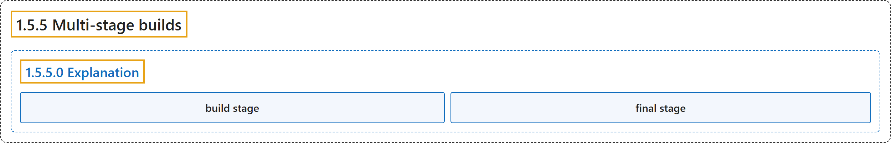

# 1.5.5 Multi-stage builds

## Classification

## Glossary

| Term | Definition | 中文翻译 | Source |
|---|---|---|---|
| **1.5.5 Multi-stage builds** 多阶段构建 | "Multi-stage builds **introduce multiple stages in your Dockerfile, each with a specific purpose**." | 多阶段构建**在 Dockerfile 中引入多个阶段，每个阶段有特定用途**。 | [Docker Inc., n.d., "Explanation", para. 2](https://docs.docker.com/get-started/docker-concepts/building-images/multi-stage-builds/#:~:text=Multi-stage%20builds%20introduce%20multiple%20stages%20in%20your) |
| **1.5.5.0 Explanation** 说明 | (No definition) | （无定义） | [Docker Inc., n.d., "Explanation"](https://docs.docker.com/get-started/docker-concepts/building-images/multi-stage-builds/#explanation) |
| **build stage** 构建阶段 | "The build stage **uses a base image containing build tools needed to compile your application**." | 构建阶段**使用一个包含编译应用所需构建工具的基础镜像**。 | [Docker Inc., n.d., "Explanation", para. 8](https://docs.docker.com/get-started/docker-concepts/building-images/multi-stage-builds/#:~:text=The%20build%20stage%20uses%20a%20base%20image) |
| **final stage** 最终阶段 | "The final stage **uses a smaller base image suitable for running your application**." | 最终阶段**使用一个更小、适合运行应用的基础镜像**。 | [Docker Inc., n.d., "Explanation", para. 9](https://docs.docker.com/get-started/docker-concepts/building-images/multi-stage-builds/#:~:text=The%20final%20stage%20uses%20a%20smaller%20base) |

## References

Docker Inc. (n.d.). *Multi-stage builds*. Docker Docs. Retrieved October 31, 2026, from <https://docs.docker.com/get-started/docker-concepts/building-images/multi-stage-builds/>
