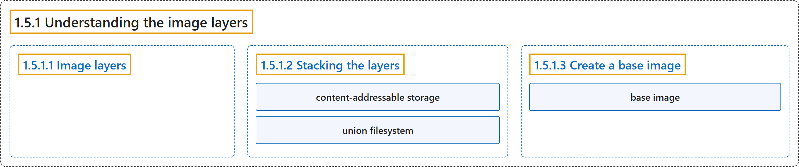

# 1.5.1 Understanding the image layers

## Classification

## Glossary

| Term | Definition | 中文翻译 | Source |
|---|---|---|---|
| **1.5.1 Understanding the image layers** 理解镜像层 | (context) "As you learned in [What is an image?](https://docs.docker.com/get-started/docker-concepts/the-basics/what-is-an-image/), **container images are composed of layers**." | （语境）正如你在 [What is an image?](https://docs.docker.com/get-started/docker-concepts/the-basics/what-is-an-image/) 中学到的，**容器镜像由层组成**。 | [Docker Inc., n.d., "Explanation", para. 1](https://docs.docker.com/get-started/docker-concepts/building-images/understanding-image-layers/#:~:text=As%20you%20learned%20in%20%5BWhat%20is%20an) |
| **1.5.1.1 Image layers** 镜像层 | "Each layer in an image contains **a set of filesystem changes - additions, deletions, or modifications**." | 镜像中的每一层包含**一组文件系统变更：新增、删除或修改**。 | [Docker Inc., n.d., "Image layers", para. 1](https://docs.docker.com/get-started/docker-concepts/building-images/understanding-image-layers/#:~:text=Each%20layer%20in%20an%20image%20contains%20a) |
| **1.5.1.2 Stacking the layers** 层的堆叠 | "Layering is made possible by **content-addressable storage and union filesystems**." | 分层是由**内容寻址存储和联合文件系统**实现的。 | [Docker Inc., n.d., "Stacking the layers", para. 1](https://docs.docker.com/get-started/docker-concepts/building-images/understanding-image-layers/#:~:text=Layering%20is%20made%20possible%20by%20content-addressable%20storage) |
| **content-addressable storage** 内容寻址存储 | (context) "Layering is made possible by **content-addressable storage** and union filesystems." | （语境）分层是由**内容寻址存储**和联合文件系统实现的。 | [Docker Inc., n.d., "Stacking the layers", para. 1](https://docs.docker.com/get-started/docker-concepts/building-images/understanding-image-layers/#:~:text=Layering%20is%20made%20possible%20by%20content-addressable%20storage) |
| **union filesystem** 联合文件系统 | "When you run a container from an image, a union filesystem is created where **layers are stacked on top of each other, creating a new and unified view**." | 从镜像运行容器时，会创建一个联合文件系统，其中**各层相互叠加，形成一个新的统一视图**。 | [Docker Inc., n.d., "Stacking the layers", para. 3](https://docs.docker.com/get-started/docker-concepts/building-images/understanding-image-layers/#:~:text=When%20you%20run%20a%20container%20from%20an) |
| **1.5.1.3 Create a base image** 创建基础镜像 | (No definition) | （无定义） | [Docker Inc., n.d., "Create a base image"](https://docs.docker.com/get-started/docker-concepts/building-images/understanding-image-layers/#create-a-base-image) |
| **base image** 基础镜像 | "A base image is **a foundation for building other images**." | 基础镜像是**构建其他镜像的基础**。 | [Docker Inc., n.d., "Create a base image", para. 11](https://docs.docker.com/get-started/docker-concepts/building-images/understanding-image-layers/#:~:text=A%20base%20image%20is%20a%20foundation%20for) |

## References

Docker Inc. (n.d.). *Understanding the image layers*. Docker Docs. Retrieved October 31, 2026, from <https://docs.docker.com/get-started/docker-concepts/building-images/understanding-image-layers/>
