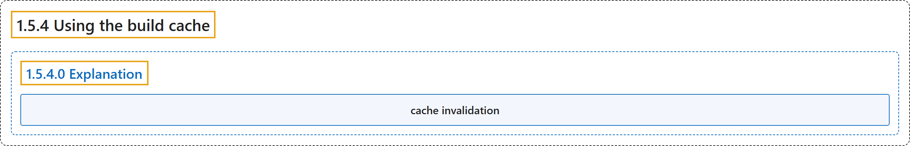

# 1.5.4 Using the build cache

## Classification

## Glossary

| Term | Definition | 中文翻译 | Source |
|---|---|---|---|
| **1.5.4 Using the build cache** 使用构建缓存 | "Using the build cache effectively lets you **achieve faster builds by reusing results from previous builds and skipping unnecessary work**." | 有效地使用构建缓存，可以**通过复用之前构建的结果并跳过不必要的工作来加快构建**。 | [Docker Inc., n.d., "Explanation", para. 3](https://docs.docker.com/get-started/docker-concepts/building-images/using-the-build-cache/#:~:text=Using%20the%20build%20cache%20effectively%20lets%20you) |
| **1.5.4.0 Explanation** 说明 | (No definition) | （无定义） | [Docker Inc., n.d., "Explanation"](https://docs.docker.com/get-started/docker-concepts/building-images/using-the-build-cache/#explanation) |
| **cache invalidation** 缓存失效 | (context) "In order to maximize cache usage and avoid resource-intensive and time-consuming rebuilds, **it's important to understand how cache invalidation works**." | （语境）为了最大化利用缓存、避免耗费资源和时间的重新构建，**理解缓存失效的机制很重要**。 | [Docker Inc., n.d., "Explanation", para. 3](https://docs.docker.com/get-started/docker-concepts/building-images/using-the-build-cache/#:~:text=In%20order%20to%20maximize%20cache%20usage%20and) |

## References

Docker Inc. (n.d.). *Using the build cache*. Docker Docs. Retrieved October 31, 2026, from <https://docs.docker.com/get-started/docker-concepts/building-images/using-the-build-cache/>
