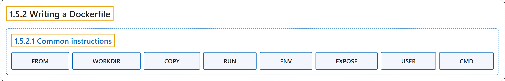

# 1.5.2 Writing a Dockerfile

## Classification

## Glossary

| Term | Definition | 中文翻译 | Source |
|---|---|---|---|
| **1.5.2 Writing a Dockerfile** 编写 Dockerfile | (context) "A Dockerfile is **a text-based document** that's used to **create a container image**." | （语境）Dockerfile 是**一个文本文档**，用于**创建容器镜像**。 | [Docker Inc., n.d., "Explanation", para. 1](https://docs.docker.com/get-started/docker-concepts/building-images/writing-a-dockerfile/#:~:text=A%20Dockerfile%20is%20a%20text-based%20document%20that%27s) |
| **1.5.2.1 Common instructions** 常用指令 | (context) "Some of the most common instructions in a `Dockerfile` include:" | （语境）`Dockerfile` 中最常用的一些指令包括： | [Docker Inc., n.d., "Common instructions", para. 1](https://docs.docker.com/get-started/docker-concepts/building-images/writing-a-dockerfile/#:~:text=Some%20of%20the%20most%20common%20instructions%20in) |
| **FROM** FROM | "`FROM <image>` - this **specifies the base image** that **the build will extend**." | `FROM <image>`：**指定基础镜像**，即**构建将要扩展**的镜像。 | [Docker Inc., n.d., "Common instructions", para. 2](https://docs.docker.com/get-started/docker-concepts/building-images/writing-a-dockerfile/#:~:text=%60FROM%20%3Cimage%3E%60%20-%20this%20specifies%20the%20base) |
| **WORKDIR** WORKDIR | "`WORKDIR <path>` - this instruction specifies **the "working directory"** or **the path in the image** where **files will be copied** and **commands will be executed**." | `WORKDIR <path>`：此指令指定 **“工作目录”**，即**镜像中的路径**，在那里**复制文件**并**执行命令**。 | [Docker Inc., n.d., "Common instructions", para. 3](https://docs.docker.com/get-started/docker-concepts/building-images/writing-a-dockerfile/#:~:text=%60WORKDIR%20%3Cpath%3E%60%20-%20this%20instruction%20specifies%20the) |
| **COPY** COPY | "`COPY <host-path> <image-path>` - this instruction tells the builder to **copy files from the host** and **put them into the container image**." | `COPY <host-path> <image-path>`：此指令让构建器**从主机复制文件**并**放入容器镜像**。 | [Docker Inc., n.d., "Common instructions", para. 4](https://docs.docker.com/get-started/docker-concepts/building-images/writing-a-dockerfile/#:~:text=%60COPY%20%3Chost-path%3E%20%3Cimage-path%3E%60%20-%20this%20instruction%20tells) |
| **RUN** RUN | "`RUN <command>` - this instruction **tells the builder** to **run the specified command**." | `RUN <command>`：此指令**让构建器**去**运行指定的命令**。 | [Docker Inc., n.d., "Common instructions", para. 5](https://docs.docker.com/get-started/docker-concepts/building-images/writing-a-dockerfile/#:~:text=%60RUN%20%3Ccommand%3E%60%20-%20this%20instruction%20tells%20the) |
| **ENV** ENV | "`ENV <name> <value>` - this instruction **sets an environment variable** that **a running container will use**." | `ENV <name> <value>`：此指令**设置一个环境变量**，供**运行中的容器使用**。 | [Docker Inc., n.d., "Common instructions", para. 6](https://docs.docker.com/get-started/docker-concepts/building-images/writing-a-dockerfile/#:~:text=%60ENV%20%3Cname%3E%20%3Cvalue%3E%60%20-%20this%20instruction%20sets) |
| **EXPOSE** EXPOSE | "`EXPOSE <port-number>` - this instruction **sets configuration on the image** that indicates **a port the image would like to expose**." | `EXPOSE <port-number>`：此指令**在镜像上设置配置**，指明**镜像希望暴露的端口**。 | [Docker Inc., n.d., "Common instructions", para. 7](https://docs.docker.com/get-started/docker-concepts/building-images/writing-a-dockerfile/#:~:text=%60EXPOSE%20%3Cport-number%3E%60%20-%20this%20instruction%20sets%20configuration) |
| **USER** USER | "`USER <user-or-uid>` - this instruction **sets the default user** for **all subsequent instructions**." | `USER <user-or-uid>`：此指令**设置默认用户**，适用于**后续所有指令**。 | [Docker Inc., n.d., "Common instructions", para. 8](https://docs.docker.com/get-started/docker-concepts/building-images/writing-a-dockerfile/#:~:text=%60USER%20%3Cuser-or-uid%3E%60%20-%20this%20instruction%20sets%20the) |
| **CMD** CMD | "`CMD ["<command>", "<arg1>"]` - this instruction **sets the default command** a container **using this image will run**." | `CMD ["<command>", "<arg1>"]`：此指令**设置默认命令**，即容器**使用该镜像时将运行**的命令。 | [Docker Inc., n.d., "Common instructions", para. 9](https://docs.docker.com/get-started/docker-concepts/building-images/writing-a-dockerfile/#:~:text=%60CMD%20%5B%22%3Ccommand%3E%22%2C%20%22%3Carg1%3E%22%5D%60%20-%20this%20instruction%20sets) |

## References

Docker Inc. (n.d.). *Writing a Dockerfile*. Docker Docs. Retrieved October 31, 2026, from <https://docs.docker.com/get-started/docker-concepts/building-images/writing-a-dockerfile/>
