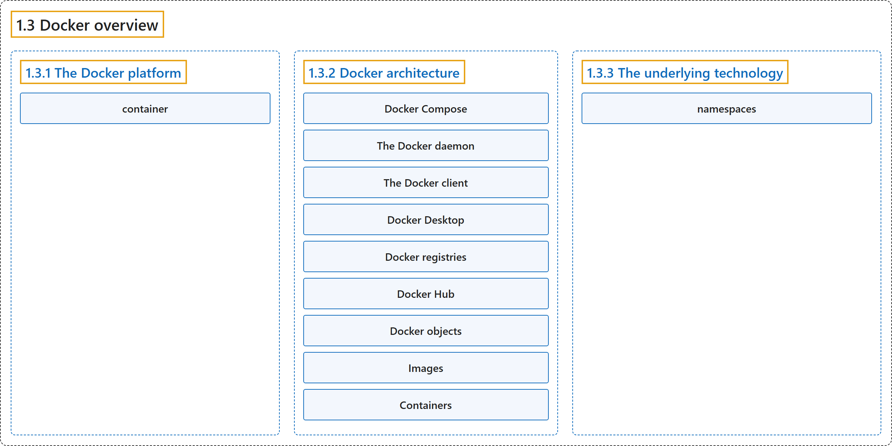

# 1.3 Docker overview

## Classification

## Glossary

| Term | Definition | 中文翻译 | Source |
|---|---|---|---|
| **1.3 Docker overview** Docker 概述 | (context) "Docker enables you to **separate your applications from your infrastructure** so you can **deliver software quickly**." | （语境）Docker 让你能够**把应用程序与基础设施分离**，从而**快速交付软件**。 | [Docker Inc., n.d., "What is Docker?", para. 1](https://docs.docker.com/get-started/docker-overview/#:~:text=Docker%20enables%20you%20to%20separate%20your%20applications) |
| **1.3.1 The Docker platform** Docker 平台 | "Docker provides the ability to **package and run an application** in **a loosely isolated environment called a container**." | Docker 提供**打包和运行应用程序**的能力，在**一个称为容器的松散隔离环境**中。 | [Docker Inc., n.d., "The Docker platform", para. 1](https://docs.docker.com/get-started/docker-overview/#:~:text=Docker%20provides%20the%20ability%20to%20package%20and) |
| **container** 容器 | "Docker provides the ability to package and run an application in **a loosely isolated environment** called **a container**." | Docker 提供在**一个松散隔离环境**（称为**容器**）中打包和运行应用程序的能力。 | [Docker Inc., n.d., "The Docker platform", para. 1](https://docs.docker.com/get-started/docker-overview/#:~:text=Docker%20provides%20the%20ability%20to%20package%20and) |
| **1.3.2 Docker architecture** Docker 架构 | "**Docker** uses **a client-server architecture**." | **Docker** 采用**客户端-服务器架构**。 | [Docker Inc., n.d., "Docker architecture", para. 1](https://docs.docker.com/get-started/docker-overview/#:~:text=Docker%20uses%20a%20client-server%20architecture.) |
| **Docker Compose** Docker Compose | "Another Docker client is **Docker Compose**, that lets you work with **applications consisting of a set of containers**." | 另一个 Docker 客户端是 **Docker Compose**，它让你处理**由一组容器组成的应用程序**。 | [Docker Inc., n.d., "Docker architecture", para. 1](https://docs.docker.com/get-started/docker-overview/#:~:text=Another%20Docker%20client%20is%20Docker%20Compose%2C%20that) |
| **The Docker daemon** Docker 守护进程 | "The Docker daemon (`dockerd`) **listens for Docker API requests** and **manages Docker objects** such as **images, containers, networks, and volumes**." | Docker 守护进程（`dockerd`）**监听 Docker API 请求**，并**管理 Docker 对象**，例如**镜像、容器、网络和卷**。 | [Docker Inc., n.d., "The Docker daemon", para. 1](https://docs.docker.com/get-started/docker-overview/#:~:text=The%20Docker%20daemon%20%28%60dockerd%60%29%20listens%20for%20Docker) |
| **The Docker client** Docker 客户端 | "The Docker client (`docker`) is **the primary way** that many Docker users **interact with Docker**." | Docker 客户端（`docker`）是**主要方式**，许多 Docker 用户借此**与 Docker 交互**。 | [Docker Inc., n.d., "The Docker client", para. 1](https://docs.docker.com/get-started/docker-overview/#:~:text=The%20Docker%20client%20%28%60docker%60%29%20is%20the%20primary) |
| **Docker Desktop** Docker Desktop | "Docker Desktop is **an easy-to-install application** for **your Mac, Windows, or Linux environment** that enables you to **build and share containerized applications and microservices**." | Docker Desktop 是**一个易于安装的应用程序**，适用于**你的 Mac、Windows 或 Linux 环境**，让你能够**构建和共享容器化应用程序与微服务**。 | [Docker Inc., n.d., "Docker Desktop", para. 1](https://docs.docker.com/get-started/docker-overview/#:~:text=Docker%20Desktop%20is%20an%20easy-to-install%20application%20for) |
| **Docker registries** Docker 注册表 | "**A Docker registry** stores **Docker images**." | **Docker 注册表**存储 **Docker 镜像**。 | [Docker Inc., n.d., "Docker registries", para. 1](https://docs.docker.com/get-started/docker-overview/#:~:text=A%20Docker%20registry%20stores%20Docker%20images.) |
| **Docker Hub** Docker Hub | "Docker Hub is **a public registry that anyone can use**, and Docker **looks for images on Docker Hub by default**." | Docker Hub 是**一个任何人都可以使用的公共注册表**，Docker **默认在 Docker Hub 上查找镜像**。 | [Docker Inc., n.d., "Docker registries", para. 1](https://docs.docker.com/get-started/docker-overview/#:~:text=Docker%20Hub%20is%20a%20public%20registry%20that) |
| **Docker objects** Docker 对象 | "When **you use Docker**, you are **creating and using images, containers, networks, volumes, plugins, and other objects**." | 当**你使用 Docker** 时，你在**创建和使用镜像、容器、网络、卷、插件以及其他对象**。 | [Docker Inc., n.d., "Docker objects", para. 1](https://docs.docker.com/get-started/docker-overview/#:~:text=When%20you%20use%20Docker%2C%20you%20are%20creating) |
| **Images** 镜像 | "An image is **a read-only template** with instructions for **creating a Docker container**." | 镜像是**一个只读模板**，包含用于**创建 Docker 容器**的指令。 | [Docker Inc., n.d., "Images", para. 1](https://docs.docker.com/get-started/docker-overview/#:~:text=An%20image%20is%20a%20read-only%20template%20with) |
| **Containers** 容器 | "A container is **a runnable instance** of **an image**." | 容器是**一个可运行实例**，基于**一个镜像**。 | [Docker Inc., n.d., "Containers", para. 1](https://docs.docker.com/get-started/docker-overview/#:~:text=A%20container%20is%20a%20runnable%20instance%20of) |
| **1.3.3 The underlying technology** 底层技术 | "Docker is written in **the Go programming language** and takes advantage of **several features of the Linux kernel** to **deliver its functionality**." | Docker 用 **Go 编程语言**编写，利用 **Linux 内核的若干特性**来**实现其功能**。 | [Docker Inc., n.d., "The underlying technology", para. 1](https://docs.docker.com/get-started/docker-overview/#:~:text=Docker%20is%20written%20in%20the%20%5BGo%20programming) |
| **namespaces** 命名空间 | "Docker uses a technology called **`namespaces`** to provide **the isolated workspace called the container**." | Docker 使用一种称为 **`namespaces`**（命名空间）的技术来提供**称为容器的隔离工作空间**。 | [Docker Inc., n.d., "The underlying technology", para. 1](https://docs.docker.com/get-started/docker-overview/#:~:text=Docker%20uses%20a%20technology%20called%20%60namespaces%60%20to) |

## References

Docker Inc. (n.d.). *What is Docker?* Docker Docs. Retrieved October 31, 2026, from <https://docs.docker.com/get-started/docker-overview/>
