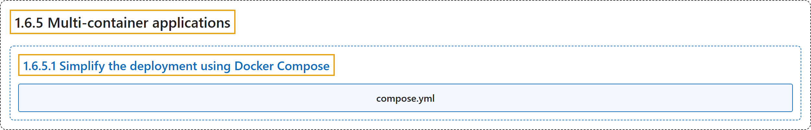

# 1.6.5 Multi-container applications

## Classification

## Glossary

| Term | Definition | 中文翻译 | Source |
|---|---|---|---|
| **1.6.5 Multi-container applications** 多容器应用 | (context) "However, as **applications grow in size**, **managing them as individual containers** becomes **more difficult**." | （语境）然而，随着**应用规模增长**，若**把它们作为单个容器来管理**，就会变得**更加困难**。 | [Docker Inc., n.d., "Explanation", para. 1](https://docs.docker.com/get-started/docker-concepts/running-containers/multi-container-applications/#:~:text=However%2C%20as%20applications%20grow%20in%20size%2C%20managing) |
| **1.6.5.1 Simplify the deployment using Docker Compose** 使用 Docker Compose 简化部署 | "Docker Compose provides **a structured and streamlined approach** for **managing multi-container deployments**." | Docker Compose 提供了**一种结构化、精简的方式**，用于**管理多容器部署**。 | [Docker Inc., n.d., "Simplify the deployment using Docker Compose", para. 1](https://docs.docker.com/get-started/docker-concepts/running-containers/multi-container-applications/#:~:text=Docker%20Compose%20provides%20a%20structured%20and%20streamlined) |
| **compose.yml** compose.yml | "All you need to do is **define your entire multi-container application** in **a single YAML file called `compose.yml`**." | 你只需要**定义整个多容器应用**，放在**一个名为 `compose.yml` 的 YAML 文件**中。 | [Docker Inc., n.d., "Simplify the deployment using Docker Compose", para. 1](https://docs.docker.com/get-started/docker-concepts/running-containers/multi-container-applications/#:~:text=All%20you%20need%20to%20do%20is%20define) |

## References

Docker Inc. (n.d.). *Multi-container applications*. Docker Docs. Retrieved October 31, 2026, from <https://docs.docker.com/get-started/docker-concepts/running-containers/multi-container-applications/>
