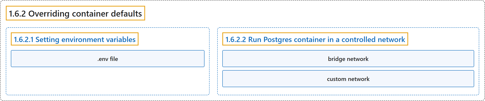

# 1.6.2 Overriding container defaults

## Classification

## Glossary

| Term | Definition | 中文翻译 | Source |
|---|---|---|---|
| **1.6.2 Overriding container defaults** 覆盖容器默认设置 | (context) "Containers come with **default settings that usually work well**, but you can **change them if needed**." | （语境）容器带有**通常运行良好的默认设置**，但你可以**在需要时修改它们**。 | [Docker Inc., n.d., "Explanation", para. 1](https://docs.docker.com/get-started/docker-concepts/running-containers/overriding-container-defaults/#:~:text=Containers%20come%20with%20default%20settings%20that%20usually) |
| **1.6.2.1 Setting environment variables** 设置环境变量 | (context) "This option **sets an environment variable `foo`** inside the container with **the value `bar`**." | （语境）此选项**在容器内设置环境变量 `foo`**，并赋予**值 `bar`**。 | [Docker Inc., n.d., "Setting environment variables", para. 1](https://docs.docker.com/get-started/docker-concepts/running-containers/overriding-container-defaults/#:~:text=This%20option%20sets%20an%20environment%20variable%20%60foo%60) |
| **.env file** .env 文件 | "The `.env` file acts as **a convenient way to set environment variables** for your Docker containers without **cluttering your command line with numerous `-e` flags**." | `.env` 文件是**为 Docker 容器设置环境变量的便捷方式**，不必**在命令行里堆满 `-e` 标志**。 | [Docker Inc., n.d., "Setting environment variables", para. 4](https://docs.docker.com/get-started/docker-concepts/running-containers/overriding-container-defaults/#:~:text=The%20%60.env%60%20file%20acts%20as%20a%20convenient) |
| **1.6.2.2 Run Postgres container in a controlled network** 在受控网络中运行 Postgres 容器 | (No definition) | （无定义） | [Docker Inc., n.d., "Run Postgres container in a controlled network"](https://docs.docker.com/get-started/docker-concepts/running-containers/overriding-container-defaults/#run-postgres-container-in-a-controlled-network) |
| **bridge network** 桥接网络 | "By default, containers **automatically connect** to **a special network called a bridge network** when you run them." | 默认情况下，容器运行时会**自动连接**到**一种称为桥接网络的特殊网络**。 | [Docker Inc., n.d., "Run Postgres container in a controlled network", para. 1](https://docs.docker.com/get-started/docker-concepts/running-containers/overriding-container-defaults/#:~:text=By%20default%2C%20containers%20automatically%20connect%20to%20a) |
| **custom network** 自定义网络 | (context) "You create a custom network by **passing `--network` flag** with **the `docker run` command**." | （语境）你可以**传入 `--network` 标志**，配合 **`docker run` 命令**，来创建自定义网络。 | [Docker Inc., n.d., "Run Postgres container in a controlled network", para. 2](https://docs.docker.com/get-started/docker-concepts/running-containers/overriding-container-defaults/#:~:text=You%20create%20a%20custom%20network%20by%20passing) |

## References

Docker Inc. (n.d.). *Overriding container defaults*. Docker Docs. Retrieved October 31, 2026, from <https://docs.docker.com/get-started/docker-concepts/running-containers/overriding-container-defaults/>
