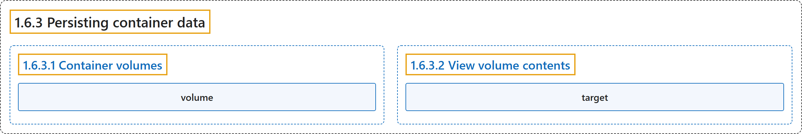

# 1.6.3 Persisting container data

## Classification

## Glossary

| Term | Definition | 中文翻译 | Source |
|---|---|---|---|
| **1.6.3 Persisting container data** 持久化容器数据 | (context) "Volumes are **a storage mechanism that provide the ability to persist data beyond the lifecycle of an individual container**." | （语境）卷是**一种存储机制，能让数据在单个容器的生命周期之外持久保存**。 | [Docker Inc., n.d., "Container volumes", para. 1](https://docs.docker.com/get-started/docker-concepts/running-containers/persisting-container-data/#:~:text=Volumes%20are%20a%20storage%20mechanism%20that%20provide) |
| **1.6.3.1 Container volumes** 容器卷 | (No definition) | （无定义） | [Docker Inc., n.d., "Container volumes"](https://docs.docker.com/get-started/docker-concepts/running-containers/persisting-container-data/#container-volumes) |
| **volume** 卷 | "Volumes are **a storage mechanism that provide the ability to persist data beyond the lifecycle of an individual container**." | 卷是**一种存储机制，能让数据在单个容器的生命周期之外持久保存**。 | [Docker Inc., n.d., "Container volumes", para. 1](https://docs.docker.com/get-started/docker-concepts/running-containers/persisting-container-data/#:~:text=Volumes%20are%20a%20storage%20mechanism%20that%20provide) |
| **1.6.3.2 View volume contents** 查看卷内容 | (No definition) | （无定义） | [Docker Inc., n.d., "View volume contents"](https://docs.docker.com/get-started/docker-concepts/running-containers/persisting-container-data/#view-volume-contents) |
| **target** 目标路径 | "A target is **a path inside a container that gives access to the files in the volume**." | 目标路径是**容器内的一个路径，通过它可以访问卷中的文件**。 | [Docker Inc., n.d., "View volume contents", para. 4](https://docs.docker.com/get-started/docker-concepts/running-containers/persisting-container-data/#:~:text=A%20target%20is%20a%20path%20inside%20a) |

## References

Docker Inc. (n.d.). *Persisting container data*. Docker Docs. Retrieved October 31, 2026, from <https://docs.docker.com/get-started/docker-concepts/running-containers/persisting-container-data/>
