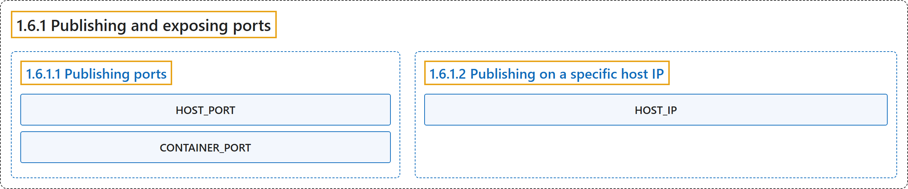

# 1.6.1 Publishing and exposing ports

## Classification

## Glossary

| Term | Definition | 中文翻译 | Source |
|---|---|---|---|
| **1.6.1 Publishing and exposing ports** 发布和暴露端口 | (context) "Publishing a port provides **the ability to break through a little bit of networking isolation by setting up a forwarding rule**." | （语境）发布端口提供了**通过设置转发规则来突破一部分网络隔离的能力**。 | [Docker Inc., n.d., "Publishing ports", para. 1](https://docs.docker.com/get-started/docker-concepts/running-containers/publishing-ports/#:~:text=Publishing%20a%20port%20provides%20the%20ability%20to) |
| **1.6.1.1 Publishing ports** 发布端口 | "Publishing a port provides **the ability to break through a little bit of networking isolation by setting up a forwarding rule**." | 发布端口提供了**通过设置转发规则来突破一部分网络隔离的能力**。 | [Docker Inc., n.d., "Publishing ports", para. 1](https://docs.docker.com/get-started/docker-concepts/running-containers/publishing-ports/#:~:text=Publishing%20a%20port%20provides%20the%20ability%20to) |
| **HOST_PORT** HOST_PORT | "`HOST_PORT`: **The port number on your host machine where you want to receive traffic**" | `HOST_PORT`：**主机上你希望接收流量的端口号** | [Docker Inc., n.d., "Publishing ports", para. 2](https://docs.docker.com/get-started/docker-concepts/running-containers/publishing-ports/#:~:text=%60HOST_PORT%60%3A%20The%20port%20number%20on%20your%20host) |
| **CONTAINER_PORT** CONTAINER_PORT | "`CONTAINER_PORT`: **The port number within the container that's listening for connections**" | `CONTAINER_PORT`：**容器内监听连接的端口号** | [Docker Inc., n.d., "Publishing ports", para. 3](https://docs.docker.com/get-started/docker-concepts/running-containers/publishing-ports/#:~:text=%60CONTAINER_PORT%60%3A%20The%20port%20number%20within%20the%20container) |
| **1.6.1.2 Publishing on a specific host IP** 在指定主机 IP 上发布 | "You can **bind to a single address by putting the IP first in the publish string**:" | 你可以**把 IP 放在发布字符串的最前面，从而绑定到单个地址**： | [Docker Inc., n.d., "Publishing on a specific host IP", para. 1](https://docs.docker.com/get-started/docker-concepts/running-containers/publishing-ports/#:~:text=You%20can%20bind%20to%20a%20single%20address) |
| **HOST_IP** HOST_IP | "`HOST_IP`: Optional. **The host address to bind**." | `HOST_IP`：可选。**要绑定的主机地址**。 | [Docker Inc., n.d., "Publishing on a specific host IP", para. 3](https://docs.docker.com/get-started/docker-concepts/running-containers/publishing-ports/#:~:text=%60HOST_IP%60%3A%20Optional.%20The%20host%20address%20to%20bind.) |

## References

Docker Inc. (n.d.). *Publishing and exposing ports*. Docker Docs. Retrieved October 31, 2026, from <https://docs.docker.com/get-started/docker-concepts/running-containers/publishing-ports/>
